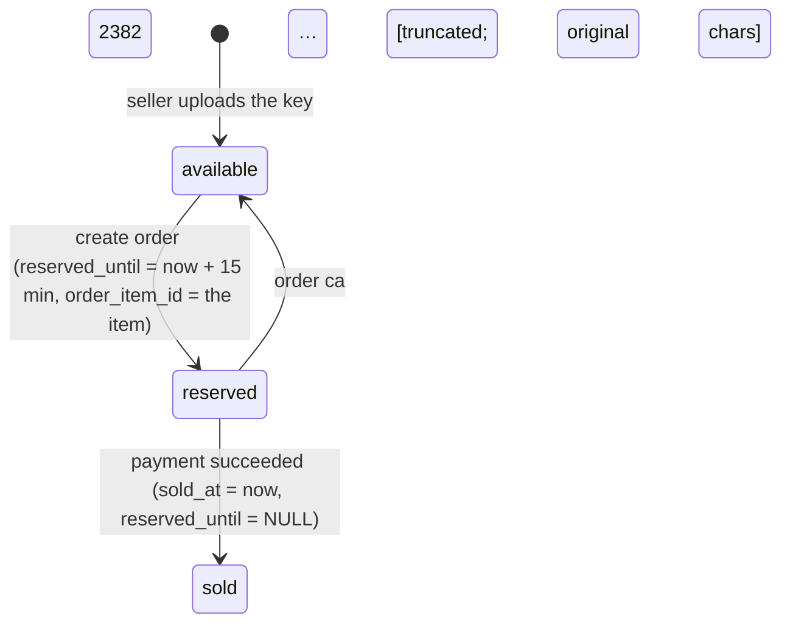

# Claude Code session log – 2026-11-22_04_checkout-backend

Converted from the session transcript (JSONL): `/export` is a user command that Claude Code cannot run itself.
Session time range (UTC): 2026-11-22T20:23:08.090Z → 2026-11-23T07:45:58.044Z.

How to read this log:
- It contains the user messages, Claude's replies and tool calls with **shortened** inputs and outputs.
- Claude's internal thinking and the harness's `<system-reminder>` context blocks are omitted.
- Attached task files are shortened to a preview; the full text is in `docs/tasks/`.
- Automated notifications (background tasks, the automated security review) and subagent hand-backs are labelled "System / agent message": they are not typed by the user.
- Secrets (connection strings, `npg_` tokens, Neon hosts, `.env` values), e-mail addresses (except reserved test domains such as `example.com` and `demo.invalid`), the Windows user name and the Vercel team name are replaced with `[REDACTED]` / `[USER]` / `[TEAM]`.
- It covers the whole session up to the start of the export work (the export work itself is not included).

---

## User · 2026-11-22T20:23:08.090Z

> [attached document, 7158 chars; full text in docs/tasks/]
> # Task 16a – Checkout backend: orders, key reservation, mock payment, order history
>
> **Model:** Opus · **Effort:** high
> Runs **in parallel with Task 16b** (UI, separate worktree) against the API contract below. Merge 16a first.
> This PR has a **migration** → owner runs *Migrate production* from this branch before merging (CLAUDE.md).
>
> ## Goal
> The purchase flow is one of the two "deep" parts: correct under concurrency, never sells a key twice, never charges twice, survives double clicks and expired reservations – and is easy to explain.
>
> ## Decisions (made by the owner – do not change)
> - **K1** Flow: cart (browser) → `POST /api/orders` creates a **pending** order and **reserves keys for 15 minutes** → payment page → `POST /api/orders/{id}/pay` with a **mock outcome** (`success` | `decline`) → paid order with keys.
> - **K2** The server is the source of truth: it re-checks price, stock and offer status. If anything changed, **no order is created** and the response lists exactly what changed per line.
> - **K3** `decline` → order stays **pending**; the user may pay again while the reservation is valid. After expiry: `409 "Reservation expired"`, order becomes `expired`, keys are free again.
> - **K4** **Idempotency:** the client sends an `idempotencyKey` (UUID) when creating an order; the same key from the same user returns the same order (no second order, no second reservation). Paying an already paid order returns it unchanged (no second payment row with success).
> … [truncated; original 7158 chars]

## Claude · 2026-11-22T20:23:15.708Z

Starting with the repo state. Per CLAUDE.md, the branch must come from an up-to-date `main`.

**Tool: Bash**

```
$ git status --short && git branch -a && git fetch origin 2>&1 | tail -2 && git log --oneline -5 origin/main && ls && ls docs docs/tasks pkg migrations 2>/dev/null
```

<details><summary>Tool result</summary>

```
?? .vscode/
  main
  task/03-workflow
  task/04-migrations
  task/05-data-model
  task/06-design-tokens
  task/07-ci-reviewer
  task/08-igdb-seed
  task/09-catalog-api
  task/10-app-shell
  task/10b-backend-hardening
  task/11-store-page
  task/11b-visual-parity
  task/12-product-page
  task/13a-search-backend
  task/13b-search-ui
  task/13c-search-followup
* task/14-auth
  remotes/origin/HEAD -> origin/main
  remotes/origin/main
  remotes/origin/task/03-workflow
  remotes/origin/task/04-migrations
  remotes/origin/task/05-data-model
  remotes/origin/task/06-design-tokens
  remotes/origin/task/07-ci-reviewer
  remotes/origin/task/08-igdb-seed
  remotes/origin/task/09-catalog-api
  remotes/origin/task/10-app-shell
  remotes/origin/task/10b-backend-hardening
  remotes/origin/task/11-store-page
  remotes/origin/task/11b-visual-parity
  remotes/origin/task/12-product-page
  remotes/origin/task/13a-search-backend
  remotes/origin/task/13b-search-ui
  remotes/origin/task/13c-search-followup
  remotes/origin/task/14-auth
From https://github.com/[USER]/ENEBA-homework
   8b0313a..9c62d2e  main       -> origin/main
9c62d2e Merge pull request #16 from [USER]/task/14-auth
b20c408 Task
… [truncated; original 2510 chars]
```

</details>

**Tool: Bash**

```
$ git checkout main && git pull 2>&1 | tail -2 && git checkout -b task/16a-checkout-backend && git log --oneline -2 && ls ai-logs | tail -3; ls docs/reports | tail -3; git worktree list
```

<details><summary>Tool result</summary>

```
Switched to branch 'main'
Your branch is behind 'origin/main' by 25 commits, and can be fast-forwarded.
  (use "git pull" to update your local branch)
 create mode 100644 src/lib/safeNext.test.ts
 create mode 100644 src/lib/safeNext.ts
Switched to a new branch 'task/16a-checkout-backend'
9c62d2e Merge pull request #16 from [USER]/task/14-auth
b20c408 Task 14: session log (converted from the transcript, redacted)
2026-11-22_01_product-page-cart.md
2026-11-22_02_search-backend.md
2026-11-22_03_auth.md
TASK_13c_search_followup.md
TASK_14_auth.md
assets
C:/PROJEKTAI/ENEBA/ENEBA-homework 9c62d2e [task/16a-checkout-backend]
```

</details>

## Claude · 2026-11-22T20:23:31.132Z

The first commit must be the task file, saved verbatim. I'll write it from the pasted task text.

**Tool: Write**

```
file_path: c:\PROJEKTAI\ENEBA\ENEBA-homework\docs\tasks\TASK_16a_checkout_backend.md
content: # Task 16a – Checkout backend: orders, key reservation, mock payment, order history

**Model:** Opus · **Effort:** high
Runs **in parallel with Task 16b** (UI, separate worktree) against the API contract below. Merge 16a first.
This PR has a **migration** → owner runs *Migrate production* from this
… [truncated; original 7157 chars]
```

**Tool: Bash**

```
$ git add docs/tasks/TASK_16a_checkout_backend.md && git commit -q -m "Task 16a: task file (verbatim)

Co-Authored-By: Claude Sonnet 5.5 <noreply@anthropic.com>" && git log --oneline -1 && cat docs/DATA_MODEL.md && cat migrations/00004_auth.sql migrations/embed.go && find pkg api cmd -type f | head -100
```

<details><summary>Tool result</summary>

```
File created successfully at: c:\PROJEKTAI\ENEBA\ENEBA-homework\docs\tasks\TASK_16a_checkout_backend.md (file state is current in your context — no need to Read it back)
```

</details>

<details><summary>Tool result</summary>

```
<persisted-output>
Output too large (52.9KB). Full output saved to: C:\Users\[USER]\.claude\projects\c--PROJEKTAI-ENEBA-ENEBA-homework\4d359276-97bc-4e0d-b0c2-22b3ecb9c2a0\tool-results\b1zei82rg.txt

Preview (first 2KB):
486fc59 Task 16a: task file (verbatim)
# Data model

The whole schema of the marketplace, designed once. The **catalog** tables exist
(migration `00002_catalog.sql`, plus `game_aliases` for search from `00003_search_aliases.sql`), and so do the **auth** tables
(`00004_auth.sql`, Task 14). The **commerce** tables are *planned*: they are
created in their own task and must follow this document (or update it in the same PR).

| Group | Tables | Status |
|---|---|---|
| Catalog | `platforms`, `regions`, `games`, `products`, `sellers`, `offers`, `keys` | **created** – migration `00002` |
| Search | `game_aliases` | **created** – migration `00003` (Task 13a) |
| Auth | `users`, `sessions`, `login_failures` | **created** – migration `00004` (Task 14) |
| Commerce | `orders`, `order_items`, `payments` + column `keys.order_item_id` | planned – checkout task |

Ground rules used everywhere:
- **Money is integer cents, EUR only** (`price_cents integer`). Never `float`/`numeric`
… [truncated; original 2187 chars]
```

</details>

**Tool: Read**

```
file_path: c:\PROJEKTAI\ENEBA\ENEBA-homework\docs\DATA_MODEL.md
```

<details><summary>Tool result</summary>

```
1	# Data model
2	
3	The whole schema of the marketplace, designed once. The **catalog** tables exist
4	(migration `00002_catalog.sql`, plus `game_aliases` for search from `00003_search_aliases.sql`), and so do the **auth** tables
5	(`00004_auth.sql`, Task 14). The **commerce** tables are *planned*: they are
6	created in their own task and must follow this document (or update it in the same PR).
7	
8	| Group | Tables | Status |
9	|---|---|---|
10	| Catalog | `platforms`, `regions`, `games`, `products`, `sellers`, `offers`, `keys` | **created** – migration `00002` |
11	| Search | `game_aliases` | **created** – migration `00003` (Task 13a) |
12	| Auth | `users`, `sessions`, `login_failures` | **created** – migration `00004` (Task 14) |
13	| Commerce | `orders`, `order_items`, `payments` + column `keys.order_item_id` | planned – checkout task |
14	
15	Ground rules used everywhere:
16	- **Money is integer cents, EUR only** (`price_cents integer`). Never `float`/`numeric` for money.
17	- **IDs:** `bigint GENERATED ALWAYS AS IDENTITY` (the database owns the numbers; a manual `INSERT` of an id fails, so seeds refer to rows by slug). Exception: `orders.id` is a **UUID** – it appears in URLs
… [truncated; original 51273 chars]
```

</details>

**Tool: Bash**

```
$ cat migrations/00004_auth.sql migrations/embed.go && find pkg api cmd src/api -type f | sort && wc -l pkg/server/*.go
```

<details><summary>Tool result</summary>

```
-- +goose Up
-- Accounts and sign-in (Task 14). Design and reasons: docs/DATA_MODEL.md ("Auth tables").
--
-- Only NEW tables -> backward compatible with the deployed code (expand/contract):
-- the code that is live while this runs never reads them.
-- citext comes from 00001_extensions.sql.

-- One row per account. A demo account (Task 14, A4) is created by the
-- "Sign in as demo user" button: it has no password, so nobody can sign in to it
-- with a password - only the browser that created it holds its session.
CREATE TABLE users (
    id            bigint      GENERATED ALWAYS AS IDENTITY PRIMARY KEY,
    -- citext: "[REDACTED]" and "[REDACTED]" are the same account; UNIQUE enforces it.
    email         citext      NOT NULL UNIQUE,
    -- argon2id PHC string ("$argon2id$v=19$m=19456,t=2,p=1$<salt>$<hash>"); never the password.
    password_hash text,
    is_demo       boolean     NOT NULL DEFAULT false,
    created_at    timestamptz NOT NULL DEFAULT now(),
    CONSTRAINT users_email_shape CHECK (length(email) <= 254 AND position('@' IN email) > 1),
    -- "No password" if and only if "demo": a normal account always has a hash,
    -- a demo account never has one.
    CONSTRAINT
… [truncated; original 6131 chars]
```

</details>

**Tool: Bash**

```
$ cat pkg/server/router.go pkg/server/respond.go pkg/server/session.go pkg/server/origin.go pkg/testdb/testdb.go
```

**Tool: Bash**

```
$ cat pkg/server/auth_handlers.go && sed -n 1,160p pkg/server/catalog_handlers.go
```

<details><summary>Tool result</summary>

```
// Package server holds the HTTP router and handlers. It is shared by the
// Vercel function (api/index.go) and the local dev server (cmd/local).
package server

import "net/http"

// Deps are the things handlers need from the outside world. They are passed
// in explicitly (no globals inside handlers), which keeps handlers testable.
type Deps struct {
	DB      DBPinger
	Catalog CatalogReader
	Auth    AuthStore
}

// NewRouter builds the application router using only the standard library.
// Go 1.22+ ServeMux supports "METHOD /path" patterns and {id} wildcards.
//
// The whole mux is wrapped in requireSameOrigin (origin.go): every POST, PUT,
// PATCH and DELETE must come from our own site (CSRF protection), including
// the endpoints that later tasks add.
func NewRouter(deps Deps) http.Handler {
	mux := http.NewServeMux()

	mux.HandleFunc("GET /api/health", healthHandler(deps.DB))
	// Same path, any other method -> JSON 405 (the more specific GET pattern wins).
	mux.HandleFunc("/api/health", methodNotAllowed)

	// Catalog: public and cacheable. These handlers never read the session
	// cookie, so the cached answer is the same for every visitor.
	mux.HandleFunc("GET /api/products",
… [truncated; original 16545 chars]
```

</details>

<details><summary>Tool result</summary>

```
package server

import (
	"context"
	"encoding/json"
	"errors"
	"log"
	"math"
	"net/http"
	"strconv"
	"time"

	"github.com/[USER]/ENEBA-homework/pkg/auth"
)

// The auth endpoints depend on three small interfaces, grouped by job, instead
// of on *auth.Store itself (same idea as CatalogReader): handler tests plug in
// a fake, and the handlers never see pgx.

// AccountStore creates and finds accounts.
type AccountStore interface {
	CreateUser(ctx context.Context, email, passwordHash string) (auth.User, error)
	CreateDemoUser(ctx context.Context) (auth.User, error)
	UserByEmail(ctx context.Context, email string) (user auth.User, passwordHash string, err error)
}

// SessionStore creates, reads and deletes sessions.
type SessionStore interface {
	SessionReader
	CreateSession(ctx context.Context, userID int64, tokenHash []byte) error
	DeleteSession(ctx context.Context, tokenHash []byte) error
}

// LoginLimiter is the failed sign-in counter (rate limit, owner decision A6).
type LoginLimiter interface {
	CountLoginAttempt(ctx context.Context, email string) (attempt int, retryAfter time.Duration, err error)
	ClearLoginFailures(ctx context.Context, email string) error
}

// AuthStor
… [truncated; original 16656 chars]
```

</details>

**Tool: Bash**

```
$ cat pkg/auth/store.go | sed -n 1,80p; cat pkg/db/db.go | head -80; cat api/index.go cmd/local/main.go; sed -n 1,200p pkg/catalog/store.go
```

<details><summary>Tool result</summary>

```
package auth

import (
	"context"
	"crypto/rand"
	"encoding/hex"
	"errors"
	"fmt"
	"time"

	"github.com/jackc/pgx/v5"
	"github.com/jackc/pgx/v5/pgconn"
	"github.com/jackc/pgx/v5/pgxpool"

	"github.com/[USER]/ENEBA-homework/pkg/db"
)

// Rate limit of failed sign-ins (owner decision A6): at most MaxFailedLogins
// failures per email within FailureWindow. The next attempt gets HTTP 429.
const (
	MaxFailedLogins = 10
	FailureWindow   = 15 * time.Minute
)

// User is the public view of an account - exactly what the API returns.
// The password hash is deliberately NOT a field, so it can never be serialised by mistake.
type User struct {
	ID     int64  `json:"id"`
	Email  string `json:"email"`
	IsDemo bool   `json:"isDemo"`
}

var (
	// ErrEmailTaken: sign-up with an email that already has an account (UNIQUE on users.email).
	ErrEmailTaken = errors.New("auth: email already registered")
	// ErrUserNotFound: no account with this email.
	ErrUserNotFound = errors.New("auth: user not found")
	// ErrNoSession: the token is unknown or its session has expired.
	ErrNoSession = errors.New("auth: no valid session")
)

// ConnSource hands the Store a database connection (same contract as in
//
… [truncated; original 16929 chars]
```

</details>

**Tool: Bash**

```
$ sed -n 95,200p migrations/00002_catalog.sql; cat pkg/db/retry.go | sed -n 1,80p; sed -n 80,200p pkg/auth/store.go; cat src/api/client.ts src/api/auth.ts; sed -n 1,60p src/api/types.ts; wc -l src/api/types.ts; cat src/api/auth.test.ts | head -40
```

<details><summary>Tool result</summary>

```
    is_active   boolean NOT NULL DEFAULT true,
    created_at  timestamptz NOT NULL DEFAULT now(),
    updated_at  timestamptz NOT NULL DEFAULT now(), -- kept current by the trigger below
    CONSTRAINT offers_price_positive CHECK (price_cents > 0),
    -- A seller has at most one offer per product (they change the price, not add a second offer).
    CONSTRAINT offers_product_seller_key UNIQUE (product_id, seller_id)
);

-- "Active offers of a product, cheapest first" (product page) and the cheapest price per product
-- (store listing). Partial: inactive offers are never read by the store, so they are not indexed.
CREATE INDEX offers_active_product_price_idx ON offers (product_id, price_cents) WHERE is_active;

-- Sets updated_at on every UPDATE, so no query can forget it. Generic: other tables can reuse it.
-- +goose StatementBegin
CREATE FUNCTION set_updated_at() RETURNS trigger
LANGUAGE plpgsql AS $$
BEGIN
    NEW.updated_at := now();
    RETURN NEW;
END;
$$;
-- +goose StatementEnd

CREATE TRIGGER offers_set_updated_at
    BEFORE UPDATE ON offers
    FOR EACH ROW EXECUTE FUNCTION set_updated_at();

-- One activation key. Stock is derived from this table (P2), never stored.
CREAT
… [truncated; original 21499 chars]
```

</details>

**Tool: Bash**

```
$ cat pkg/seedgen/db.go; sed -n 1,80p pkg/server/auth_integration_test.go; grep -rn "testdb\." --include=*_test.go pkg cmd | grep -v "^pkg/testdb" | head -20; cat .github/workflows/ci.yml
```

<details><summary>Tool result</summary>

```
package seedgen

import (
	"context"
	"fmt"

	"github.com/jackc/pgx/v5"
)

// CatalogTables in dependency order: children first. Deleting in this order never
// breaks a foreign key (all FKs are ON DELETE RESTRICT); inserting goes the other way.
var CatalogTables = []string{"keys", "offers", "products", "game_aliases", "sellers", "games", "regions", "platforms"}

// TableCount is the number of rows in one table.
type TableCount struct {
	Table string
	Rows  int64
}

// Lock blocks other writers of the catalog until the transaction ends, so the
// "is it empty?" check and the inserts cannot race with a second seed run
// (the second one waits, then sees the data and refuses). Readers are not blocked.
func Lock(ctx context.Context, tx pgx.Tx) error {
	_, err := tx.Exec(ctx, "LOCK TABLE platforms, regions, games, game_aliases, products, sellers, offers, keys IN SHARE ROW EXCLUSIVE MODE")
	return err
}

// Counts returns the row count of every catalog table (in CatalogTables order).
func Counts(ctx context.Context, tx pgx.Tx) ([]TableCount, error) {
	var out []TableCount
	for _, t := range CatalogTables {
		var n int64
		// t comes from the fixed list above, never from user input.
		if
… [truncated; original 18777 chars]
```

</details>

**Tool: Bash**

```
$ go version; (which docker psql postgres pg_ctl initdb 2>&1 | head); ls "/c/Program Files/PostgreSQL" 2>&1 | head; echo "TEST_DB=[${TEST_DATABASE_URL:-}]"; ls -a | grep -i env; cat go.mod | head -20; grep -n "^## \|^### " README.md | head -60
```

<details><summary>Tool result</summary>

```
go version go1.27.4 windows/amd64
which: no docker in (/c/Users/[USER]/bin:/mingw64/bin:/usr/local/bin:/usr/bin:/bin:/mingw64/bin:/usr/bin:/c/Users/[USER]/bin:/c/Users/[USER]/AppData/Local/Programs/Python/Python314/Scripts:/c/Users/[USER]/AppData/Local/Programs/Python/Python314:/c/Windows/system32:/c/Windows:/c/Windows/System32/Wbem:/c/Windows/System32/WindowsPowerShell/v1.0:/c/Windows/System32/OpenSSH:/c/Program Files/NVIDIA Corporation/NVIDIA NvDLISR:/c/Program Files/dotnet:/cmd:/c/ProgramData/chocolatey/bin:/c/Program Files/nodejs:/c/Program Files/Go/bin:/c/Program Files/GitHub CLI:/c/Users/[USER]/AppData/Local/Microsoft/WindowsApps:/c/Users/[USER]/AppData/Local/Programs/cursor/resources/app/bin:/c/Users/[USER]/AppData/Local/Programs/Microsoft VS Code/bin:/c/Users/[USER]/AppData/Local/GitHubDesktop/bin:/c/Users/[USER]/AppData/Roaming/npm:/c/Users/[USER]/go/bin:/usr/bin/vendor_perl:/usr/bin/core_perl)
which: no psql in (/c/Users/[USER]/bin:/mingw64/bin:/usr/local/bin:/usr/bin:/bin:/mingw64/bin:/usr/bin:/c/Users/[USER]/bin:/c/Users/[USER]/AppData/Local/Programs/Python/Python314/Scripts:/c/Users/[USER]/AppData/Local/Programs/Python/Python314:/c/Windows/system32:/c/Windows:/c/Windows/System32/Wbe
… [truncated; original 5305 chars]
```

</details>

## Claude · 2026-11-22T20:27:30.073Z

You've hit your 5-hour limit · resets 1:30am (Europe/Vilnius)

## User · 2026-11-23T05:11:16.879Z

> Tesk

## Claude · 2026-11-23T05:11:37.660Z

**Tool: Write**

```
file_path: c:\PROJEKTAI\ENEBA\ENEBA-homework\migrations\00005_orders.sql
content: -- +goose Up
-- Checkout (Task 16a): orders, their items, payment attempts, and the link from a key to the
-- order item that reserved / bought it. Design and reasons: docs/DATA_MODEL.md ("Commerce tables").
--
-- Backward compatible (expand/contract): three NEW tables and one NEW nullable column.
-
… [truncated; original 5265 chars]
```

<details><summary>Tool result</summary>

```
File created successfully at: c:\PROJEKTAI\ENEBA\ENEBA-homework\migrations\00005_orders.sql (file state is current in your context — no need to Read it back)
```

</details>

## Claude · 2026-11-23T05:11:42.267Z

CLAUDE.md says to create migrations with `go run ./cmd/migrate create`. I wrote the file by hand, so I'm checking that its name and format match what that command produces.

**Tool: Bash**

```
$ grep -n "create" -i cmd/migrate/main.go cmd/migrate/helpers.go | head -30
```

<details><summary>Tool result</summary>

```
cmd/migrate/main.go:3://	go run ./cmd/migrate up | down | status | version | create <name>
cmd/migrate/main.go:35:	usage       = "usage: go run ./cmd/migrate up | down | status | version | create <name>"
cmd/migrate/main.go:36:	migrationsD = "migrations" // folder used by `create` (relative to the repo root)
cmd/migrate/main.go:59:	// `create` only writes a file: no database, no env variable needed.
cmd/migrate/main.go:60:	if cmd == "create" {
cmd/migrate/main.go:62:			return errors.New("usage: go run ./cmd/migrate create <name>")
cmd/migrate/main.go:64:		path, err := createMigration(migrationsD, args[1])
cmd/migrate/main.go:68:		fmt.Println("created", path)
cmd/migrate/main.go:132:		return nil, nil, fmt.Errorf("cannot create the session locker: %w", err)
cmd/migrate/main.go:142:		return nil, nil, fmt.Errorf("cannot create the migration provider: %w", err)
cmd/migrate/helpers.go:1:// Helpers for the `create` sub-command. The connection-string guard and the error
cmd/migrate/helpers.go:26:// createMigration writes the next sequentially numbered migration file
cmd/migrate/helpers.go:28:func createMigration(dir, name string) (string, error) {
cmd/migrate/helpers.go:46:	f, err := os.Op
… [truncated; original 1330 chars]
```

</details>

## Claude · 2026-11-23T05:11:47.676Z

`create` opens the file with `O_EXCL`, so it would refuse my file. I'll move mine aside, run the command, and put my SQL into the file it generates.

**Tool: Bash**

```
$ mv migrations/00005_orders.sql "$TMPDIR/00005_orders.sql" 2>/dev/null || mv migrations/00005_orders.sql /tmp/00005_orders.sql; go run ./cmd/migrate create orders && ls migrations && head -5 migrations/00005_orders.sql
```

<details><summary>Tool result</summary>

```
created migrations\00005_orders.sql
00001_extensions.sql
00002_catalog.sql
00003_search_aliases.sql
00004_auth.sql
00005_orders.sql
embed.go
-- +goose Up


-- +goose Down
```

</details>

**Tool: Bash**

```
$ ls "$TMPDIR/00005_orders.sql" /tmp/00005_orders.sql 2>&1; cat migrations/00005_orders.sql | head -20
```

<details><summary>Tool result</summary>

```
/c/Users/[USER]/AppData/Local/Temp/00005_orders.sql
/tmp/00005_orders.sql
-- +goose Up


-- +goose Down
```

</details>

**Tool: Bash**

```
$ cp /tmp/00005_orders.sql migrations/00005_orders.sql && rm /tmp/00005_orders.sql && head -3 migrations/00005_orders.sql && grep -c "" migrations/00005_orders.sql && git status --short
```

<details><summary>Tool result</summary>

```
-- +goose Up
-- Checkout (Task 16a): orders, their items, payment attempts, and the link from a key to the
-- order item that reserved / bought it. Design and reasons: docs/DATA_MODEL.md ("Commerce tables").
89
?? .vscode/
?? migrations/00005_orders.sql
```

</details>

## Claude · 2026-11-23T05:12:15.459Z

The migration is in place, created with the official command. Next is the `pkg/orders` package, starting with the types and the pure rules file.

**Tool: Write**

```
file_path: c:\PROJEKTAI\ENEBA\ENEBA-homework\pkg\orders\types.go
content: // Package orders is the checkout: quote a cart, create an order that reserves keys,
// pay it (simulated), cancel it, read it back.
//
//   - rules.go  - every business rule that needs no database (limits, change detection,
//     status transitions, "keys only when paid"). Pure functions, unit-tes
… [truncated; original 3953 chars]
```

<details><summary>Tool result</summary>

```
File created successfully at: c:\PROJEKTAI\ENEBA\ENEBA-homework\pkg\orders\types.go (file state is current in your context — no need to Read it back)
```

</details>

**Tool: Write**

```
file_path: c:\PROJEKTAI\ENEBA\ENEBA-homework\pkg\orders\rules.go
content: package orders

// THE CHECKOUT RULES, in one place.
//
// Everything here is a pure function (no database, no clock of its own), so every rule can be
// unit-tested and read without the SQL around it. store.go applies them inside transactions.
//
//	R1  Limits           1-20 lines, quantity 1-5 per
… [truncated; original 9371 chars]
```

<details><summary>Tool result</summary>

```
File created successfully at: c:\PROJEKTAI\ENEBA\ENEBA-homework\pkg\orders\rules.go (file state is current in your context — no need to Read it back)
```

</details>

## Claude · 2026-11-23T05:13:43.893Z

Now the store, which holds all the SQL and applies the rules inside transactions.

**Tool: Write**

```
file_path: c:\PROJEKTAI\ENEBA\ENEBA-homework\pkg\orders\store.go
content: package orders

import (
	"context"
	"errors"
	"fmt"
	"time"

	"github.com/jackc/pgx/v5"
	"github.com/jackc/pgx/v5/pgconn"
	"github.com/jackc/pgx/v5/pgxpool"

	"github.com/[USER]/ENEBA-homework/pkg/db"
)

// ConnSource hands the Store a database connection (same contract as in pkg/catalog and
//
… [truncated; original 28053 chars]
```

**Tool: Bash**

```
$ gofmt -l pkg/orders; go build ./pkg/orders && go vet ./pkg/orders
```

<details><summary>Tool result</summary>

```
File created successfully at: c:\PROJEKTAI\ENEBA\ENEBA-homework\pkg\orders\store.go (file state is current in your context — no need to Read it back)
```

</details>

<details><summary>Tool result</summary>

```
pkg\orders\rules.go
```

</details>

**Tool: Bash**

```
$ gofmt -w pkg/orders && gofmt -l pkg; go build ./pkg/orders && go vet ./pkg/orders && echo OK
```

<details><summary>Tool result</summary>

```
OK
```

</details>

**Tool: Bash**

```
$ SP="/c/Users/[USER]/AppData/Local/Temp/claude/27133936c4ab5668/4d359276-97bc-4e0d-b0c2-22b3ecb9c2a0/scratchpad"; mkdir -p "$SP/pg"; cd "$SP/pg"; for v in 18.1-1 17.7-1 17.5-1; do echo "== $v"; curl -sI -L --max-time 20 "https://get.enterprisedb.com/postgresql/postgresql-$v-windows-x64-binaries.zip" | grep -iE "^HTTP|content-length" | head -4; done
```

<details><summary>Tool result</summary>

```
== 18.1-1
HTTP/1.1 200 OK
Content-Length: 334929717
== 17.7-1
HTTP/1.1 200 OK
Content-Length: 331472022
== 17.5-1
HTTP/1.1 200 OK
Content-Length: 321800244
Shell cwd was reset to c:\PROJEKTAI\ENEBA\ENEBA-homework
```

</details>

## Claude · 2026-11-23T05:15:13.793Z

A 335 MB download is available, and 18.1 matches the major version CI uses. I'll fetch it into its own scratchpad folder in the background.

**Tool: Bash**

```
$ SP="/c/Users/[USER]/AppData/Local/Temp/claude/27133936c4ab5668/4d359276-97bc-4e0d-b0c2-22b3ecb9c2a0/scratchpad"; mkdir -p "$SP/pg/dl" && cd "$SP/pg/dl" && curl -sL --max-time 900 -o pg18.zip "https://get.enterprisedb.com/postgresql/postgresql-18.1-1-windows-x64-binaries.zip" && ls -l pg18.zip && unzip -q pg18.zip -d ../x && ls ../x/pgsql/bin | head -5
```

<details><summary>Tool result</summary>

```
Command running in background with ID: bh1iyi9gt. Output is being written to: C:\Users\[USER]\AppData\Local\Temp\claude\27133936c4ab5668\4d359276-97bc-4e0d-b0c2-22b3ecb9c2a0\tasks\bh1iyi9gt.output. You will be notified when it completes — do not poll that file or sleep while waiting. Read the file only if the user asks for progress, or if you need a line it prints before you can go on, such as a server's ready line or port.
Session cwd remains c:\PROJEKTAI\ENEBA\ENEBA-homework; directory changes made by the backgrounded command do not apply to subsequent commands.
```

</details>

## Claude · 2026-11-23T05:15:19.088Z

While that downloads, I'll write the unit tests for the rules.

**Tool: Write**

```
file_path: c:\PROJEKTAI\ENEBA\ENEBA-homework\pkg\orders\rules_test.go
content: package orders

import (
	"reflect"
	"strings"
	"testing"
	"time"
)

func TestValidateItems(t *testing.T) {
	ok := CartItem{OfferID: 1, Quantity: 2, ExpectedPriceCents: 999}
	many := make([]CartItem, 21)
	for i := range many {
		many[i] = CartItem{OfferID: int64(i + 1), Quantity: 1, ExpectedPriceCen
… [truncated; original 8341 chars]
```

**Tool: Bash**

```
$ gofmt -l pkg/orders; go test ./pkg/orders 2>&1 | tail -15
```

<details><summary>Tool result</summary>

```
File created successfully at: c:\PROJEKTAI\ENEBA\ENEBA-homework\pkg\orders\rules_test.go (file state is current in your context — no need to Read it back)
```

</details>

<details><summary>Tool result</summary>

```
ok  	github.com/[USER]/ENEBA-homework/pkg/orders	1.948s
```

</details>

## Claude · 2026-11-23T05:15:55.891Z

Now the HTTP layer.

**Tool: Write**

```
file_path: c:\PROJEKTAI\ENEBA\ENEBA-homework\pkg\server\orders_handlers.go
content: package server

import (
	"context"
	"encoding/json"
	"errors"
	"net/http"
	"time"

	"github.com/[USER]/ENEBA-homework/pkg/auth"
	"github.com/[USER]/ENEBA-homework/pkg/orders"
)

// OrderStore is everything the checkout handlers need from the data layer (a small interface, like
// CatalogRea
… [truncated; original 7913 chars]
```

<details><summary>Tool result</summary>

```
File created successfully at: c:\PROJEKTAI\ENEBA\ENEBA-homework\pkg\server\orders_handlers.go (file state is current in your context — no need to Read it back)
```

</details>

**Tool: Bash**

```
$ python - <<'EOF'
import re
p='pkg/server/router.go'
s=open(p,encoding='utf-8').read()
s=s.replace("""	Auth    AuthStore
}""","""	Auth    AuthStore
	Orders  OrderStore
}""")
s=s.replace("""	// Catch-all for everything else""","""	// Checkout (Task 16a): every response is Cache-Control: no-store. The quote is public (it only
	// re-prices a cart); everything that touches an order needs a signed-in user, and an order id
	// that is not yours answers 404 exactly like an unknown one.
	sessions := sessionReader(deps.Auth)
	mux.HandleFunc("POST /api/checkout/quote", noStore(quoteHandler(deps.Orders)))
	mux.HandleFunc("/api/checkout/quote", methodNotAllowed)
	mux.HandleFunc("POST /api/orders", requi
… [truncated; original 2073 chars]
```

<details><summary>Tool result</summary>

```
api\index.go
cmd\local\main.go
pkg\server\router.go
warning: in the working copy of 'api/index.go', CRLF will be replaced by LF the next time Git touches it
warning: in the working copy of 'cmd/local/main.go', CRLF will be replaced by LF the next time Git touches it
warning: in the working copy of 'pkg/server/router.go', CRLF will be replaced by LF the next time Git touches it
 api/index.go         |  3 ++-
 cmd/local/main.go    |  3 ++-
 pkg/server/router.go | 17 +++++++++++++++++
 3 files changed, 21 insertions(+), 2 deletions(-)
```

</details>

## Claude · 2026-11-23T05:16:36.804Z

Python wrote CRLF line endings on Windows. I'll let gofmt put them back to LF.

**Tool: Bash**

```
$ gofmt -w api/index.go cmd/local/main.go pkg/server/router.go && gofmt -l . ; git diff --stat; go build ./... && go vet ./... && echo BUILD_OK
```

<details><summary>Tool result</summary>

```
 api/index.go         |  3 ++-
 cmd/local/main.go    |  3 ++-
 pkg/server/router.go | 17 +++++++++++++++++
 3 files changed, 21 insertions(+), 2 deletions(-)
BUILD_OK
```

</details>

## Claude · 2026-11-23T05:16:52.705Z

Line endings are fixed and everything builds. While the download finishes, I'll look at how the existing handler tests are set up so mine match.

**Tool: Bash**

```
$ grep -n "func \|^type " pkg/server/auth_handlers_test.go | head -50; sed -n 1,80p pkg/server/session_test.go
```

<details><summary>Tool result</summary>

```
23:type fakeAccount struct {
28:type fakeAuth struct {
43:func newFakeAuth() *fakeAuth {
47:func (f *fakeAuth) failWith(err error) { f.err = err }
49:func (f *fakeAuth) userByID(id int64) auth.User {
58:func (f *fakeAuth) CreateUser(_ context.Context, email, hash string) (auth.User, error) {
73:func (f *fakeAuth) CreateDemoUser(context.Context) (auth.User, error) {
84:func (f *fakeAuth) UserByEmail(_ context.Context, email string) (auth.User, string, error) {
97:func (f *fakeAuth) CreateSession(_ context.Context, userID int64, hash []byte) error {
106:func (f *fakeAuth) UserBySession(_ context.Context, hash []byte) (auth.User, error) {
119:func (f *fakeAuth) DeleteSession(_ context.Context, hash []byte) error {
129:func (f *fakeAuth) CountLoginAttempt(_ context.Context, email string) (int, time.Duration, error) {
139:func (f *fakeAuth) ClearLoginFailures(_ context.Context, email string) error {
158:func (f *fakeAuth) addAccount(t *testing.T, email string) auth.User {
174:func (f *fakeAuth) signedIn(t *testing.T, email string) (auth.User, string) {
185:func (f *fakeAuth) expire(token string) {
190:func (f *fakeAuth) hasSession(token string) bool {
201:func post(t *testing.T, store A
… [truncated; original 5295 chars]
```

</details>

**Tool: Bash**

```
$ sed -n 150,260p pkg/server/auth_handlers_test.go; grep -rn "func sameOriginRequest" -A8 pkg/server/*_test.go
```

<details><summary>Tool result</summary>

```
const testPassword = "correct horse 1"

var (
	knownHashOnce sync.Once
	knownHash     string
)

// addAccount stores an account whose password is testPassword.
func (f *fakeAuth) addAccount(t *testing.T, email string) auth.User {
	t.Helper()
	knownHashOnce.Do(func() {
		h, err := auth.HashPassword(testPassword)
		if err != nil {
			panic(err)
		}
		knownHash = h
	})
	f.nextID++
	u := auth.User{ID: f.nextID, Email: email}
	f.accounts[strings.ToLower(email)] = fakeAccount{user: u, hash: knownHash}
	return u
}

// signedIn adds an account plus a live session and returns the cookie token.
func (f *fakeAuth) signedIn(t *testing.T, email string) (auth.User, string) {
	t.Helper()
	u := f.addAccount(t, email)
	token, hash, err := auth.NewSessionToken()
	if err != nil {
		t.Fatal(err)
	}
	f.sessions[string(hash)] = u.ID
	return u, token
}

func (f *fakeAuth) expire(token string) {
	hash, _ := auth.HashSessionToken(token)
	f.expired[string(hash)] = true
}

func (f *fakeAuth) hasSession(token string) bool {
	hash, _ := auth.HashSessionToken(token)
	_, ok := f.sessions[string(hash)]
	return ok
}

// ---------------------------------------------------------------------------
// helpers
// -----
… [truncated; original 4030 chars]
```

</details>

**Tool: Write**

```
file_path: c:\PROJEKTAI\ENEBA\ENEBA-homework\pkg\server\orders_handlers_test.go
content: package server

import (
	"context"
	"encoding/json"
	"errors"
	"fmt"
	"net/http"
	"net/http/httptest"
	"strings"
	"testing"
	"time"

	"github.com/[USER]/ENEBA-homework/pkg/db"
	"github.com/[USER]/ENEBA-homework/pkg/orders"
)

// fakeOrders is an OrderStore that returns canned answers and re
… [truncated; original 11785 chars]
```

**Tool: Bash**

```
$ gofmt -l pkg; go vet ./pkg/server && go test ./pkg/server ./pkg/orders 2>&1 | tail -30
```

<details><summary>Tool result</summary>

```
File created successfully at: c:\PROJEKTAI\ENEBA\ENEBA-homework\pkg\server\orders_handlers_test.go (file state is current in your context — no need to Read it back)
```

</details>

<details><summary>Tool result</summary>

```
Exit code 1
# github.com/[USER]/ENEBA-homework/pkg/server
# [github.com/[USER]/ENEBA-homework/pkg/server]
vet.exe: pkg\server\orders_handlers_test.go:115:64: orders.CartItem is not a type
```

</details>

## Claude · 2026-11-23T05:17:40.248Z

The postgres download finished. The test failure is my own: local variables named `orders` shadow the package. I'll rename them.

**Tool: Bash**

```
$ python - <<'EOF'
p='pkg/server/orders_handlers_test.go'
s=open(p,encoding='utf-8',newline='').read()
s=s.replace("""	orders := &fakeOrders{}
	for _, c := range []struct{ method, path string }{""","""	store := &fakeOrders{}
	for _, c := range []struct{ method, path string }{""")
s=s.replace("rec := callOrders(t, auth, orders, c.method, c.path, `{}`, \"\")","rec := callOrders(t, auth, store, c.method, c.path, `{}`, \"\")")
s=s.replace("""	if orders.calls != 0 {
		t.Errorf("the store was called %d times for signed-out requests, want 0", orders.calls)""","""	if store.calls != 0 {
		t.Errorf("the store was called %d times for signed-out requests, want 0", store.calls)""")
s=s.replace("""	orders :
… [truncated; original 1513 chars]
```

<details><summary>Tool result</summary>

```
Exit code 1
  File "<stdin>", line 16
    		t.Errorf("items passed to the store = %+v", store.gotItems)""")
    		                                                           ^
SyntaxError: unterminated triple-quoted string literal (detected at line 17)
# github.com/[USER]/ENEBA-homework/pkg/server
# [github.com/[USER]/ENEBA-homework/pkg/server]
vet.exe: pkg\server\orders_handlers_test.go:115:64: orders.CartItem is not a type
```

</details>

## Claude · 2026-11-23T05:17:47.716Z

My quoting broke the script, so I'll use Edit for these.

**Tool: Edit**

```
file_path: c:\PROJEKTAI\ENEBA\ENEBA-homework\pkg\server\orders_handlers_test.go
old_string: 	orders := &fakeOrders{}
	for _, c := range []struct{ method, path string }{
new_string: 	store := &fakeOrders{}
	for _, c := range []struct{ method, path string }{
```

**Tool: Edit**

```
file_path: c:\PROJEKTAI\ENEBA\ENEBA-homework\pkg\server\orders_handlers_test.go
old_string: 		rec := callOrders(t, auth, orders, c.method, c.path, `{}`, "")
		assertJSONStatus(t, rec, http.StatusUnauthorized, "not signed in")
	}
	if orders.calls != 0 {
		t.Errorf("the store was called %d times for signed-out requests, want 0", orders.calls)
new_string: 		rec := callOrders(t, auth, store, c.method, c.path, `{}`, "")
		assertJSONStatus(t, rec, http.StatusUnauthorized, "not signed in")
	}
	if store.calls != 0 {
		t.Errorf("the store was called %d times for signed-out requests, want 0", store.calls)
```

**Tool: Edit**

```
file_path: c:\PROJEKTAI\ENEBA\ENEBA-homework\pkg\server\orders_handlers_test.go
old_string: 	orders := &fakeOrders{}
	body := `{"items":[{"offerId":4,"quantity":2,"expectedPriceCents":1500}]}`
	rec := callOrders(t, newFakeAuth(), orders, "POST", "/api/checkout/quote", body, "")
new_string: 	store := &fakeOrders{}
	body := `{"items":[{"offerId":4,"quantity":2,"expectedPriceCents":1500}]}`
	rec := callOrders(t, newFakeAuth(), store, "POST", "/api/checkout/quote", body, "")
```

**Tool: Edit**

```
file_path: c:\PROJEKTAI\ENEBA\ENEBA-homework\pkg\server\orders_handlers_test.go
old_string: 	if len(orders.gotItems) != 1 || orders.gotItems[0] != (orders.CartItem{OfferID: 4, Quantity: 2, ExpectedPriceCents: 1500}) {
		t.Errorf("items passed to the store = %+v", orders.gotItems)
new_string: 	if len(store.gotItems) != 1 || store.gotItems[0] != (orders.CartItem{OfferID: 4, Quantity: 2, ExpectedPriceCents: 1500}) {
		t.Errorf("items passed to the store = %+v", store.gotItems)
```

**Tool: Bash**

```
$ gofmt -l pkg; go vet ./pkg/server && go test ./pkg/server ./pkg/orders 2>&1 | tail -30
```

<details><summary>Tool result</summary>

```
The file c:\PROJEKTAI\ENEBA\ENEBA-homework\pkg\server\orders_handlers_test.go has been updated successfully. (file state is current in your context — no need to Read it back)
```

</details>

<details><summary>Tool result</summary>

```
The file c:\PROJEKTAI\ENEBA\ENEBA-homework\pkg\server\orders_handlers_test.go has been updated successfully. (file state is current in your context — no need to Read it back)
```

</details>

<details><summary>Tool result</summary>

```
The file c:\PROJEKTAI\ENEBA\ENEBA-homework\pkg\server\orders_handlers_test.go has been updated successfully. (file state is current in your context — no need to Read it back)
```

</details>

<details><summary>Tool result</summary>

```
The file c:\PROJEKTAI\ENEBA\ENEBA-homework\pkg\server\orders_handlers_test.go has been updated successfully. (file state is current in your context — no need to Read it back)
```

</details>

<details><summary>Tool result</summary>

```
ok  	github.com/[USER]/ENEBA-homework/pkg/server	2.034s
ok  	github.com/[USER]/ENEBA-homework/pkg/orders	(cached)
```

</details>

## Claude · 2026-11-23T05:18:09.646Z

Unit tests pass. The editor warnings came from intermediate edits and the final build is clean. Next I'm setting up the throwaway Postgres on 127.0.0.1 only, with its data in the scratchpad.

**Tool: Bash**

```
$ SP="/c/Users/[USER]/AppData/Local/Temp/claude/27133936c4ab5668/4d359276-97bc-4e0d-b0c2-22b3ecb9c2a0/scratchpad"; PGB="$SP/pg/x/pgsql/bin"; ls "$PGB" | head -3; "$PGB/initdb.exe" -D "$SP/pg/data" -U postgres --auth=trust -E UTF8 >/dev/null 2>&1 && echo INITDB_OK; "$PGB/pg_ctl.exe" -D "$SP/pg/data" -o "-c listen_addresses=127.0.0.1 -p 54329" -l "$SP/pg/log.txt" -w start 2>&1 | tail -2; "$PGB/psql.exe" -h 127.0.0.1 -p 54329 -U postgres -c "create database eneba_test" -c "select version()" 2>&1 | tail -4
```

<details><summary>Tool result</summary>

```
Permission for this action was denied by the Claude Code auto mode classifier. Reason: [Undermining Oversight]. If you have other tasks that don't depend on this action, continue working on those. IMPORTANT: You *may* attempt to accomplish this action using other tools that might naturally be used to accomplish this goal, e.g. using head instead of cat. But you *should not* attempt to work around this denial in malicious ways, e.g. do not use your ability to run tests to execute non-test actions. You should only try to work around this restriction in reasonable ways that do not attempt to bypass the intent behind this denial. If you believe this capability is essential to complete the user's request, first try a safer method. Get as much of the rest of the task done as you can, then STOP and explain to the user what you were trying to do and why you need this permission. Let the user decide how to proceed. To allow this type of action in the future, the user can add a permission rule for Bash to their settings.
```

</details>

**Tool: Edit**

```
file_path: c:\PROJEKTAI\ENEBA\ENEBA-homework\pkg\seedgen\db.go
old_string: func Reset(ctx context.Context, tx pgx.Tx) error {
	for _, t := range CatalogTables {
new_string: func Reset(ctx context.Context, tx pgx.Tx) error {
	if err := refuseWhenOrdersExist(ctx, tx); err != nil {
		return err
	}
	for _, t := range CatalogTables {
```

**Tool: Edit**

```
file_path: c:\PROJEKTAI\ENEBA\ENEBA-homework\pkg\seedgen\db.go
old_string: // Insert writes the catalog, parents first.
new_string: // ErrOrdersExist is returned by Reset when orders exist: they reference offers and keys (RESTRICT),
// so the catalog cannot be rewritten under them, and deleting them silently would destroy order history.
var ErrOrdersExist = errors.New("seedgen: orders exist")

// refuseWhenOrdersExist stops a re
… [truncated; original 1259 chars]
```

**Tool: Edit**

```
file_path: c:\PROJEKTAI\ENEBA\ENEBA-homework\pkg\seedgen\db.go
old_string: import (
	"context"
	"fmt"
new_string: import (
	"context"
	"errors"
	"fmt"
```

**Tool: Edit**

```
file_path: c:\PROJEKTAI\ENEBA\ENEBA-homework\pkg\testdb\testdb.go
old_string: 	if err := seedgen.Reset(ctx, tx); err != nil {
		return nil, err
	}
	if err := seedgen.Insert(ctx, tx, cat); err != nil {
new_string: 	// Orders from an earlier test run (pkg/orders) reference offers and keys; seedgen.Reset refuses
	// to run over orders on purpose (a real seed must never delete order history). This is the
	// throw-away test database, so here they are wiped first: payments, keys, then the orders
	// (their items
… [truncated; original 661 chars]
```

**Tool: Bash**

```
$ gofmt -l .; go build ./... && go vet ./pkg/... && grep -n "Reset\|reset" cmd/seed/main.go | head -20
```

<details><summary>Tool result</summary>

```
The file c:\PROJEKTAI\ENEBA\ENEBA-homework\pkg\seedgen\db.go has been updated successfully.
```

</details>

<details><summary>Tool result</summary>

```
The file c:\PROJEKTAI\ENEBA\ENEBA-homework\pkg\seedgen\db.go has been updated successfully.
```

</details>

<details><summary>Tool result</summary>

```
The file c:\PROJEKTAI\ENEBA\ENEBA-homework\pkg\seedgen\db.go has been updated successfully.
```

</details>

<details><summary>Tool result</summary>

```
The file c:\PROJEKTAI\ENEBA\ENEBA-homework\pkg\testdb\testdb.go has been updated successfully.
```

</details>

<details><summary>Tool result</summary>

```
4://	go run ./cmd/seed --reset    # delete the catalog first, then seed
45:	reset := flag.Bool("reset", false, "delete the existing catalog data before seeding")
48:	if err := run(*reset); err != nil {
54:func run(reset bool) error {
107:	if total(before) > 0 && !reset {
109:			"Run with --reset to delete it and seed again", format(before))
112:		fmt.Printf("--reset: deleting existing catalog (%s)\n", format(before))
116:	if err := seedgen.Reset(ctx, tx); err != nil {
```

</details>

**Tool: Write**

```
file_path: c:\PROJEKTAI\ENEBA\ENEBA-homework\pkg\orders\store_integration_test.go
content: package orders_test

// Integration tests: the REAL orders.Store on a real Postgres (pkg/testdb, schema only).
// Skipped when TEST_DATABASE_URL is empty; CI's `migrations` job runs them (REQUIRE_TEST_DB=1).
//
// Every test builds its OWN catalog rows (random slugs, its own offer and keys), so the
… [truncated; original 29101 chars]
```

**Tool: Bash**

```
$ gofmt -l pkg; go vet ./pkg/orders && go test ./pkg/orders 2>&1 | tail -20
```

<details><summary>Tool result</summary>

```
File created successfully at: c:\PROJEKTAI\ENEBA\ENEBA-homework\pkg\orders\store_integration_test.go (file state is current in your context — no need to Read it back)
```

</details>

<details><summary>Tool result</summary>

```
ok  	github.com/[USER]/ENEBA-homework/pkg/orders	1.319s
```

</details>

## Claude · 2026-11-23T05:20:59.981Z

Cleaning up one muddled block in the idempotency test. It should check that the same key from a different user creates a separate order.

**Tool: Edit**

```
file_path: c:\PROJEKTAI\ENEBA\ENEBA-homework\pkg\orders\store_integration_test.go
old_string: 	// The key belongs to ONE user: the same key from another user is a separate order.
	third, created, err := f.store.CreateOrder(context.Background(), f.newUser(t), orders.CreateRequest{
		IdempotencyKey: req.IdempotencyKey, Items: []orders.CartItem{{OfferID: o.id, Quantity: 0 + 0, ExpectedPriceCent
… [truncated; original 473 chars]
new_string: 	// The key belongs to ONE user: the same key from another user is a separate order.
	third, created, err := f.store.CreateOrder(context.Background(), f.newUser(t), req)
	if err != nil || !created || third.ID == first.ID {
		t.Errorf("same key, other user: id %q (first %q), created=%v, err=%v; want
… [truncated; original 1290 chars]
```

**Tool: Edit**

```
file_path: c:\PROJEKTAI\ENEBA\ENEBA-homework\pkg\orders\store_integration_test.go
old_string: 	o := f.newOffer(t, 1000, 5)
	req := orders.CreateRequest{IdempotencyKey: newUUID(), Items: []orders.CartItem{{OfferID: o.id, Quantity: 2, ExpectedPriceCents: 1000}}}
new_string: 	o := f.newOffer(t, 1000, 6)
	req := orders.CreateRequest{IdempotencyKey: newUUID(), Items: []orders.CartItem{{OfferID: o.id, Quantity: 2, ExpectedPriceCents: 1000}}}
```

**Tool: Bash**

```
$ sed -i 's#(here: all the other keys are gone, the retried request still gets its order)#(here: 5 of the 6 keys are taken by now, the retry still gets its order)#' pkg/orders/store_integration_test.go && gofmt -l pkg; go vet ./pkg/orders && echo VET_OK
```

<details><summary>Tool result</summary>

```
The file c:\PROJEKTAI\ENEBA\ENEBA-homework\pkg\orders\store_integration_test.go has been updated successfully. (file state is current in your context — no need to Read it back)
```

</details>

<details><summary>Tool result</summary>

```
The file c:\PROJEKTAI\ENEBA\ENEBA-homework\pkg\orders\store_integration_test.go has been updated successfully. (file state is current in your context — no need to Read it back)
```

</details>

<details><summary>Tool result</summary>

```
VET_OK
[This command modified 1 file you've previously read: pkg\orders\store_integration_test.go. Call Read before editing.]
```

</details>

**Tool: Bash**

```
$ python - <<'PYEOF'
p='.github/workflows/ci.yml'
s=open(p,encoding='utf-8',newline='').read()
nl = '\r\n' if '\r\n' in s else '\n'
s=s.replace('\r\n','\n')
old1="""      # Only pkg/catalog resets and re-seeds the catalog tables (testdb.Pool). The auth tests
      # (pkg/auth, pkg/server) use testdb.Migrated: schema only, their own users with unique
      # emails, the catalog untouched - so the packages can still run in parallel. If a SECOND
      # package ever resets the catalog, run them one after another with `go test -p 1 ./...`.
      - name: go test (with the database)
        run: go test ./...
"""
new1="""      # -p 1 = one package at a time. pkg/catalog resets and re-seeds the catal
… [truncated; original 2259 chars]
```

<details><summary>Tool result</summary>

```
 .github/workflows/ci.yml | 19 ++++++++++---------
 1 file changed, 10 insertions(+), 9 deletions(-)
25:  go:
```

</details>

## Claude · 2026-11-23T05:21:23.510Z

Now the frontend API layer: types and functions only, with no UI.

**Tool: Bash**

```
$ sed -n 120,162p src/api/types.ts; sed -n 40,80p src/api/auth.test.ts; cat package.json | grep -n '"test"\|"lint"\|"build"'
```

<details><summary>Tool result</summary>

```
}

/** Another product of the same game ("other versions"). */
export interface Variant {
  slug: string;
  edition: string;
  platform: Ref;
  region: Ref;
  priceCents: number | null;
  inStock: boolean;
}

/** Response of GET /api/products/{slug}. */
export interface ProductDetail {
  product: ProductInfo;
  game: GameInfo;
  /** Cheapest first; empty when out of stock. */
  offers: Offer[];
  variants: Variant[];
}

/** One entry of the search-box dropdown: one per GAME, linking to one of its products. */
export interface Suggestion {
  gameTitle: string;
  /** The game's cheapest in-stock product; if none is in stock, its first product (then inStock=false). */
  productSlug: string;
  /** Edition of that product: "Standard" or a special one such as "Game of the Year Edition" (the row shows only the special ones). */
  edition: string;
  /** Platform and region of that product. */
  platform: Ref;
  region: Ref;
  coverUrl: string | null;
  /** Price of that product in cents; null = no product of the game is in stock. */
  priceCents: number | null;
  inStock: boolean;
  /** The alias that matched when the title did not ("GTA 5" for Grand Theft Auto V); null when the title matc
… [truncated; original 3510 chars]
```

</details>

**Tool: Bash**

```
$ cat >> src/api/types.ts <<'EOF'

// ---------------------------------------------------------------------------
// Checkout (Task 16a): pkg/orders. Money is integer cents; times are ISO-8601 strings.
// ---------------------------------------------------------------------------

/** What the server found different from what the cart expected, on one line. */
export type LineChange = "price_changed" | "quantity_reduced" | "unavailable";

/** One cart line as the client sends it (POST /api/checkout/quote and POST /api/orders). */
export interface CartLineInput {
  offerId: number;
  quantity: number;
  /** The price the buyer saw. The server only COMPARES it; the buyer is charged the server's
… [truncated; original 12770 chars]
```

<details><summary>Tool result</summary>

```
Exit code 2
/usr/bin/bash: -c: line 198: unexpected EOF while looking for matching `''
```

</details>

## Claude · 2026-11-23T05:21:58.508Z

The whole shell command failed to parse, so nothing was written. I'll use the file tools instead.

**Tool: Edit**

```
file_path: c:\PROJEKTAI\ENEBA\ENEBA-homework\src\api\types.ts
old_string: /** Response of GET /api/search/suggest?q=…: at most 6 items, best match first; [] when nothing matches. */
export interface SuggestResponse {
  items: Suggestion[];
}
new_string: /** Response of GET /api/search/suggest?q=…: at most 6 items, best match first; [] when nothing matches. */
export interface SuggestResponse {
  items: Suggestion[];
}

// ---------------------------------------------------------------------------
// Checkout (Task 16a): pkg/orders. Money is integer
… [truncated; original 3359 chars]
```

**Tool: Write**

```
file_path: c:\PROJEKTAI\ENEBA\ENEBA-homework\src\api\orders.ts
content: // Typed functions for the checkout endpoints (Task 16a, pkg/orders). Every call goes through apiFetch.
// No UI here: the cart and checkout screens (Task 16b) call these from TanStack Query.
import { ApiError, apiFetch, type ApiOptions } from "./client.ts";
import type {
  CartChangedBody,
  CartLi
… [truncated; original 4229 chars]
```

**Tool: Write**

```
file_path: c:\PROJEKTAI\ENEBA\ENEBA-homework\src\api\orders.test.ts
content: import { afterEach, describe, expect, it, vi } from "vitest";
import { ApiError } from "./client.ts";
import {
  cancelOrder,
  cartChangedLines,
  createOrder,
  getOrder,
  isPaymentDeclined,
  isReservationExpired,
  listOrders,
  newIdempotencyKey,
  payOrder,
  quoteCart,
} from "./orders.ts";
… [truncated; original 5184 chars]
```

<details><summary>Tool result</summary>

```
The file c:\PROJEKTAI\ENEBA\ENEBA-homework\src\api\types.ts has been updated successfully.
```

</details>

<details><summary>Tool result</summary>

```
File created successfully at: c:\PROJEKTAI\ENEBA\ENEBA-homework\src\api\orders.ts (file state is current in your context — no need to Read it back)
```

</details>

<details><summary>Tool result</summary>

```
File created successfully at: c:\PROJEKTAI\ENEBA\ENEBA-homework\src\api\orders.test.ts (file state is current in your context — no need to Read it back)
```

</details>

## Claude · 2026-11-23T05:22:29.239Z

Now the frontend checks. CLAUDE.md says to run Vitest from PowerShell.

**Tool: PowerShell**

```
$ Set-Location C:\PROJEKTAI\ENEBA\ENEBA-homework; npm run lint 2>&1 | Select-Object -Last 15; npm test 2>&1 | Select-Object -Last 15; npm run build 2>&1 | Select-Object -Last 8
```

<details><summary>Tool result</summary>

```
> eneba-homework@0.0.0 lint
> eslint .

> eneba-homework@0.0.0 test
> vitest run


 RUN  v5.1.1 C:/PROJEKTAI/ENEBA/ENEBA-homework


 Test Files  38 passed (38)
      Tests  476 passed (476)
   Start at  07:22:50
   Duration  27.69s (environment 57%, tests 28%, import 13%, transform 2%, worker 1%)

    Isolate  38 workers spawned · ~1.35s startup each (spawn + environment, per file)
             at least ~15.73s faster with isolate: false — reuses workers across files instead of one per file

computing gzip size...
dist/index.html                                           0.54 kB │ gzip:   0.34 kB
dist/assets/metropolis-latin-400-normal-DKepXnDq.woff2   24.15 kB
dist/assets/metropolis-latin-500-normal-C_TK2_yL.woff2   26.36 kB
dist/assets/metropolis-latin-700-normal-BZLKi5Gb.woff2   26.43 kB
dist/assets/index-u2viYU43.css                           58.34 kB │ gzip:  10.20 kB
dist/assets/index-Clkb6ugZ.js                           433.85 kB │ gzip: 138.69 kB
✓ built in 6.53s
```

</details>

## Claude · 2026-11-23T05:23:57.791Z

All frontend checks pass: lint, 476 tests, build. Two small cleanups before the docs: drop a stray `nolint` comment, and note the `-p 1` requirement in the `testdb` package doc.

**Tool: Edit**

```
file_path: c:\PROJEKTAI\ENEBA\ENEBA-homework\pkg\orders\store_integration_test.go
old_string: 	defer tx.Rollback(ctx) //nolint:errcheck // a rollback at the end of a test: nothing to do on failure
new_string: 	defer tx.Rollback(ctx) // Reset must have changed nothing; the rollback is only tidiness
```

**Tool: Edit**

```
file_path: c:\PROJEKTAI\ENEBA\ENEBA-homework\pkg\testdb\testdb.go
old_string: // Used only from _test.go files.
new_string: // Packages that share this database must not run at the same time: pkg/catalog re-seeds the catalog
// (deleting every product, offer and key) while pkg/orders builds its own rows in the same tables.
// Run them one after another: `go test -p 1 ./...` (CI does).
//
// Used only from _test.go files.
```

**Tool: Bash**

```
$ sed -n 42,120p README.md; grep -n "^## \|^### " docs/PAAISKINIMAI_LT.md | tail -40; wc -l docs/PAAISKINIMAI_LT.md
```

<details><summary>Tool result</summary>

```
The file c:\PROJEKTAI\ENEBA\ENEBA-homework\pkg\orders\store_integration_test.go has been updated successfully.
```

</details>

<details><summary>Tool result</summary>

```
The file c:\PROJEKTAI\ENEBA\ENEBA-homework\pkg\testdb\testdb.go has been updated successfully.
```

</details>

<details><summary>Tool result</summary>

```
## API
JSON, `camelCase` field names. Money is **integer cents** (formatting is the frontend's job). Errors are always
`{"error":"..."}`; an unreachable database gives `503` and any other unexpected error `500`, both with a generic message (never SQL or driver text).

| Endpoint | Purpose |
|---|---|
| `GET /api/health` | API + DB status (see above) |
| `GET /api/products` | Store listing: `items`, `total`, `page`, `pageSize` and `facets` (filter options with counts) |
| `GET /api/products/{slug}` | Product page: `product`, `game`, `offers` (buyable, cheapest first), `variants` (other versions of the game). Unknown slug → `404` |

**`GET /api/products` query parameters** (all optional; an empty value = not given; unknown names are ignored):

| Parameter | Meaning |
|---|---|
| `q` | Search text (Task 13a): game **title or alias** ("gta 5", "rdr2"), contains or typo match (`witchr 3`). Trimmed, 2–100 characters. A **2-character** query matches only at the **start of a word** of the title or an alias (`re` → Red Dead Redemption, not Dishonored; `gt` → GTA via the alias "GTA 5"); 3+ characters match anywhere and tolerate typos. Filters the items **and** the facets |
| `platform`, `reg
… [truncated; original 9299 chars]
```

</details>

**Tool: Bash**

```
$ sed -n 664,682p docs/PAAISKINIMAI_LT.md; sed -n 119,175p README.md
```

<details><summary>Tool result</summary>

```
# Task 14 – paskyros: registracija, prisijungimas, atsijungimas, demo vartotojas, apsaugoti puslapiai

## Duomenų bazė: `users`, `sessions`, `login_failures` (`migrations/00004_auth.sql`)
- **Ką daro:** `users` – paskyros (`email citext UNIQUE`, `password_hash`, `is_demo`). `sessions` – prisijungimai: raktas yra **tokeno SHA-256** (`token_hash bytea PRIMARY KEY`), `user_id` → `users` su `ON DELETE CASCADE`, `expires_at`. `login_failures` – nesėkmingų bandymų skaitliukas pagal įvestą el. paštą.
- **Kodėl taip:** `citext` – „[REDACTED]" ir „[REDACTED]" yra ta pati paskyra, o `UNIQUE` tai užtikrina net kai du žmonės registruojasi vienu metu (sprendžia DB, ne ankstesnis `SELECT`). CHECK `(password_hash IS NULL) = is_demo`: paprasta paskyra visada turi slaptažodį, demo – niekada. `CASCADE` tik sesijoms: tai laikina prisijungimo būsena, ne istorija (visur kitur `RESTRICT`).
- **Gali paklausti:** „Kodėl `login_failures.email` nėra FK į `users`?" – skaičiuojami ir **neegzistuojantys** el. paštai; kitaip 429 vs 401 atskleistų, kurie el. paštai užregistruoti.

## argon2id ir kodėl ne paprastas SHA (`pkg/auth/password.go`)
- **Ką daro:** `HashPassword` – atsitiktinė 16 baitų druska (`crypto/ran
… [truncated; original 7811 chars]
```

</details>

## Claude · 2026-11-23T05:24:12.588Z

Now the README section for the checkout API and its shortcuts.

**Tool: Edit**

```
file_path: c:\PROJEKTAI\ENEBA\ENEBA-homework\README.md
old_string: Frontend: `src/api/auth.ts` (typed calls), `src/features/auth/` (`useCurrentUser`, the sign-in / sign-up page, `RequireAuth`),
the header account menu in `src/app/AccountMenu.tsx`.
new_string: Frontend: `src/api/auth.ts` (typed calls), `src/features/auth/` (`useCurrentUser`, the sign-in / sign-up page, `RequireAuth`),
the header account menu in `src/app/AccountMenu.tsx`.

## Checkout (Task 16a)
The cart lives in the browser. At checkout the server **re-prices it**, creates a **pending ord
… [truncated; original 5243 chars]
```

<details><summary>Tool result</summary>

```
The file c:\PROJEKTAI\ENEBA\ENEBA-homework\README.md has been updated successfully.
```

</details>

## Claude · 2026-11-23T05:24:32.403Z

Now `DATA_MODEL.md`, updated to the schema as built, including where it differs from the earlier plan.

**Tool: Bash**

```
$ python - <<'PYEOF'
p='docs/DATA_MODEL.md'
s=open(p,encoding='utf-8',newline='').read()
crlf='\r\n' in s
s=s.replace('\r\n','\n')

def rep(old,new,count=1):
    global s
    assert s.count(old)>=1, old[:60]
    s=s.replace(old,new,count)

rep("""(`00004_auth.sql`, Task 14). The **commerce** tables are *planned*: they are
created in their own task and must follow this document (or update it in the same PR).""",
"""(`00004_auth.sql`, Task 14). The **commerce** tables (`00005_orders.sql`, Task 16a) are built as
documented in [Commerce tables](#commerce-tables-created--migration-00005-task-16a).""")
rep("| Commerce | `orders`, `order_items`, `payments` + column `keys.order_item_id` | planned – ch
… [truncated; original 16013 chars]
```

<details><summary>Tool result</summary>

```
Exit code 2
/usr/bin/bash: -c: line 119: unexpected EOF while looking for matching `''
```

</details>

## Claude · 2026-11-23T05:25:13.684Z

The shell can't parse that inline heredoc. I'll write the script to the scratchpad with the Write tool and run it from there.

**Tool: Write**

```
file_path: C:\Users\[USER]\AppData\Local\Temp\claude\27133936c4ab5668\4d359276-97bc-4e0d-b0c2-22b3ecb9c2a0\scratchpad\update_data_model.py
content: import sys

p = sys.argv[1]
s = open(p, encoding="utf-8", newline="").read()
crlf = "\r\n" in s
s = s.replace("\r\n", "\n")


def rep(old, new):
    global s
    assert old in s, "not found: " + old[:70]
    s = s.replace(old, new, 1)


rep(
    """(`00004_auth.sql`, Task 14). The **commerce** table
… [truncated; original 5362 chars]
```

<details><summary>Tool result</summary>

```
File created successfully at: C:\Users\[USER]\AppData\Local\Temp\claude\27133936c4ab5668\4d359276-97bc-4e0d-b0c2-22b3ecb9c2a0\scratchpad\update_data_model.py (file state is current in your context — no need to Read it back)
```

</details>

**Tool: Write**

```
file_path: C:\Users\[USER]\AppData\Local\Temp\claude\27133936c4ab5668\4d359276-97bc-4e0d-b0c2-22b3ecb9c2a0\scratchpad\dm_commerce.md
content: ## Commerce tables (created – migration `00005`, Task 16a)

**The cart lives in the browser** (decided) – there is no cart table. At checkout the frontend sends
the list of `(offerId, quantity, expectedPriceCents)`; the server re-reads prices from `offers` (never trusts client
prices) and creates th
… [truncated; original 4375 chars]
```

<details><summary>Tool result</summary>

```
File created successfully at: C:\Users\[USER]\AppData\Local\Temp\claude\27133936c4ab5668\4d359276-97bc-4e0d-b0c2-22b3ecb9c2a0\scratchpad\dm_commerce.md (file state is current in your context — no need to Read it back)
```

</details>

**Tool: Write**

```
file_path: C:\Users\[USER]\AppData\Local\Temp\claude\27133936c4ab5668\4d359276-97bc-4e0d-b0c2-22b3ecb9c2a0\scratchpad\dm_states.md
content: ### Key


<details><summary>Tool result</summary>

```
File created successfully at: C:\Users\[USER]\AppData\Local\Temp\claude\27133936c4ab5668\4d359276-97bc-4e0d-b0c2-22b3ecb9c2a0\scratchpad\dm_states.md (file state is current in your context — no need to Read it back)
```

</details>

**Tool: Write**

```
file_path: C:\Users\[USER]\AppData\Local\Temp\claude\27133936c4ab5668\4d359276-97bc-4e0d-b0c2-22b3ecb9c2a0\scratchpad\dm_sketch3.md
content: ### 3. Reserve N keys of one offer (checkout, implemented in `pkg/orders/store.go` → `reserveKeys`)
```sql
-- inside the create-order transaction (BEGIN … COMMIT)
-- $1 offer id, $2 now (the application's clock), $3 quantity, $4 now + 15 minutes, $5 order item id
WITH picked AS (
    SELECT id
    F
… [truncated; original 3818 chars]
```

<details><summary>Tool result</summary>

```
File created successfully at: C:\Users\[USER]\AppData\Local\Temp\claude\27133936c4ab5668\4d359276-97bc-4e0d-b0c2-22b3ecb9c2a0\scratchpad\dm_sketch3.md (file state is current in your context — no need to Read it back)
```

</details>

**Tool: Bash**

```
$ SP="/c/Users/[USER]/AppData/Local/Temp/claude/27133936c4ab5668/4d359276-97bc-4e0d-b0c2-22b3ecb9c2a0/scratchpad" && python -I "$SP/update_data_model.py" docs/DATA_MODEL.md "$SP/dm_commerce.md" "$SP/dm_states.md" "$SP/dm_sketch3.md" && grep -n "planned\|Planned\|PLANNED" docs/DATA_MODEL.md; git diff --stat docs/DATA_MODEL.md
```

<details><summary>Tool result</summary>

```
ok
 docs/DATA_MODEL.md | 170 ++++++++++++++++++++++++++++++-----------------------
 1 file changed, 97 insertions(+), 73 deletions(-)
```

</details>

**Tool: Bash**

```
$ grep -n "later tables (e.g. \`orders\`)" docs/DATA_MODEL.md && sed -i 's/Generic, so later tables (e.g. `orders`) reuse it\./Generic, so a later table can reuse it (the checkout tables did not need it)./' docs/DATA_MODEL.md && grep -n "checkout tables did not need" docs/DATA_MODEL.md | head -2
```

<details><summary>Tool result</summary>

```
280:- **Trigger `offers_set_updated_at`** (`BEFORE UPDATE … FOR EACH ROW`) calls the small function `set_updated_at()`, which sets `NEW.updated_at := now()`. Generic, so later tables (e.g. `orders`) reuse it. Note: inside one transaction `now()` is the transaction start time.
280:- **Trigger `offers_set_updated_at`** (`BEFORE UPDATE … FOR EACH ROW`) calls the small function `set_updated_at()`, which sets `NEW.updated_at := now()`. Generic, so a later table can reuse it (the checkout tables did not need it). Note: inside one transaction `now()` is the transaction start time.
[This command modified 1 file you've previously read: docs\DATA_MODEL.md. Call Read before editing.]
```

</details>

## Claude · 2026-11-23T05:25:56.489Z

Now the Lithuanian explanations: what each part does, why it's built that way, and what to expect in an interview.

**Tool: Write**

```
file_path: C:\Users\[USER]\AppData\Local\Temp\claude\27133936c4ab5668\4d359276-97bc-4e0d-b0c2-22b3ecb9c2a0\scratchpad\paaiskinimai_16a.md
content: ---

# Task 16a – apmokėjimo (checkout) backend: užsakymai, raktų rezervacija, imituotas mokėjimas

## Bendras vaizdas ir failų pasidalijimas (`pkg/orders`, `pkg/server/orders_handlers.go`)
- **Ką daro:** krepšelis yra naršyklėje. `POST /api/orders` sukuria **pending** užsakymą ir **15 min. rezervuo
… [truncated; original 11203 chars]
```

<details><summary>Tool result</summary>

```
File created successfully at: C:\Users\[USER]\AppData\Local\Temp\claude\27133936c4ab5668\4d359276-97bc-4e0d-b0c2-22b3ecb9c2a0\scratchpad\paaiskinimai_16a.md (file state is current in your context — no need to Read it back)
```

</details>

**Tool: Bash**

```
$ SP="/c/Users/[USER]/AppData/Local/Temp/claude/27133936c4ab5668/4d359276-97bc-4e0d-b0c2-22b3ecb9c2a0/scratchpad" && tail -c 200 docs/PAAISKINIMAI_LT.md | od -c | tail -3; file docs/PAAISKINIMAI_LT.md; cat "$SP/paaiskinimai_16a.md" >> docs/PAAISKINIMAI_LT.md && wc -l docs/PAAISKINIMAI_LT.md
```

<details><summary>Tool result</summary>

```
0000260   g   u   s       (   o   w   n   e   r       s   p   r   e   n
0000300   d   i   m   a   s   )   .  \n
0000310
docs/PAAISKINIMAI_LT.md: Unicode text, UTF-8 text, with very long lines (874)
799 docs/PAAISKINIMAI_LT.md
```

</details>

## Claude · 2026-11-23T05:26:59.879Z

The docs are in place. Now the full verification pass before committing.

**Tool: Bash**

```
$ echo "gofmt:[$(gofmt -l .)]" && go build ./... && go vet ./... && go test ./... 2>&1 | tail -20; git status --short
```

<details><summary>Tool result</summary>

```
gofmt:[]
?   	github.com/[USER]/ENEBA-homework/api	[no test files]
?   	github.com/[USER]/ENEBA-homework/cmd/igdb-snapshot	[no test files]
ok  	github.com/[USER]/ENEBA-homework/cmd/local	1.999s
ok  	github.com/[USER]/ENEBA-homework/cmd/migrate	(cached)
?   	github.com/[USER]/ENEBA-homework/cmd/seed	[no test files]
?   	github.com/[USER]/ENEBA-homework/migrations	[no test files]
?   	github.com/[USER]/ENEBA-homework/node_modules/flatted/golang/pkg/flatted	[no test files]
ok  	github.com/[USER]/ENEBA-homework/pkg/auth	6.264s
ok  	github.com/[USER]/ENEBA-homework/pkg/catalog	1.600s
ok  	github.com/[USER]/ENEBA-homework/pkg/db	(cached)
ok  	github.com/[USER]/ENEBA-homework/pkg/dbsafe	(cached)
ok  	github.com/[USER]/ENEBA-homework/pkg/igdb	(cached)
ok  	github.com/[USER]/ENEBA-homework/pkg/orders	2.342s
ok  	github.com/[USER]/ENEBA-homework/pkg/seedgen	2.993s
ok  	github.com/[USER]/ENEBA-homework/pkg/server	2.723s
ok  	github.com/[USER]/ENEBA-homework/pkg/testdb	2.006s
?   	github.com/[USER]/ENEBA-homework/seed	[no test files]
 M .github/workflows/ci.yml
 M README.md
 M api/index.go
 M cmd/local/main.go
 M docs/DATA_MOD
… [truncated; original 1497 chars]
```

</details>

## Claude · 2026-11-23T05:27:33.010Z

Everything passes locally. The integration tests skip here because there's no database. I'm committing in small steps, leaving out the untracked `.vscode/`.

**Tool: Bash**

```
$ CO="Co-Authored-By: Claude Sonnet 5.5 <noreply@anthropic.com>" && \
git add migrations/00005_orders.sql docs/DATA_MODEL.md && git commit -q -m "Task 16a: migration 00005 (orders, order_items, payments, keys.order_item_id) + DATA_MODEL" -m "$CO" && \
git add pkg/orders pkg/seedgen/db.go pkg/testdb/testdb.go && git commit -q -m "Task 16a: pkg/orders - rules (pure) and store (transactions), unit + integration tests; seed reset refuses while orders exist" -m "$CO" && \
git add pkg/server api/index.go cmd/local/main.go && git commit -q -m "Task 16a: checkout handlers and routes (quote, create, list, get, pay, cancel)" -m "$CO" && \
git add src/api && git commit -q -m "Task 16a: frontend API types
… [truncated; original 1096 chars]
```

<details><summary>Tool result</summary>

```
df988f6 Task 16a: README (checkout API, shortcuts) and Lithuanian explanations
67d1427 Task 16a: CI runs the database test packages one at a time and checks the orders tests ran
77113f9 Task 16a: frontend API types and calls for checkout (no UI)
485e822 Task 16a: checkout handlers and routes (quote, create, list, get, pay, cancel)
1cc1545 Task 16a: pkg/orders - rules (pure) and store (transactions), unit + integration tests; seed reset refuses while orders exist
c16473f Task 16a: migration 00005 (orders, order_items, payments, keys.order_item_id) + DATA_MODEL
486fc59 Task 16a: task file (verbatim)
9c62d2e Merge pull request #16 from [USER]/task/14-auth
?? .vscode/
```

</details>

## Claude · 2026-11-23T05:27:42.656Z

Everything is committed. I'm pushing the branch now, since CI is the only place the database tests can run, and CLAUDE.md allows pushing task branches. Then I'll check the CI result.

**Tool: Bash**

```
$ git push -u origin task/16a-checkout-backend 2>&1 | tail -4; gh auth status 2>&1 | head -3
```

<details><summary>Tool result</summary>

```
remote: 
To https://github.com/[USER]/ENEBA-homework.git
 * [new branch]      task/16a-checkout-backend -> task/16a-checkout-backend
branch 'task/16a-checkout-backend' set up to track 'origin/task/16a-checkout-backend'.
github.com
  ✓ Logged in to github.com account [USER] (keyring)
  - Active account: true
```

</details>

**Tool: Bash**

```
$ cat .github/pull_request_template.md
```

<details><summary>Tool result</summary>

```
## Summary
<!-- 3-5 lines: what changed and why -->

## Task and report
- Task file: `docs/tasks/TASK_NN_name.md`
- Report: `docs/reports/TASK_NN_name.md`

## CI status
<!-- GitHub checks / Vercel Preview state when the PR was opened, and the local checks that passed -->

## Manual test checklist
- [ ] Vercel Preview URL opens and the page loads
- [ ] `<preview-url>/api/health` returns `{"status":"ok","db":"ok",...}`
- [ ] Task-specific checks from the report ("What I must do manually")
```

</details>

**Tool: Write**

```
file_path: C:\Users\[USER]\AppData\Local\Temp\claude\27133936c4ab5668\4d359276-97bc-4e0d-b0c2-22b3ecb9c2a0\scratchpad\pr_body.md
content: ## Summary
Checkout backend: `pkg/orders` creates a **pending order that reserves keys for 15 minutes** (`FOR UPDATE SKIP LOCKED`, one transaction), takes a **simulated payment** (success / decline), cancels, and lists / reads orders. The server re-prices every cart (`409 cart_changed` with the chan
… [truncated; original 1778 chars]
```

<details><summary>Tool result</summary>

```
File created successfully at: C:\Users\[USER]\AppData\Local\Temp\claude\27133936c4ab5668\4d359276-97bc-4e0d-b0c2-22b3ecb9c2a0\scratchpad\pr_body.md (file state is current in your context — no need to Read it back)
```

</details>

**Tool: Bash**

```
$ SP="/c/Users/[USER]/AppData/Local/Temp/claude/27133936c4ab5668/4d359276-97bc-4e0d-b0c2-22b3ecb9c2a0/scratchpad" && gh pr create --draft --base main --head task/16a-checkout-backend --title "Task 16a: Checkout backend - orders, key reservation, mock payment, order history" --body-file "$SP/pr_body.md" 2>&1 | tail -3
```

<details><summary>Tool result</summary>

```
  - It misses changes made before it starts, so read the pull request once it is running.
  - See `gh event listen --help` for other event types.
  - Event subscriptions are in preview and may not be enabled for your account.
```

</details>

**Tool: Bash**

```
$ gh pr view --json url,number,isDraft,state 2>&1 | head -5; gh pr checks --watch --interval 20 2>&1 | tail -15
```

<details><summary>Tool result</summary>

```
hint: if you need to wait for this pull request to be reviewed, merged, or closed before continuing, use this instead of polling:
    gh event listen --resource https://github.com/[USER]/ENEBA-homework/pull/17 --event com.github.pull_request.review.submitted.v1,com.github.pull_request.state.changed.v1
  - It prints the first event as a JSON line on stdout and exits; run it again to wait for the next one.
  - Add `--timeout` to stop waiting after a while, for example `--timeout 30m`; it then exits with status 8.
  - Events carry no details; read the pull request to see what changed.
Vercel Preview Comments	pass	0	https://vercel.com/github	
go	pending	0	https://github.com/[USER]/ENEBA-homework/actions/runs/45117959233/job/137505016411	
migrations	pending	0	https://github.com/[USER]/ENEBA-homework/actions/runs/45117959233/job/137505016816	
Vercel	pass	0	https://vercel.com/[TEAM]/enehomeworkba/6Hca4nC1kb1bXysh4UogQ1B3xmMd	Deployment has completed
frontend	pass	31s	https://github.com/[USER]/ENEBA-homework/actions/runs/45117959233/job/137505016723	
migrations	fail	50s	https://github.com/[USER]/ENEBA-homework/actions/runs/45117959233/job/137505016816	
Vercel	pass	0	h
… [truncated; original 2039 chars]
```

</details>

## Claude · 2026-11-23T05:29:19.905Z

CI result: `go` and `frontend` pass, `migrations` fails. That's the first run of the integration tests against a real database, so I'm reading the log.

**Tool: Bash**

```
$ gh run view 45117959233 --job 137505016816 --log-failed 2>&1 | grep -v "^$" | grep -E "FAIL|--- |Error|error|panic|expected|want|got|orders_test|store_integration|\.go:[0-9]+" | head -60
```

<details><summary>Tool result</summary>

```
migrations	go test (with the database)	2026-11-23T05:28:54.6431708Z --- FAIL: TestCreate_sameIdempotencyKeyIsTheSameOrder (0.02s)
migrations	go test (with the database)	2026-11-23T05:28:54.6434662Z     store_integration_test.go:411: same key, other user: id "" (first "57bd5a14-c8ba-4090-9ade-650317e472a4"), created=false, err=orders: cart changed; want a new order
migrations	go test (with the database)	2026-11-23T05:28:54.6437384Z FAIL
migrations	go test (with the database)	2026-11-23T05:28:54.6438264Z FAIL	github.com/[USER]/ENEBA-homework/pkg/orders	0.469s
migrations	go test (with the database)	2026-11-23T05:28:57.7193717Z FAIL
migrations	go test (with the database)	2026-11-23T05:28:57.7835132Z ##[error]Process completed with exit code 1.
```

</details>

**Tool: Edit**

```
file_path: C:\PROJEKTAI\ENEBA\ENEBA-homework\pkg\orders\store_integration_test.go
old_string: 	third, created, err := f.store.CreateOrder(context.Background(), f.newUser(t), req)
new_string: 	// (1 key is left: 6 - 2 - 3, so this buyer asks for 1.)
	third, created, err := f.store.CreateOrder(context.Background(), f.newUser(t), orders.CreateRequest{
		IdempotencyKey: req.IdempotencyKey,
		Items:          []orders.CartItem{{OfferID: o.id, Quantity: 1, ExpectedPriceCents: 1000}},
	})
```

**Tool: Bash**

```
$ gofmt -l pkg; go vet ./pkg/orders && git add -A pkg/orders && git commit -q -m "Task 16a: fix test - the third buyer asks for the one key that is left" -m "Co-Authored-By: Claude Sonnet 5.5 <noreply@anthropic.com>" && git push -q 2>&1 | tail -1; gh pr checks --watch --interval 20 2>&1 | tail -8
```

<details><summary>Tool result</summary>

```
The file C:\PROJEKTAI\ENEBA\ENEBA-homework\pkg\orders\store_integration_test.go has been updated successfully.
```

</details>

<details><summary>Tool result</summary>

```
no checks reported on the 'task/16a-checkout-backend' branch
```

</details>

## Claude · 2026-11-23T05:29:42.366Z

Those editor notes are style hints only. CI hadn't registered the new push yet, so I'll check again.

**Tool: Bash**

```
$ git log --oneline -1 && git status -sb | head -2 && sleep 25 && gh pr checks --watch --interval 20 2>&1 | tail -8
```

<details><summary>Tool result</summary>

```
e1a49e3 Task 16a: fix test - the third buyer asks for the one key that is left
## task/16a-checkout-backend...origin/task/16a-checkout-backend
?? .vscode/
frontend	pass	35s	https://github.com/[USER]/ENEBA-homework/actions/runs/45118121813/job/137505523211	
go	pass	47s	https://github.com/[USER]/ENEBA-homework/actions/runs/45118121813/job/137505523463	
migrations	pass	45s	https://github.com/[USER]/ENEBA-homework/actions/runs/45118121813/job/137505523377	
Vercel	pass	0	https://vercel.com/[TEAM]/enehomeworkba/CyH2XWFdMzwcJKgmePmpa1wn6Rjm	Deployment has completed
Vercel Preview Comments	pass	0	https://vercel.com/github	
frontend	pass	35s	https://github.com/[USER]/ENEBA-homework/actions/runs/45118121813/job/137505523211	
go	pass	47s	https://github.com/[USER]/ENEBA-homework/actions/runs/45118121813/job/137505523463	
migrations	pass	45s	https://github.com/[USER]/ENEBA-homework/actions/runs/45118121813/job/137505523377
```

</details>

## Claude · 2026-11-23T05:30:55.531Z

CI is fully green. I'm confirming in the log that the orders tests actually ran and weren't skipped.

**Tool: Bash**

```
$ gh run view 45118121813 --job 137505523377 --log 2>&1 | grep -E "^migrations.*(--- (PASS|FAIL|SKIP): (Test(K6|Create|Pay|Cancel|Orders|Quote|Database|SeedReset|Expired)|TestPay)|tests: [0-9]+ passed|applied|OK +0000)" | sed -E 's/^migrations\t[^\t]*\t[0-9TZ:.-]+ //' | head -40
```

<details><summary>Tool result</summary>

```
applied  00001_extensions.sql (10ms)
applied  00002_catalog.sql (12ms)
applied  00003_search_aliases.sql (2ms)
applied  00004_auth.sql (4ms)
applied  00005_orders.sql (6ms)
applied  00001_extensions.sql (8ms)
applied  00002_catalog.sql (12ms)
applied  00003_search_aliases.sql (2ms)
applied  00004_auth.sql (6ms)
applied  00005_orders.sql (9ms)
00001_extensions.sql                     applied 2026-11-23 05:30:08 UTC
00002_catalog.sql                        applied 2026-11-23 05:30:08 UTC
00003_search_aliases.sql                 applied 2026-11-23 05:30:08 UTC
00004_auth.sql                           applied 2026-11-23 05:30:08 UTC
00005_orders.sql                         applied 2026-11-23 05:30:08 UTC
--- PASS: TestCreatePay_happyPath (0.02s)
--- PASS: TestPay_declineThenSuccess (0.01s)
--- PASS: TestPay_expiredReservationIs409AndReleasesTheKeys (0.01s)
--- PASS: TestExpiredReservation_isTakenOverAndTheOldOwnerCannotSellIt (0.01s)
--- PASS: TestCancel_releasesTheKeys (0.01s)
--- PASS: TestCancel_paidOrderIsRefused (0.01s)
--- PASS: TestCreate_sameIdempotencyKeyIsTheSameOrder (0.01s)
--- PASS: TestCreate_badRequestsAreValidationErrors (0.00s)
--- PASS: TestCreate_concurrentDuplicates
… [truncated; original 2002 chars]
```

</details>

**Tool: Agent**

```
{"description": "Review Task 16a", "subagent_type": "task-reviewer", "prompt": "Task 16a"}
```

<details><summary>Tool result</summary>

```
Async agent launched successfully. (This tool result is internal metadata — never quote or paste any part of it, including the agentId below, into a user-facing reply.)
agentId: afa63a0b8990b0138 (internal ID - do not mention to user. Use SendMessage with to: 'afa63a0b8990b0138', summary: '<5-10 word recap>' to continue this agent.)
The agent is working in the background. You will be notified automatically when it completes. You know nothing about its results until that notification arrives — do not report, assume, or predict them; continue other work or respond to the user in the meantime.
Do not duplicate this agent's work — avoid working with the same files or topics it is using.
output_file: C:\Users\[USER]\AppData\Local\Temp\claude\27133936c4ab5668\4d359276-97bc-4e0d-b0c2-22b3ecb9c2a0\tasks\afa63a0b8990b0138.output
Do NOT Read or tail this file via the shell tool — it is the full subagent JSONL transcript and reading it will overflow your context. If the user asks for progress, say the agent is still running; you'll get a completion notification.
```

</details>

## Claude · 2026-11-23T05:31:06.441Z

The reviewer is running in the background. Meanwhile I'll gather the file list and check line counts for the report.

**Tool: Bash**

```
$ git diff --stat origin/main...HEAD | cat; ls ai-logs | tail -3; ls docs/reports | head -3; sed -n 1,60p docs/reports/TASK_14_auth.md | head -80
```

<details><summary>Tool result</summary>

```
 .github/workflows/ci.yml                |  19 +-
 README.md                               |  54 +++
 api/index.go                            |   3 +-
 cmd/local/main.go                       |   3 +-
 docs/DATA_MODEL.md                      | 172 ++++---
 docs/PAAISKINIMAI_LT.md                 |  64 +++
 docs/tasks/TASK_16a_checkout_backend.md |  63 +++
 migrations/00005_orders.sql             |  89 ++++
 pkg/orders/rules.go                     | 236 ++++++++++
 pkg/orders/rules_test.go                | 217 +++++++++
 pkg/orders/store.go                     | 757 ++++++++++++++++++++++++++++++
 pkg/orders/store_integration_test.go    | 803 ++++++++++++++++++++++++++++++++
 pkg/orders/types.go                     | 108 +++++
 pkg/seedgen/db.go                       |  30 ++
 pkg/server/orders_handlers.go           | 220 +++++++++
 pkg/server/orders_handlers_test.go      | 303 ++++++++++++
 pkg/server/router.go                    |  17 +
 pkg/testdb/testdb.go                    |  13 +
 src/api/orders.test.ts                  | 139 ++++++
 src/api/orders.ts                       |  87 ++++
 src/api/types.ts                        | 106 +++++
 21 files changed, 3418 insertions(+), 8
… [truncated; original 10283 chars]
```

</details>

**Tool: Bash**

```
$ go run ./cmd/migrate status 2>&1 | tail -8
```

<details><summary>Tool result</summary>

```
00001_extensions.sql                     applied 2026-11-20 08:32:01 UTC
00002_catalog.sql                        applied 2026-11-20 19:51:48 UTC
00003_search_aliases.sql                 applied 2026-11-22 17:41:06 UTC
00004_auth.sql                           applied 2026-11-22 19:17:24 UTC
00005_orders.sql                         pending
```

</details>

**Tool: Bash**

```
$ go run ./cmd/migrate up 2>&1 | tail -3 && go run ./cmd/migrate down 2>&1 | tail -2 && go run ./cmd/migrate up 2>&1 | tail -2 && go run ./cmd/migrate status 2>&1 | tail -2
```

<details><summary>Tool result</summary>

```
applied  00005_orders.sql (616ms)
rolled back  00005_orders.sql (360ms)
applied  00005_orders.sql (583ms)
00004_auth.sql                           applied 2026-11-22 19:17:24 UTC
00005_orders.sql                         applied 2026-11-23 05:31:31 UTC
```

</details>

**Tool: Bash**

```
$ go run ./cmd/local -port 8095 > /tmp/local8095.log 2>&1 &
sleep 6; curl -s -m 20 http://127.0.0.1:8095/api/health; echo; head -3 /tmp/local8095.log
```

**Tool: Write**

```
file_path: C:\Users\[USER]\AppData\Local\Temp\claude\27133936c4ab5668\4d359276-97bc-4e0d-b0c2-22b3ecb9c2a0\scratchpad\e2e.py
content: """End-to-end check of the checkout API against cmd/local (127.0.0.1) on the Neon dev branch."""
import json
import sys
import urllib.error
import urllib.request
import uuid

BASE = "http://127.0.0.1:8095"
ORIGIN = "http://127.0.0.1:8095"
failures = []


def call(method, path, body=None, cookie=None
… [truncated; original 7302 chars]
```

**Tool: Bash**

```
$ SP="/c/Users/[USER]/AppData/Local/Temp/claude/27133936c4ab5668/4d359276-97bc-4e0d-b0c2-22b3ecb9c2a0/scratchpad" && python -I "$SP/e2e.py"
```

<details><summary>Tool result</summary>

```
{"status":"ok","db":"ok","dbLatencyMs":419}

2026/11/23 07:32:05 local API listening on http://127.0.0.1:8095
```

</details>

<details><summary>Tool result</summary>

```
File created successfully at: C:\Users\[USER]\AppData\Local\Temp\claude\27133936c4ab5668\4d359276-97bc-4e0d-b0c2-22b3ecb9c2a0\scratchpad\e2e.py (file state is current in your context — no need to Read it back)
```

</details>

<details><summary>Tool result</summary>

```
using offer {'id': 88, 'price': 549, 'stock': 6, 'title': 'Half-Life 2'}
PASS  quote 200 without sign-in
PASS  quote no-store
PASS  quote line unchanged and total = 2 x price
PASS  create signed out -> 401
PASS  create -> 201 pending
PASS  create response no-store
PASS  keys hidden while pending
PASS  total from server
PASS  same key again -> 200 same order
PASS  other user GET b3bc4d2aa8c5 -> 404
PASS  other user POST 4d2aa8c5/pay -> 404
PASS  other user POST aa8c5/cancel -> 404
PASS  malformed id -> 404
PASS  other user's list is empty
PASS  decline -> 402
PASS  still pending after decline, with serverTime
PASS  bad outcome -> 400
PASS  pay success -> 200 paid with 2 DEMO keys
PASS  pay twice -> 200 same keys
PASS  cancel a paid order -> 409
PASS  owner reads the keys back
PASS  list: newest first, itemCount 2
PASS  price changed -> 409 cart_changed price_changed
PASS  nothing created by the refused order
PASS  validation: no items -> 400
PASS  validation: quantity 6 -> 400
PASS  validation: bad key -> 400
PASS  second buyer creates an order
PASS  cancel -> 200 cancelled
PASS  foreign origin -> 403

FAILURES: none
```

</details>

## Claude · 2026-11-23T05:32:20.087Z

All 29 end-to-end checks pass against Neon `dev` through the PgBouncer pooler. I'm stopping the local server now.

**Tool: PowerShell**

```
$ $c = Get-NetTCPConnection -LocalPort 8095 -State Listen -ErrorAction SilentlyContinue; if ($c) { $c | ForEach-Object { Stop-Process -Id $_.OwningProcess -Force }; "stopped" } else { "nothing listening" }; Start-Sleep 1; (Get-NetTCPConnection -LocalPort 8095 -ErrorAction SilentlyContinue | Measure-Object).Count
```

<details><summary>Tool result</summary>

```
stopped
27
```

</details>

**Tool: PowerShell**

```
$ (Get-NetTCPConnection -LocalPort 8095 -State Listen -ErrorAction SilentlyContinue | Measure-Object).Count
```

<details><summary>Tool result</summary>

```
0
```

</details>

## Claude · 2026-11-23T05:32:38.128Z

Cleaning up the PostgreSQL download I made but never ran (it's in the scratchpad), then I'll draft the report while the reviewer finishes.

**Tool: Bash**

```
$ SP="/c/Users/[USER]/AppData/Local/Temp/claude/27133936c4ab5668/4d359276-97bc-4e0d-b0c2-22b3ecb9c2a0/scratchpad"; rm -rf "$SP/pg"; ls "$SP"; rm -f /tmp/local8095.log
```

<details><summary>Tool result</summary>

```
dm_commerce.md
dm_sketch3.md
dm_states.md
e2e.py
paaiskinimai_16a.md
pr_body.md
update_data_model.py
```

</details>

**Tool: Write**

```
file_path: c:\PROJEKTAI\ENEBA\ENEBA-homework\docs\reports\TASK_16a_checkout_backend.md
content: # Task 16a – Checkout backend: orders, key reservation, mock payment, order history: report

Task file: [`docs/tasks/TASK_16a_checkout_backend.md`](../tasks/TASK_16a_checkout_backend.md) · Branch: `task/16a-checkout-backend` · PR #17 · **This PR has a migration (`00005_orders.sql`): production is mi
… [truncated; original 13503 chars]
```

**Tool: Bash**

```
$ git add docs/reports/TASK_16a_checkout_backend.md && git commit -q -m "Task 16a: report" -m "Co-Authored-By: Claude Sonnet 5.5 <noreply@anthropic.com>" && git push -q 2>&1 | tail -1; git log --oneline -1
```

<details><summary>Tool result</summary>

```
File created successfully at: c:\PROJEKTAI\ENEBA\ENEBA-homework\docs\reports\TASK_16a_checkout_backend.md (file state is current in your context — no need to Read it back)
```

</details>

<details><summary>Tool result</summary>

```
cd18b98 Task 16a: report
```

</details>

## Claude · 2026-11-23T05:33:50.528Z

Now updating the PR body so it links the finished report and states the CI result, then watching CI on this last push.

**Tool: Write**

```
file_path: C:\Users\[USER]\AppData\Local\Temp\claude\27133936c4ab5668\4d359276-97bc-4e0d-b0c2-22b3ecb9c2a0\scratchpad\pr_body.md
content: ## Summary
Checkout backend: `pkg/orders` creates a **pending order that reserves keys for 15 minutes** (`FOR UPDATE SKIP LOCKED`, one transaction), takes a **simulated payment** (success / decline), cancels, and lists / reads orders. The server re-prices every cart (`409 cart_changed` with the chan
… [truncated; original 1962 chars]
```

<details><summary>Tool result</summary>

```
The file C:\Users\[USER]\AppData\Local\Temp\claude\27133936c4ab5668\4d359276-97bc-4e0d-b0c2-22b3ecb9c2a0\scratchpad\pr_body.md has been updated successfully. (file state is current in your context — no need to Read it back)
```

</details>

**Tool: Bash**

```
$ SP="/c/Users/[USER]/AppData/Local/Temp/claude/27133936c4ab5668/4d359276-97bc-4e0d-b0c2-22b3ecb9c2a0/scratchpad" && gh pr edit 17 --body-file "$SP/pr_body.md" >/dev/null 2>&1 && echo body-updated; sleep 30; gh pr checks 17 --watch --interval 20 2>&1 | tail -6
```

<details><summary>Tool result</summary>

```
body-updated
migrations	pass	48s	https://github.com/[USER]/ENEBA-homework/actions/runs/45118569263/job/137506894763	
Vercel	pass	0	https://vercel.com/[TEAM]/enehomeworkba/Cs26ksbbt7BWT1k9jAxH16cJo9hd	Deployment has completed
Vercel Preview Comments	pass	0	https://vercel.com/github	
frontend	pass	33s	https://github.com/[USER]/ENEBA-homework/actions/runs/45118569263/job/137506894917	
go	pass	41s	https://github.com/[USER]/ENEBA-homework/actions/runs/45118569263/job/137506894516	
migrations	pass	48s	https://github.com/[USER]/ENEBA-homework/actions/runs/45118569263/job/137506894763
```

</details>

## Claude · 2026-11-23T05:34:54.424Z

CI is green on the final commit, so I'm taking the PR out of draft.

**Tool: Bash**

```
$ gh pr ready 17 2>&1 | tail -1; gh pr view 17 --json url,isDraft -q '.url + " draft=" + (.isDraft|tostring)'
```

<details><summary>Tool result</summary>

```
✓ Pull request [USER]/ENEBA-homework#17 is marked as "ready for review"
hint: if you need to wait for this pull request to be reviewed, merged, or closed before continuing, use this instead of polling:
    gh event listen --resource https://github.com/[USER]/ENEBA-homework/pull/17 --event com.github.pull_request.review.submitted.v1,com.github.pull_request.state.changed.v1
  - It prints the first event as a JSON line on stdout and exits; run it again to wait for the next one.
  - Add `--timeout` to stop waiting after a while, for example `--timeout 30m`; it then exits with status 8.
  - Events carry no details; read the pull request to see what changed.
  - It misses changes made before it starts, so read the pull request once it is running.
  - See `gh event listen --help` for other event types.
  - Event subscriptions are in preview and may not be enabled for your account.
https://github.com/[USER]/ENEBA-homework/pull/17 draft=false
```

</details>

## Claude · 2026-11-23T05:35:04.524Z

Task 16a is done: the checkout backend is on PR #17, CI is green, and the PR is ready for review.

- **What's built:** quote, create order, list, get, pay and cancel endpoints, backed by migration `00005` and the new `pkg/orders` package, plus the frontend types and calls in `src/api/orders.ts` (no UI). The docs are updated too: `DATA_MODEL.md`, the README and `PAAISKINIMAI_LT.md`.
- **Checks in CI:** `go`, `migrations`, `frontend` and Vercel all pass. The database tests ran on Postgres 18, with 139 passed and 0 skipped. That includes both K6 tests (two buyers, one last key, 25 rounds) and the concurrent double-click tests.
- **Local checks:** `gofmt`, `go build`, `go vet`, `go test ./...`, `npm run lint`, `npm test` and `npm run build` all pass.
- **Not run locally:** the integration tests didn't run on this machine, because there's no Postgres here. The sandbox refused to start a portable build I had downloaded, so I deleted it and didn't try to get around that. I also ran 29 end-to-end API checks by hand against the Neon `dev` branch, and all passed.
- **One CI failure along the way:** the first run failed on a bug in one of my own tests, which I fixed.
- **Unrequested changes (all in report §5):**
  - `cmd/seed --reset` now refuses while orders exist, so order history can't be deleted by accident.
  - CI runs `go test -p 1`, so database test packages run one at a time.
  - The `keys` check is one-way, because the seed has reserved and sold keys that never belonged to an order.

**What you need to do:**
1. **Before merging:** run Actions → *Migrate production* from `task/16a-checkout-backend` and check that `00005_orders.sql` was applied.
2. Merge PR #17.
3. Run `/export` and commit the session log. I can't do that from inside the session.

**One decision for you:** the automated security review noted that nothing limits how many pending orders one user can hold, so a script could hoard keys for 15 minutes at a time. I left it out because the task didn't ask for it. Should I add a cap in this PR or a follow-up? The options are in report §6.

The report is `docs/reports/TASK_16a_checkout_backend.md`, and PR #17 is at https://github.com/[USER]/ENEBA-homework/pull/17.

## User · 2026-11-23T07:37:29.935Z

> Review answers: 1) Add the cap in this PR: max 3 pending (not expired) orders per user, checked inside the create transaction (lock the user row so parallel creates cannot both pass); over the cap → 409 {"error":"Too many unpaid orders – pay or cancel one first"}. Unit + integration test (incl. parallel creates). Code only – the migration file must not change. Update README, PAAISKINIMAI_LT.md and the report. 2) and 3) fine as is. Push, wait for CI, export the session log and commit it on this branch.

## Claude · 2026-11-23T07:37:48.977Z

I'll add the cap in `pkg/orders`, the handler, the tests and the docs, without touching the migration. First a look at the exact spots in `CreateOrder` and the existing test shape.

**Tool: Bash**

```
$ grep -n "1. A retry\|tx, err := conn.Begin\|defer rollback(tx)\|now := s.clock()" pkg/orders/store.go | head; sed -n 1,40p ai-logs/2026-11-22_03_auth.md | cut -c1-220; ls ~/.claude/projects/c--PROJEKTAI-ENEBA-ENEBA-homework/*.jsonl 2>/dev/null | tail -3
```

<details><summary>Tool result</summary>

```
56:// `defer rollback(tx)` is always safe. It uses its own context: the request's may already be over.
225:	tx, err := conn.Begin(ctx)
229:	defer rollback(tx)
230:	now := s.clock()
232:	// 1. A retry of an order that already exists.
407:	now := s.clock()
450:	now := s.clock()
577:	tx, err := conn.Begin(ctx)
581:	defer rollback(tx)
582:	now := s.clock()
# Claude Code session log – 2026-11-22_03_auth

Converted from the session transcript (JSONL): `/export` is a user command that Claude Code cannot run itself.
Session time range (UTC): 2026-11-22T18:59:48.022Z → 2026-11-22T20:00:07.222Z.

How to read this log:
- It contains the user messages, Claude's replies and tool calls with **shortened** inputs and outputs.
- Claude's internal thinking and the harness's `<system-reminder>` context blocks are omitted.
- Attached task files are shortened to a preview; the full text is in `docs/tasks/`.
- Automated notifications (background tasks, the automated security review) and subagent hand-backs are labelled "System / agent message": they are not typed by the user.
- Secrets (connection strings, `npg_` tokens, Neon hosts, `.env` values), e-mail addresses (except reserved test domains such as
… [truncated; original 2804 chars]
```

</details>

## Claude · 2026-11-23T07:37:54.095Z

Now the rule itself. I'm adding it as R10 in `rules.go`, so every rule stays in one place.

**Tool: Bash**

```
$ sed -n 1,50p pkg/orders/rules.go
```

<details><summary>Tool result</summary>

```
package orders

// THE CHECKOUT RULES, in one place.
//
// Everything here is a pure function (no database, no clock of its own), so every rule can be
// unit-tested and read without the SQL around it. store.go applies them inside transactions.
//
//	R1  Limits           1-20 lines, quantity 1-5 per line, no offer twice.            ValidateItems
//	R2  Server re-prices The client's price is only COMPARED with the database price.  ReviewLine
//	R3  Changes          Anything that differs -> no order, the changed lines listed.  ReviewLine, HasChanges
//	R4  Reservation      Keys are held 15 minutes; after that the order is expired.    ReservedUntil, EffectiveStatus
//	R5  Snapshots        An order item copies title, edition, platform, ... and price. (store.go, order_items)
//	R6  Pay / cancel     Which statuses may be paid / cancelled, and what happens.     DecidePay, DecideCancel
//	R7  Keys are secret  Key codes leave the server only inside a PAID order.          VisibleKeys
//	R8  Idempotency      The same (user, key) is the same order.                       store.go + UNIQUE in the DB
//	R9  Owner only       Another user's order does not exist for you (404).            store.go (u
… [truncated; original 2458 chars]
```

</details>

**Tool: Edit**

```
file_path: c:\PROJEKTAI\ENEBA\ENEBA-homework\pkg\orders\rules.go
old_string: //	R9  Owner only       Another user's order does not exist for you (404).            store.go (user_id in every query)
new_string: //	R9  Owner only       Another user's order does not exist for you (404).            store.go (user_id in every query)
//	R10 Unpaid cap       At most 3 pending, not-yet-expired orders per user.           PendingCapReached + store.go (user row lock)
```

**Tool: Edit**

```
file_path: c:\PROJEKTAI\ENEBA\ENEBA-homework\pkg\orders\rules.go
old_string: // R4: how long the keys of a pending order are reserved.
const ReservationTTL = 15 * time.Minute
new_string: // R4: how long the keys of a pending order are reserved.
const ReservationTTL = 15 * time.Minute

// R10: how many unpaid orders (pending, reservation still running) one user may hold at once.
// Without it a script could keep reserving keys, 15 minutes at a time, and starve real buyers.
const MaxP
… [truncated; original 587 chars]
```

**Tool: Edit**

```
file_path: c:\PROJEKTAI\ENEBA\ENEBA-homework\pkg\orders\rules.go
old_string: 	ErrPaymentDeclined    = errors.New("orders: payment declined (simulated)") // 402
)
new_string: 	ErrPaymentDeclined    = errors.New("orders: payment declined (simulated)") // 402
	ErrTooManyPending     = errors.New("orders: too many unpaid orders")       // 409 (create, R10)
)
```

**Tool: Bash**

```
$ sed -n 205,245p pkg/orders/store.go
```

<details><summary>Tool result</summary>

```
The file c:\PROJEKTAI\ENEBA\ENEBA-homework\pkg\orders\rules.go has been updated successfully.
```

</details>

<details><summary>Tool result</summary>

```
The file c:\PROJEKTAI\ENEBA\ENEBA-homework\pkg\orders\rules.go has been updated successfully.
```

</details>

<details><summary>Tool result</summary>

```
The file c:\PROJEKTAI\ENEBA\ENEBA-homework\pkg\orders\rules.go has been updated successfully.
```

</details>

<details><summary>Tool result</summary>

```
//  2. Read + lock the offers (FOR SHARE): live price and state.
//  3. INSERT the order. The UNIQUE (user_id, idempotency_key) decides a race between two requests
//     with the same key: the second INSERT waits for the first, then does nothing (ON CONFLICT DO
//     NOTHING) and we return the first one's order. No advisory lock, no check-then-insert.
//  4. Per line: INSERT the order item, then take its keys (reserveKeys).
//  5. If any line differs from what the client expected, or got fewer keys than wanted -> ROLLBACK
//     (the order, items and reservations vanish) and report every line. Else COMMIT.
func (s *Store) CreateOrder(ctx context.Context, userID int64, req CreateRequest) (order Order, created bool, err error) {
	if err := ValidateItems(req.Items); err != nil {
		return Order{}, false, err
	}
	key, err := ValidateIdempotencyKey(req.IdempotencyKey)
	if err != nil {
		return Order{}, false, err
	}
	conn, err := s.src.Acquire(ctx)
	if err != nil {
		return Order{}, false, err
	}
	defer conn.Release()
	tx, err := conn.Begin(ctx)
	if err != nil {
		return Order{}, false, fmt.Errorf("orders: begin: %w", err)
	}
	defer rollback(tx)
	now := s.clock()

	// 1. A retry of an
… [truncated; original 1580 chars]
```

</details>

**Tool: Edit**

```
file_path: c:\PROJEKTAI\ENEBA\ENEBA-homework\pkg\orders\store.go
old_string: 	// 1. A retry of an order that already exists.
	if id, found, err := orderIDByKey(ctx, tx, userID, key); err != nil {
		return Order{}, false, err
	} else if found {
		o, err := loadOrder(ctx, tx, userID, id, now)
		return o, false, err
	}
new_string: 	// 0. Lock the USER row. Everything below counts what the user already holds, so two creates of
	// the same user must not run side by side: both would count 2 open orders and both would pass.
	// The second one waits here until the first has committed, then counts again and sees 3.
	// FOR NO KEY
… [truncated; original 1429 chars]
```

**Tool: Edit**

```
file_path: c:\PROJEKTAI\ENEBA\ENEBA-homework\pkg\orders\store.go
old_string: //  1. Same (user, key) already an order? -> return it.
//  2. Read + lock the offers
new_string: //     0. Lock the user's row, so that two creates of one user run one after the other.
//  1. Same (user, key) already an order? -> return it.
//     1b. The user already holds 3 open unpaid orders? -> ErrTooManyPending (rule R10).
//  2. Read + lock the offers
```

**Tool: Bash**

```
$ gofmt -w pkg/orders && sed -n 196,215p pkg/orders/store.go
```

<details><summary>Tool result</summary>

```
The file c:\PROJEKTAI\ENEBA\ENEBA-homework\pkg\orders\store.go has been updated successfully. (file state is current in your context — no need to Read it back)
```

</details>

<details><summary>Tool result</summary>

```
The file c:\PROJEKTAI\ENEBA\ENEBA-homework\pkg\orders\store.go has been updated successfully. (file state is current in your context — no need to Read it back)
```

</details>

<details><summary>Tool result</summary>

```
// CreateOrder turns a cart into a PENDING order and reserves its keys for 15 minutes, in ONE
// transaction: either the order, all its items and all its keys exist, or nothing does.
//
// Returns created = false when the same user already created an order with this idempotency key
// (rule R8): that order comes back and nothing new is reserved. When anything differs from what
// the client expected (R3) it returns *ChangedError and the database is untouched.
//
// Steps:
//  0. Lock the user's row, so that two creates of one user run one after the other.
//  1. Same (user, key) already an order? -> return it.
//     1b. The user already holds 3 open unpaid orders? -> ErrTooManyPending (rule R10).
//  2. Read + lock the offers (FOR SHARE): live price and state.
//  3. INSERT the order. The UNIQUE (user_id, idempotency_key) decides a race between two requests
//     with the same key: the second INSERT waits for the first, then does nothing (ON CONFLICT DO
//     NOTHING) and we return the first one's order. No advisory lock, no check-then-insert.
//  4. Per line: INSERT the order item, then take its keys (reserveKeys).
//  5. If any line differs from what the client expected, or go
… [truncated; original 1495 chars]
```

</details>

## Claude · 2026-11-23T07:38:23.471Z

Now the handler mapping and the message.

**Tool: Edit**

```
file_path: c:\PROJEKTAI\ENEBA\ENEBA-homework\pkg\server\orders_handlers.go
old_string: 	msgPaymentDeclined    = "Payment declined (simulated)"
new_string: 	msgPaymentDeclined    = "Payment declined (simulated)"
	msgTooManyPending     = "Too many unpaid orders – pay or cancel one first"
```

**Tool: Edit**

```
file_path: c:\PROJEKTAI\ENEBA\ENEBA-homework\pkg\server\orders_handlers.go
old_string: 	case errors.Is(err, orders.ErrPaymentDeclined):
new_string: 	case errors.Is(err, orders.ErrTooManyPending):
		writeError(w, http.StatusConflict, msgTooManyPending)
	case errors.Is(err, orders.ErrPaymentDeclined):
```

**Tool: Edit**

```
file_path: c:\PROJEKTAI\ENEBA\ENEBA-homework\pkg\server\orders_handlers.go
old_string: //   - 409 {error:"cart_changed", lines}: price, stock or offer state differs; nothing was created
//   - 400 invalid body
new_string: //   - 409 {error:"cart_changed", lines}: price, stock or offer state differs; nothing was created
//   - 409 "Too many unpaid orders – pay or cancel one first": the user already holds 3 open unpaid orders
//   - 400 invalid body
```

**Tool: Edit**

```
file_path: c:\PROJEKTAI\ENEBA\ENEBA-homework\pkg\server\orders_handlers_test.go
old_string: 		{"declined", orders.ErrPaymentDeclined, 402, "Payment declined (simulated)"},
new_string: 		{"declined", orders.ErrPaymentDeclined, 402, "Payment declined (simulated)"},
		{"too many unpaid orders", orders.ErrTooManyPending, 409, "Too many unpaid orders – pay or cancel one first"},
```

**Tool: Edit**

```
file_path: c:\PROJEKTAI\ENEBA\ENEBA-homework\pkg\orders\rules_test.go
old_string: func TestValidOutcome(t *testing.T) {
new_string: // R10: the cap is 3 open unpaid orders; the fourth is refused.
func TestPendingCapReached(t *testing.T) {
	for n, want := range map[int]bool{0: false, 1: false, 2: false, 3: true, 4: true, 100: true} {
		if got := PendingCapReached(n); got != want {
			t.Errorf("PendingCapReached(%d) = %v, want %v"
… [truncated; original 469 chars]
```

<details><summary>Tool result</summary>

```
The file c:\PROJEKTAI\ENEBA\ENEBA-homework\pkg\server\orders_handlers.go has been updated successfully. (file state is current in your context — no need to Read it back)
```

</details>

<details><summary>Tool result</summary>

```
The file c:\PROJEKTAI\ENEBA\ENEBA-homework\pkg\server\orders_handlers.go has been updated successfully. (file state is current in your context — no need to Read it back)
```

</details>

<details><summary>Tool result</summary>

```
The file c:\PROJEKTAI\ENEBA\ENEBA-homework\pkg\server\orders_handlers.go has been updated successfully. (file state is current in your context — no need to Read it back)
```

</details>

<details><summary>Tool result</summary>

```
The file c:\PROJEKTAI\ENEBA\ENEBA-homework\pkg\server\orders_handlers_test.go has been updated successfully. (file state is current in your context — no need to Read it back)
```

</details>

<details><summary>Tool result</summary>

```
The file c:\PROJEKTAI\ENEBA\ENEBA-homework\pkg\orders\rules_test.go has been updated successfully. (file state is current in your context — no need to Read it back)
```

</details>

## Claude · 2026-11-23T07:38:42.048Z

Now the integration tests, including the parallel-creates case.

**Tool: Bash**

```
$ tail -25 pkg/orders/store_integration_test.go
```

<details><summary>Tool result</summary>

```
		t.Errorf("available key with an order item: err = %v, want check violation 23514", err)
	}
	// Quantity limits and the same offer twice in one order.
	_, err = f.pool.Exec(ctx, `UPDATE order_items SET quantity = 6 WHERE order_id = $1::uuid`, order.ID)
	if !errors.As(err, &pgErr) || pgErr.Code != "23514" {
		t.Errorf("quantity 6: err = %v, want check violation 23514", err)
	}
}

// A catalog re-seed must not silently destroy order history: Reset refuses while orders exist.
func TestSeedReset_refusesWhenOrdersExist(t *testing.T) {
	f := newFixture(t)
	buyer := f.newUser(t)
	f.mustCreate(t, buyer, f.newOffer(t, 1000, 1), 1)

	ctx := context.Background()
	tx, err := f.pool.Begin(ctx)
	if err != nil {
		t.Fatal(err)
	}
	defer tx.Rollback(ctx) // Reset must have changed nothing; the rollback is only tidiness
	if err := seedgen.Reset(ctx, tx); !errors.Is(err, seedgen.ErrOrdersExist) {
		t.Fatalf("Reset with orders: err = %v, want seedgen.ErrOrdersExist", err)
	}
}
```

</details>

**Tool: Bash**

```
$ cat >> pkg/orders/store_integration_test.go <<'GOEOF'

// R10: at most 3 unpaid (pending, not expired) orders per user.
func TestCreate_capsUnpaidOrdersAtThree(t *testing.T) {
	f := newFixture(t)
	buyer, other := f.newUser(t), f.newUser(t)
	o := f.newOffer(t, 1000, 12)
	ctx := context.Background()
	pending := func() int {
		return f.count(t, `SELECT count(*) FROM orders WHERE user_id = $1 AND status = 'pending'`, buyer)
	}

	// Three open orders are fine.
	var first orders.Order
	var firstReq orders.CreateRequest
	var open []orders.Order
	for i := 0; i < 3; i++ {
		req := orders.CreateRequest{IdempotencyKey: newUUID(), Items: []orders.CartItem{{OfferID: o.id, Quantity: 1, ExpectedPriceCents:
… [truncated; original 4247 chars]
```

<details><summary>Tool result</summary>

```
ok  	github.com/[USER]/ENEBA-homework/pkg/orders	2.628s
ok  	github.com/[USER]/ENEBA-homework/pkg/server	2.273s
```

</details>

## Claude · 2026-11-23T07:39:35.269Z

Adding the matching frontend helper (16b will need it) and putting the new parallel test on CI's must-pass list.

**Tool: Bash**

```
$ python -I - <<'PYEOF'
p='src/api/orders.ts'
s=open(p,encoding='utf-8',newline='').read()
s=s.replace(''' * Throws ApiError status 409 when the cart changed (read it with `cartChangedLines`), 401 when signed out.''',''' * Throws ApiError status 409 when the cart changed (read it with `cartChangedLines`) or when the user already
 * holds 3 unpaid orders (`isTooManyPendingOrders`), 401 when signed out.''')
s+='''
/** The text of the 409 answer of POST /api/orders when the user already holds 3 open unpaid orders. */
export const TOO_MANY_PENDING_MESSAGE = "Too many unpaid orders \\u2013 pay or cancel one first";

/** True for that 409: the buyer must pay or cancel one of their pending orders fir
… [truncated; original 2432 chars]
```

<details><summary>Tool result</summary>

```
 .github/workflows/ci.yml             |   2 +-
 pkg/orders/rules.go                  |  10 ++++
 pkg/orders/rules_test.go             |  12 ++++
 pkg/orders/store.go                  |  25 +++++++-
 pkg/orders/store_integration_test.go | 111 +++++++++++++++++++++++++++++++++++
 pkg/server/orders_handlers.go        |   4 ++
 pkg/server/orders_handlers_test.go   |   1 +
 src/api/orders.test.ts               |  15 +++++
 src/api/orders.ts                    |  12 +++-
 9 files changed, 189 insertions(+), 3 deletions(-)
140:          for name in TestStore_loginAttemptCounter TestAuthFlow_eleventhFailureIs429 TestK6_twoBuyersOneLastKey TestK6_manyBuyersFewKeys TestPay_concurrentDoubleClickChargesOnce TestCreate_capHoldsForParallelCreates; do
```

</details>

**Tool: PowerShell**

```
$ Set-Location C:\PROJEKTAI\ENEBA\ENEBA-homework; npm run lint 2>&1 | Select-Object -Last 5; npm test 2>&1 | Select-String "Test Files|Tests |FAIL" ; npm run build 2>&1 | Select-Object -Last 2
```

<details><summary>Tool result</summary>

```
> eneba-homework@0.0.0 lint
> eslint .


 Test Files  38 passed (38)
      Tests  477 passed (477)
   Duration  38.28s (environment 53%, tests 30%, import 14%, transform 2%, worker 1%)
dist/assets/index-Clkb6ugZ.js                           433.85 kB │ gzip: 138.69 kB
✓ built in 9.10s
```

</details>

## Claude · 2026-11-23T07:41:01.772Z

The code is done. Now the docs, starting with the README.

**Tool: Bash**

```
$ python -I - <<'PYEOF'
p='README.md'
s=open(p,encoding='utf-8',newline='').read()
nl='\r\n' if '\r\n' in s else '\n'
s=s.replace('\r\n','\n')
old='''`201 {"order"}` new · `200 {"order"}` same key again · `409 {"error":"cart_changed","lines":[Line]}` · `400` · `401` |'''
new='''`201 {"order"}` new · `200 {"order"}` same key again · `409 {"error":"cart_changed","lines":[Line]}` · `409 {"error":"Too many unpaid orders – pay or cancel one first"}` · `400` · `401` |'''
assert old in s; s=s.replace(old,new,1)
old='''- **Lazy expiry:**'''
new='''- **At most 3 unpaid orders per user (R10):** a user who already holds 3 *pending, not yet expired* orders gets `409 "Too many unpaid orders – pay or cancel
… [truncated; original 3043 chars]
```

<details><summary>Tool result</summary>

```
 README.md          | 4 +++-
 docs/DATA_MODEL.md | 4 +++-
 2 files changed, 6 insertions(+), 2 deletions(-)
```

</details>

## Claude · 2026-11-23T07:41:12.151Z

Now the Lithuanian explanations.

**Tool: Bash**

```
$ cat >> docs/PAAISKINIMAI_LT.md <<'MDEOF'

## Riba: ne daugiau kaip 3 neapmokėti užsakymai vienam vartotojui (`rules.go` → R10, `store.go` → `CreateOrder`)
- **Ką daro:** vartotojas, kuris jau turi **3 `pending` užsakymus, kurių rezervacija dar nesibaigė**, ketvirtam `POST /api/orders` gauna `409 "Too many unpaid orders – pay or cancel one first"`. Apmokėjus, atšaukus arba pasibaigus galiojimui vieta atsilaisvina.
- **Kodėl:** be ribos skriptas galėtų be galo kurti užsakymus ir rezervuoti **visus** pasiūlymo raktus po 15 min. – tikri pirkėjai nieko nebegautų („inventoriaus laikymas įkaitu"). Riba maža ir aiški, o keičia tik tai, ką galima rezervuoti vienu metu.
- **Kodėl tikrinama transakcijo
… [truncated; original 2575 chars]
```

<details><summary>Tool result</summary>

```
ok
```

</details>

## Claude · 2026-11-23T07:41:31.316Z

Full Go checks first, and confirming the migration file is untouched.

**Tool: Bash**

```
$ echo "gofmt:[$(gofmt -l .)]" && go build ./... && go vet ./... && go test ./... 2>&1 | grep -v "no test files" | tail -14; echo "migration diff vs HEAD: [$(git diff HEAD --stat -- migrations)]"; git status --short
```

<details><summary>Tool result</summary>

```
gofmt:[]
ok  	github.com/[USER]/ENEBA-homework/cmd/local	2.334s
ok  	github.com/[USER]/ENEBA-homework/cmd/migrate	(cached)
ok  	github.com/[USER]/ENEBA-homework/pkg/auth	(cached)
ok  	github.com/[USER]/ENEBA-homework/pkg/catalog	(cached)
ok  	github.com/[USER]/ENEBA-homework/pkg/db	(cached)
ok  	github.com/[USER]/ENEBA-homework/pkg/dbsafe	(cached)
ok  	github.com/[USER]/ENEBA-homework/pkg/igdb	(cached)
ok  	github.com/[USER]/ENEBA-homework/pkg/orders	(cached)
ok  	github.com/[USER]/ENEBA-homework/pkg/seedgen	(cached)
ok  	github.com/[USER]/ENEBA-homework/pkg/server	(cached)
ok  	github.com/[USER]/ENEBA-homework/pkg/testdb	(cached)
migration diff vs HEAD: []
 M .github/workflows/ci.yml
 M README.md
 M docs/DATA_MODEL.md
 M docs/PAAISKINIMAI_LT.md
 M pkg/orders/rules.go
 M pkg/orders/rules_test.go
 M pkg/orders/store.go
 M pkg/orders/store_integration_test.go
 M pkg/server/orders_handlers.go
 M pkg/server/orders_handlers_test.go
 M src/api/orders.test.ts
 M src/api/orders.ts
?? .vscode/
```

</details>

**Tool: Bash**

```
$ CO="Co-Authored-By: Claude Sonnet 5.5 <noreply@anthropic.com>" && \
git add pkg src .github && git commit -q -m "Task 16a: cap of 3 unpaid orders per user (user-row lock inside the create transaction), tests, frontend helper" -m "$CO" && \
git add README.md docs/DATA_MODEL.md docs/PAAISKINIMAI_LT.md && git commit -q -m "Task 16a: docs for the unpaid-order cap (README, DATA_MODEL, PAAISKINIMAI_LT)" -m "$CO" && git push -q 2>&1 | tail -1; sleep 30; gh pr checks 17 --watch --interval 20 2>&1 | tail -6
```

<details><summary>Tool result</summary>

```
migrations	pass	52s	https://github.com/[USER]/ENEBA-homework/actions/runs/45133022181/job/137552655361	
Vercel	pass	0	https://vercel.com/[TEAM]/enehomeworkba/BiqL3RxyNbQRohrXApxN35NphMFc	Deployment has completed
Vercel Preview Comments	pass	0	https://vercel.com/github	
frontend	pass	40s	https://github.com/[USER]/ENEBA-homework/actions/runs/45133022181/job/137552655670	
go	pass	43s	https://github.com/[USER]/ENEBA-homework/actions/runs/45133022181/job/137552654944	
migrations	pass	52s	https://github.com/[USER]/ENEBA-homework/actions/runs/45133022181/job/137552655361
```

</details>

**Tool: Bash**

```
$ gh run view 45133022181 --job 137552655361 --log 2>&1 | grep -E "(--- (PASS|FAIL|SKIP): Test(Create_cap|K6)|tests: [0-9]+ passed)" | sed -E 's/^migrations\t[^\t]*\t[0-9TZ:.-]+ //'
```

<details><summary>Tool result</summary>

```
--- PASS: TestK6_twoBuyersOneLastKey (0.19s)
--- PASS: TestK6_manyBuyersFewKeys (0.03s)
--- PASS: TestCreate_capsUnpaidOrdersAtThree (0.03s)
--- PASS: TestCreate_capHoldsForParallelCreates (0.09s)
catalog + auth + orders tests: 142 passed, 0 skipped
```

</details>

**Tool: Write**

```
file_path: C:\Users\[USER]\AppData\Local\Temp\claude\27133936c4ab5668\4d359276-97bc-4e0d-b0c2-22b3ecb9c2a0\scratchpad\cap_e2e.py
content: """Cap of 3 unpaid orders, checked on the Neon dev branch through cmd/local (127.0.0.1)."""
import json
import sys
import threading
import urllib.error
import urllib.request
import uuid

BASE = "http://127.0.0.1:8095"
MSG = "Too many unpaid orders – pay or cancel one first"
fails = []


def call(met
… [truncated; original 3130 chars]
```

<details><summary>Tool result</summary>

```
File created successfully at: C:\Users\[USER]\AppData\Local\Temp\claude\27133936c4ab5668\4d359276-97bc-4e0d-b0c2-22b3ecb9c2a0\scratchpad\cap_e2e.py (file state is current in your context — no need to Read it back)
```

</details>

**Tool: Bash**

```
$ SP="/c/Users/[USER]/AppData/Local/Temp/claude/27133936c4ab5668/4d359276-97bc-4e0d-b0c2-22b3ecb9c2a0/scratchpad" && (go run ./cmd/local -port 8095 > "$SP/local.log" 2>&1 &) ; sleep 7; curl -s -m 20 http://127.0.0.1:8095/api/health; echo; python -I "$SP/cap_e2e.py"
```

<details><summary>Tool result</summary>

```
Exit code 1
{"status":"ok","db":"ok","dbLatencyMs":890}

PASS  order 1 -> 201
PASS  order 2 -> 201
PASS  order 3 -> 201
PASS  fourth -> 409 with the owner's text
PASS  fourth is no-store
PASS  cancel one -> 200
PASS  then a new order -> 201
FAIL  parallel: exactly 3 created and 3 refused   [201, 409, 409, 409, 409, 409]

FAILURES: ['parallel: exactly 3 created and 3 refused']
```

</details>

**Tool: Bash**

```
$ SP="/c/Users/[USER]/AppData/Local/Temp/claude/27133936c4ab5668/4d359276-97bc-4e0d-b0c2-22b3ecb9c2a0/scratchpad" && sed -i 's/\["stock"\] >= 4/["stock"] >= 12/' "$SP/cap_e2e.py" && sed -i 's/\[s for s, _ in results\])/[(s, b.get("error")) for s, b in results])/' "$SP/cap_e2e.py" && python -I "$SP/cap_e2e.py"
```

<details><summary>Tool result</summary>

```
Exit code 1
Traceback (most recent call last):
  File "C:\Users\[USER]\AppData\Local\Temp\claude\27133936c4ab5668\4d359276-97bc-4e0d-b0c2-22b3ecb9c2a0\scratchpad\cap_e2e.py", line 40, in <module>
    offer = next(
        (it["cheapestOffer"]["offerId"], it["priceCents"])
        for it in listing["items"]
        if it.get("cheapestOffer") and it["cheapestOffer"]["stock"] >= 12 and it["priceCents"]
    )
StopIteration
```

</details>

**Tool: Bash**

```
$ SP="/c/Users/[USER]/AppData/Local/Temp/claude/27133936c4ab5668/4d359276-97bc-4e0d-b0c2-22b3ecb9c2a0/scratchpad" && python -I - <<'PYEOF'
import os
p=os.environ.get("SP_PATH")
PYEOF
sed -i 's/\["stock"\] >= 12/["stock"] >= 6/' "$SP/cap_e2e.py" && sed -i 's|^# parallel: 6 creates of one fresh user at the same moment|# free a'"'"'s keys first, so the parallel part has stock\nfor oid in made[1:]:\n    call("POST", f"/api/orders/{oid}/cancel", None, a)\n\n# parallel: 6 creates of one fresh user at the same moment|' "$SP/cap_e2e.py" && python -I "$SP/cap_e2e.py"
```

<details><summary>Tool result</summary>

```
PASS  order 1 -> 201
PASS  order 2 -> 201
PASS  order 3 -> 201
PASS  fourth -> 409 with the owner's text
PASS  fourth is no-store
PASS  cancel one -> 200
PASS  then a new order -> 201
PASS  parallel: exactly 3 created and 3 refused

FAILURES: none
[This command modified 1 file you've previously read: ..\..\..\Users\[USER]\AppData\Local\Temp\claude\27133936c4ab5668\4d359276-97bc-4e0d-b0c2-22b3ecb9c2a0\scratchpad\cap_e2e.py. Call Read before editing.]
```

</details>

## Claude · 2026-11-23T07:44:20.704Z

The cap works on `dev` through the pooler, including the parallel case. I'm stopping the local server.

**Tool: PowerShell**

```
$ Get-NetTCPConnection -LocalPort 8095 -State Listen -ErrorAction SilentlyContinue | ForEach-Object { Stop-Process -Id $_.OwningProcess -Force }; Start-Sleep 1; (Get-NetTCPConnection -LocalPort 8095 -State Listen -ErrorAction SilentlyContinue | Measure-Object).Count
```

<details><summary>Tool result</summary>

```
0
```

</details>

## Claude · 2026-11-23T07:44:26.866Z

Now the report. I'm updating files, verification, open questions and self-review.

**Tool: Edit**

```
file_path: c:\PROJEKTAI\ENEBA\ENEBA-homework\docs\reports\TASK_16a_checkout_backend.md
old_string: - `rules.go`: **all business rules, pure functions**, indexed as R1–R9 at the top: `ValidateItems` (limits), `ReviewLine` (re-pricing and change detection), `HasChanges`, `TotalCents`, `ReservedUntil`, `EffectiveStatus` (lazy expiry), `DecidePay` / `DecideCancel` (state machine), `VisibleKeys` (keys
… [truncated; original 835 chars]
new_string: - `rules.go`: **all business rules, pure functions**, indexed as R1–R10 at the top: `ValidateItems` (limits), `ReviewLine` (re-pricing and change detection), `HasChanges`, `TotalCents`, `ReservedUntil`, `EffectiveStatus` (lazy expiry), `DecidePay` / `DecideCancel` (state machine), `VisibleKeys` (key
… [truncated; original 1019 chars]
```

**Tool: Edit**

```
file_path: c:\PROJEKTAI\ENEBA\ENEBA-homework\docs\reports\TASK_16a_checkout_backend.md
old_string: - `pkg/server/orders_handlers.go` (+ `orders_handlers_test.go`, fake store): the six handlers, `OrderStore` interface, error → status mapping.
new_string: - `pkg/server/orders_handlers.go` (+ `orders_handlers_test.go`, fake store): the six handlers, `OrderStore` interface, error → status mapping (`ErrTooManyPending` → `409 "Too many unpaid orders – pay or cancel one first"`).
```

**Tool: Edit**

```
file_path: c:\PROJEKTAI\ENEBA\ENEBA-homework\docs\reports\TASK_16a_checkout_backend.md
old_string: `src/api/orders.ts` (`quoteCart`, `createOrder`, `listOrders`, `getOrder`, `payOrder`, `cancelOrder`, `newIdempotencyKey`, `cartChangedLines`, `isPaymentDeclined`, `isReservationExpired`)
new_string: `src/api/orders.ts` (`quoteCart`, `createOrder`, `listOrders`, `getOrder`, `payOrder`, `cancelOrder`, `newIdempotencyKey`, `cartChangedLines`, `isPaymentDeclined`, `isReservationExpired`, `isTooManyPendingOrders`)
```

**Tool: Edit**

```
file_path: c:\PROJEKTAI\ENEBA\ENEBA-homework\docs\reports\TASK_16a_checkout_backend.md
old_string: `docs/DATA_MODEL.md` (tables, both state machines and sketches 3 / 3b as built, ER diagram), `README.md` ("Checkout (Task 16a)": endpoints, rules, shortcuts, how to run the DB tests), `docs/PAAISKINIMAI_LT.md` (Task 16a block: SKIP LOCKED vs SELECT-then-UPDATE, idempotency key, lazy expiry, why 404,
… [truncated; original 340 chars]
new_string: `docs/DATA_MODEL.md` (tables, both state machines and sketches 3 / 3b as built incl. the user-row lock and the cap, ER diagram), `README.md` ("Checkout (Task 16a)": endpoints, rules incl. the cap, shortcuts incl. "no rate limit", how to run the DB tests), `docs/PAAISKINIMAI_LT.md` (Task 16a block: S
… [truncated; original 730 chars]
```

**Tool: Edit**

```
file_path: c:\PROJEKTAI\ENEBA\ENEBA-homework\docs\reports\TASK_16a_checkout_backend.md
old_string: "Tests ran" step: `catalog + auth + orders tests: 139 passed, 0 skipped`. All 19 orders integration tests passed, among them `TestK6_twoBuyersOneLastKey` (25 rounds), `TestK6_manyBuyersFewKeys` (10 buyers, 4 keys), `TestCreate_concurrentDuplicatesMakeOneOrder`, `TestPay_concurrentDoubleClickChargesO
… [truncated; original 444 chars]
new_string: "Tests ran" step: `catalog + auth + orders tests: 142 passed, 0 skipped`. All 21 orders integration tests passed, among them `TestK6_twoBuyersOneLastKey` (25 rounds), `TestK6_manyBuyersFewKeys` (10 buyers, 4 keys), `TestCreate_concurrentDuplicatesMakeOneOrder`, `TestPay_concurrentDoubleClickChargesO
… [truncated; original 836 chars]
```

**Tool: Edit**

```
file_path: c:\PROJEKTAI\ENEBA\ENEBA-homework\docs\reports\TASK_16a_checkout_backend.md
old_string: | `npm run lint`, `npm test` (PowerShell), `npm run build` | pass (38 files, 476 tests) |
new_string: | `npm run lint`, `npm test` (PowerShell), `npm run build` | pass (38 files, 477 tests) |
| **Cap on Neon dev** (scratchpad script, `cmd/local` on 127.0.0.1:8095, through the pooler) | 8/8: three orders `201`, the 4th `409 {"error":"Too many unpaid orders – pay or cancel one first"}` (`no-store`); a
… [truncated; original 564 chars]
```

**Tool: Edit**

```
file_path: c:\PROJEKTAI\ENEBA\ENEBA-homework\docs\reports\TASK_16a_checkout_backend.md
old_string: ## 6. Open questions
1. **Reservation hoarding (found by the automated security review).** Nothing limits how many pending orders one user can hold, and there is no rate limit on `POST /api/orders`; a scripted demo user could reserve all keys of an offer for 15 minutes at a time. I did **not** add a
… [truncated; original 1028 chars]
new_string: ## 6. Open questions
Answered by the owner in review:
1. **Reservation hoarding** (automated security review) → **done in this PR:** at most 3 pending, not-expired orders per user, checked inside the create transaction after locking the user row; over the cap → `409 "Too many unpaid orders – pay or
… [truncated; original 923 chars]
```

**Tool: Edit**

```
file_path: c:\PROJEKTAI\ENEBA\ENEBA-homework\docs\reports\TASK_16a_checkout_backend.md
old_string: **Automated security review (separate hook):** *business-logic / inventory hoarding* (no cap on pending orders per user, no rate limit) – see open question 1; not changed because it is a product decision outside the task.
new_string: **Automated security review (separate hook):** *business-logic / inventory hoarding* (no cap on pending orders per user, no rate limit) → **fixed after the owner's decision**: the cap of 3 (§1, §6). The "rate limit" half of the suggestion was not asked for and stays a documented shortcut.

*The revi
… [truncated; original 530 chars]
```

<details><summary>Tool result</summary>

```
The file c:\PROJEKTAI\ENEBA\ENEBA-homework\docs\reports\TASK_16a_checkout_backend.md has been updated successfully. (file state is current in your context — no need to Read it back)
```

</details>

<details><summary>Tool result</summary>

```
The file c:\PROJEKTAI\ENEBA\ENEBA-homework\docs\reports\TASK_16a_checkout_backend.md has been updated successfully. (file state is current in your context — no need to Read it back)
```

</details>

<details><summary>Tool result</summary>

```
The file c:\PROJEKTAI\ENEBA\ENEBA-homework\docs\reports\TASK_16a_checkout_backend.md has been updated successfully. (file state is current in your context — no need to Read it back)
```

</details>

<details><summary>Tool result</summary>

```
The file c:\PROJEKTAI\ENEBA\ENEBA-homework\docs\reports\TASK_16a_checkout_backend.md has been updated successfully. (file state is current in your context — no need to Read it back)
```

</details>

<details><summary>Tool result</summary>

```
The file c:\PROJEKTAI\ENEBA\ENEBA-homework\docs\reports\TASK_16a_checkout_backend.md has been updated successfully. (file state is current in your context — no need to Read it back)
```

</details>

<details><summary>Tool result</summary>

```
The file c:\PROJEKTAI\ENEBA\ENEBA-homework\docs\reports\TASK_16a_checkout_backend.md has been updated successfully. (file state is current in your context — no need to Read it back)
```

</details>

<details><summary>Tool result</summary>

```
The file c:\PROJEKTAI\ENEBA\ENEBA-homework\docs\reports\TASK_16a_checkout_backend.md has been updated successfully. (file state is current in your context — no need to Read it back)
```

</details>

<details><summary>Tool result</summary>

```
The file c:\PROJEKTAI\ENEBA\ENEBA-homework\docs\reports\TASK_16a_checkout_backend.md has been updated successfully. (file state is current in your context — no need to Read it back)
```

</details>

**Tool: Bash**

```
$ sed -n 40,75p ai-logs/2026-11-22_03_auth.md | cut -c1-200; grep -n "System / agent message" ai-logs/2026-11-22_03_auth.md | head -3; sed -n 14,16p ai-logs/2026-11-22_03_auth.md | cut -c200-700; J=~/.claude/projects/c--PROJEKTAI-ENEBA-ENEBA-homework/4d359276-97bc-4e0d-b0c2-22b3ecb9c2a0.jsonl; ls -l "$J"; python -I - "$J" <<'PYEOF'
import json,sys,collections
c=collections.Counter()
ex={}
for line in open(sys.argv[1],encoding='utf-8'):
    try: r=json.loads(line)
    except: continue
    t=r.get('type'); c[t]+=1
    m=r.get('message')
    if isinstance(m,dict) and isinstance(m.get('content'),list):
        for b in m['content']:
            k=(t,b.get('type')); c[k]+=1
            ex.setdefaul
… [truncated; original 745 chars]
```

<details><summary>Tool result</summary>

```
<details><summary>Tool result</summary>

```
?? .vscode/
cd01d96 Task 13a: session log updated (includes the review round)
67784b8 Task 13a: review answers - migrate production from the PR branch before merging (CLAUDE.md, README), report updated
0da616e Task 13a: session log (converted from the transcript, redacted)
59c5bef Task 13a: report
1bc6059 Task 13a: docs - DATA_MODEL (game_aliases, search sketch), README (q, suggest, checksum), LT explanations
CLAUDE.md
README.md
ai-logs
api
cmd
dist
docs
eslint.config.js
go.mod
go.sum
index.html
migrations
node_modules
package-lock.json
package.json
pkg
public
seed
src
tsconfig.app.json
tsconfig.json
tsconfig.node.json
vercel.json
vite.config.ts
src/main.tsx
src/test-utils.tsx
10:- Automated notifications (background tasks, the automated security review) and subagent hand-backs are labelled "System / agent message": they are not typed by the user.
2778:## System / agent message · 2026-11-22T19:15:45.316Z
2848:## System / agent message · 2026-11-22T19:15:54.915Z


-rw-r--r-- 1 [USER] 197609 3981447 Nov 23 09:45 /c/Users/[USER]/.claude/projects/c--PROJEKTAI-ENEBA-ENEBA-homework/4d359276-97bc-4e0d-b0c2-22b3ecb9c2a0.jsonl
Counter({'assistant'
… [truncated; original 2669 chars]
```

</details>

**Tool: Bash**

```
$ sed -n 11p ai-logs/2026-11-22_03_auth.md; sed -n 28,52p ai-logs/2026-11-22_03_auth.md | cut -c1-160; sed -n 2778,2800p ai-logs/2026-11-22_03_auth.md | cut -c1-240; grep -c "^<details>" ai-logs/2026-11-22_03_auth.md
```

<details><summary>Tool result</summary>

```
- Secrets (connection strings, `npg_` tokens, Neon hosts, `.env` values), e-mail addresses (except reserved test domains such as `example.com` and `demo.invalid`), the Windows user name and the Vercel team name are replaced with `[REDACTED]` / `[USER]`.
> - **A1.** Email + password (8–128 characters), sign out. No email verification (simulated)
> … [truncated; original 6476 chars]

## Claude · 2026-11-22T18:59:55.823Z

Starting Task 14. First I'll get oriented in the repo: structure, existing patterns, and the planned tables in DATA_MODEL.

**Tool: Bash**

```
$ git status --short && git log --oneline -5 && ls && ls pkg pkg/* api cmd src src/* migrations 2>/dev/null | head -150 && cat go.mod
```

<details><summary>Tool result</summary>

```
?? .vscode/
cd01d96 Task 13a: session log updated (includes the review round)
67784b8 Task 13a: review answers - migrate production from the PR branch before merging (CLAUDE.md, README), report updated
0da616e Task 13a: session log (converted from the transcript, redacted)
59c5bef Task 13a: report
1bc6059 Task 13a: docs - DATA_MODEL (game_aliases, search sketch), README (q, suggest, checksum), LT explanations
CLAUDE.md
README.md
ai-logs
## Syste
… [truncated; original 2726 chars]
```

</details>
