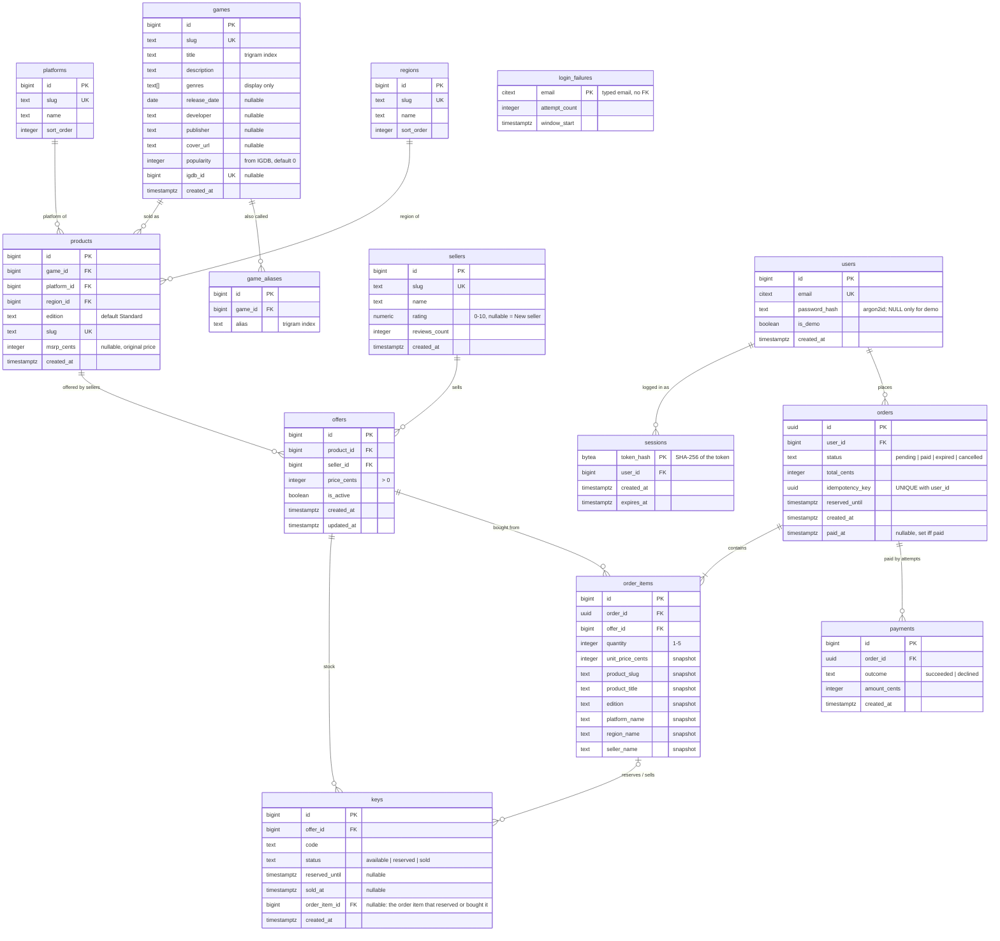
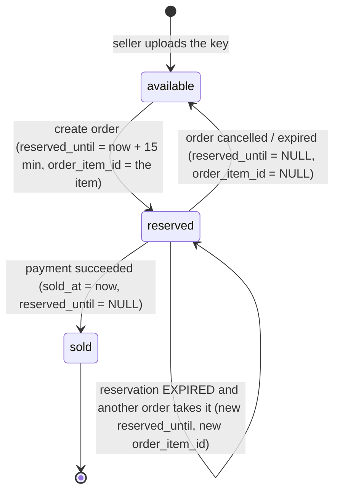
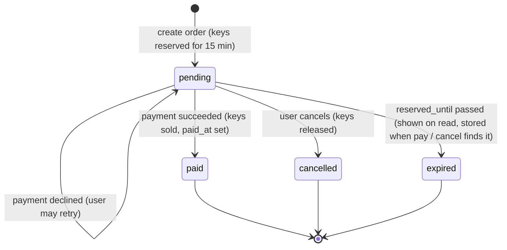

# Data model

The whole schema of the marketplace, designed once. The **catalog** tables exist
(migration `00002_catalog.sql`, plus `game_aliases` for search from `00003_search_aliases.sql`), and so do the **auth** tables
(`00004_auth.sql`, Task 14). The **commerce** tables (`00005_orders.sql`, Task 16a) are built as
documented in [Commerce tables](#commerce-tables-created--migration-00005-task-16a). The **home page** tables
(`00006_homepage.sql`, Task 15) are in [Home page tables](#home-page-tables-created--migration-00006-task-15).

| Group | Tables | Status |
|---|---|---|
| Catalog | `platforms`, `regions`, `games`, `products`, `sellers`, `offers`, `keys` | **created** – migration `00002` |
| Search | `game_aliases` | **created** – migration `00003` (Task 13a) |
| Auth | `users`, `sessions`, `login_failures` | **created** – migration `00004` (Task 14) |
| Commerce | `orders`, `order_items`, `payments` + column `keys.order_item_id` | **created** – migration `00005` (Task 16a) |
| Home page | `homepage_blocks`, `homepage_slides`, `homepage_tiles` (+ their content rows) | **created** – migration `00006` (Task 15) |

Ground rules used everywhere:
- **Money is integer cents, EUR only** (`price_cents integer`). Never `float`/`numeric` for money.
- **IDs:** `bigint GENERATED ALWAYS AS IDENTITY` (the database owns the numbers; a manual `INSERT` of an id fails, so seeds refer to rows by slug). Exception: `orders.id` is a **UUID** – it appears in URLs and must not reveal how many orders exist.
- **Slugs** (`the-witcher-3-pc-global`) are the public, URL-friendly identifiers; numeric ids stay internal. Every slug column has the same CHECK `^[a-z0-9]+(-[a-z0-9]+)*$` (lowercase letters/digits, single `-` between groups) and is UNIQUE.
- **Required text is never blank:** every required name/title/code has CHECK `btrim(x) <> ''` (`NOT NULL` alone still allows `''` or `'   '`). The only exception is `games.description`, where `''` deliberately means "no description".
- **All timestamps are `timestamptz`, default `now()`**, so time zones are never ambiguous.
- **Foreign keys are `ON DELETE RESTRICT`** (two deliberate exceptions: `sessions` and `order_items`). See [Why RESTRICT](#why-restrict-and-not-cascade).
- **Rules live in the database** (`NOT NULL`, `UNIQUE`, `CHECK`, FKs), not only in Go. See [Why CHECK in the DB](#why-check-constraints-in-the-database).
- **Derived values are not stored** (P2): stock, cheapest price, discount % and the seller's tier label are computed (by queries or in Go).
- Data access is hand-written `pgx` SQL (no ORM, no sqlc, P8). The sketches below are that SQL.

## ER diagram



How to read it: a **game** (The Witcher 3) is sold as several **products** (PC / Global / Standard,
Xbox / Europe / GOTY …). Many **sellers** make an **offer** (their price) for a product. Each offer
has its own **keys** – one row per activation code; the number of sellable keys *is* the stock.

## Catalog tables (created – migration `00002`)

Notation: *NN* = `NOT NULL`. Every column without "null" is NOT NULL.

### `platforms` and `regions`
Lookup tables for the store filters (PC, PlayStation 5 … / Global, Europe …). Same shape (P1).

| Column | Type | Why |
|---|---|---|
| `id` | `bigint` identity, PK | internal key used by `products` |
| `slug` | `text` NN, **UNIQUE**, CHECK slug format | filter value in the URL (`?platform=ps5`); the CHECK keeps it URL-safe |
| `name` | `text` NN, CHECK not blank | display name ("PlayStation 5") |
| `sort_order` | `integer` NN, default `0` | the order in the filter list is a business choice, not alphabetical |

- **Why a table, not a Postgres `enum`:** adding a platform is an `INSERT`, not a migration; an enum value cannot be removed easily; the table also carries `name` and `sort_order`.
- Indexes: only the PK and the UNIQUE on `slug` (a few dozen rows).

### `games`
The game itself – everything that is the same on every platform.

| Column | Type | Why |
|---|---|---|
| `id` | `bigint` identity, PK | |
| `slug` | `text` NN, **UNIQUE**, CHECK slug format | game URL |
| `title` | `text` NN, CHECK not blank | shown everywhere, searched with trigrams |
| `description` | `text` NN, default `''` | empty string instead of NULL: one "no description" value, no NULL checks in Go |
| `genres` | `text[]` NN, default `'{}'` | display only (P6): an array is enough, no join table because we never filter by genre |
| `release_date` | `date`, null | NULL = unknown; `date` (not timestamp) because a day is the real precision |
| `developer`, `publisher` | `text`, null | not always known |
| `cover_url` | `text`, null | IGDB image CDN URL (`t_cover_big`, built from the IGDB `image_id`; nothing is stored in the repo). NULL **or** a broken URL → the frontend shows a generated placeholder |
| `popularity` | `integer` NN, default `0` | IGDB `total_rating_count` (set by the seed); the **default store sort** is `popularity DESC`. `0` = unknown, so a game without IGDB data still sorts (last) |
| `igdb_id` | `bigint`, null, **UNIQUE** | the game's id in IGDB, for importing/refreshing data; UNIQUE so one IGDB game cannot be imported twice; NULL = not linked (several NULLs are allowed by UNIQUE) |
| `created_at` | `timestamptz` NN, default `now()` | |

**Search index:** `CREATE INDEX games_title_trgm_idx ON games USING gin (title gin_trgm_ops);`
- `pg_trgm` splits text into 3-letter pieces ("wit", "itc", "tch" …). Two strings that share many trigrams are similar, so "witchr" still finds "Witcher".
- **`gin_trgm_ops` (GIN)** supports *both* `ILIKE '%witcher%'` (substring) *and* the similarity operators `%` / `<%` (typos) – one index for both kinds of search. GIN is faster to read than GiST; GiST's only extra (`ORDER BY title <-> 'x'`, nearest-neighbour) is not needed: we order the few matching rows by `word_similarity()` after filtering.
- **Plain `title`, not `lower(title)`:** pg_trgm lowercases trigrams itself and `ILIKE` is case-insensitive, so an expression index would add nothing (and every query would have to repeat the exact expression to use it).
- Note: the function `similarity(a, b)` alone cannot use an index; queries must filter with the *operators* (`%`, `<%`) and may sort by the function.

### `game_aliases` (migration `00003`, Task 13a)
Other names of a game that the search must find: abbreviations and alternative titles ("GTA V", "RDR2",
"Witcher 3"). Filled by the seed from the IGDB snapshot (`alternative_names`, cleaned) plus a few
hand-written ones in `seed/search_aliases_extra.json`. Used **only by search** – never shown as the title.

| Column | Type | Why |
|---|---|---|
| `id` | `bigint` identity, PK | like every table; the seed restarts it at 1, so ids are deterministic |
| `game_id` | `bigint` NN, FK → `games` **RESTRICT** | the game this alias belongs to |
| `alias` | `text` NN, CHECK not blank | the other name, as IGDB writes it (case kept) |

- **Unique index `(game_id, lower(alias))`:** one alias once per game, whatever the case ("GTA V" = "gta v"). Its leading `game_id` also serves "aliases of a game" and the FK check.
- **Search index:** `CREATE INDEX game_aliases_alias_trgm_idx ON game_aliases USING gin (alias gin_trgm_ops);` – the same kind as `games_title_trgm_idx`, so the alias half of the search uses an index for `ILIKE` *and* `<%`.
- **Why a table and not `games.aliases text[]`:** a trigram GIN index indexes a *text value*, not the elements of an array. One row per alias gets the same index as the title, and "which alias matched" (shown in the search dropdown) is simply that row. An array would need an `unnest` per game per query (no index) or a concatenated "search text" column that loses which alias matched.
- **Backward compatible (expand/contract):** a new table only; the code deployed while the migration runs never reads it. Until the seed fills it, search works on titles only.

### `products`
The thing a buyer chooses: **one game on one platform for one region in one edition**.

| Column | Type | Why |
|---|---|---|
| `id` | `bigint` identity, PK | |
| `game_id` | `bigint` NN, FK → `games`, RESTRICT | |
| `platform_id` | `bigint` NN, FK → `platforms`, RESTRICT | |
| `region_id` | `bigint` NN, FK → `regions`, RESTRICT | a key bought for "Europe" may not activate elsewhere, so region is part of the product |
| `edition` | `text` NN, default `'Standard'`, CHECK not blank | Standard / Deluxe / GOTY … – free text, editions differ per game |
| `slug` | `text` NN, **UNIQUE**, CHECK slug format | product URL, e.g. `the-witcher-3-pc-global` |
| `msrp_cents` | `integer`, null, CHECK `> 0` | the original (list) price of this variant. The **discount %** shown on cards is derived from it and the listing price, never stored. NULL = unknown → no discount badge |
| `created_at` | `timestamptz` NN, default `now()` | |

- **UNIQUE `(game_id, platform_id, region_id, edition)`** (`products_variant_key`): the same variant cannot exist twice (otherwise offers would be split between two "identical" pages). Its first column `game_id` also serves "all products of a game" and the FK check when a game is deleted.
- **Indexes `products_platform_id_idx`, `products_region_id_idx`:** the store filters; they also make the RESTRICT check fast when a platform/region is deleted. Two single-column indexes because each filter can be used alone (Postgres can combine them with a BitmapAnd).

### `sellers`
Marketplace sellers (a fixed list of 8 fictional sellers from the seed, `pkg/seedgen`; seller accounts are out of scope).

| Column | Type | Why |
|---|---|---|
| `id` | `bigint` identity, PK | |
| `slug` | `text` NN, **UNIQUE**, CHECK slug format | |
| `name` | `text` NN, CHECK not blank | |
| `rating` | `numeric(4,2)`, **null**, CHECK `0–10` | e.g. `9.42` – exact decimal for display (not money); `(4,2)` = max `99.99`, the CHECK limits it to `10.00`. **NULL = no rating yet**, the UI shows "New seller" (a CHECK passes for NULL) |
| `reviews_count` | `integer` NN, default `0`, CHECK `≥ 0` | |
| `created_at` | `timestamptz` NN, default `now()` | |

**Tier label – derived in Go, not stored** (one place to change the wording, no label that disagrees with the number):

| `rating` | Label |
|---|---|
| NULL | New seller |
| ≥ 9.75 | Superb |
| ≥ 9.50 | Excellent |
| ≥ 9.00 | Very good |
| ≥ 8.00 | Good |
| < 8.00 | no label (only the number is shown) |

Thresholds (decided) are based on real Eneba examples: 9.90 → Superb, 9.67 → Excellent, 9.41 → Very good.
The checks run top-down, so the first matching row wins.

### `offers`
One seller's price for one product.

| Column | Type | Why |
|---|---|---|
| `id` | `bigint` identity, PK | |
| `product_id` | `bigint` NN, FK → `products`, RESTRICT | |
| `seller_id` | `bigint` NN, FK → `sellers`, RESTRICT | |
| `price_cents` | `integer` NN, CHECK `> 0` | money in cents; a free or negative price is always a bug |
| `is_active` | `boolean` NN, default `true` | a seller can pause an offer without deleting it (orders will reference it) |
| `created_at`, `updated_at` | `timestamptz` NN, default `now()` | `updated_at` is kept current by a trigger (below), so no query can forget it |

- **UNIQUE `(product_id, seller_id)`** (`offers_product_seller_key`): one offer per seller per product – a seller changes their price, they do not add a second offer. Its first column also serves the FK from `products`.
- **Partial index `offers_active_product_price_idx ON offers (product_id, price_cents) WHERE is_active`:** exactly the product-page query ("active offers of this product, cheapest first") – the index returns the rows already in price order (verified: index scan, no Sort step); and `MIN(price_cents)` per product for the listing. Inactive offers are never read by the store, so they are not in the index.
- **Trigger `offers_set_updated_at`** (`BEFORE UPDATE … FOR EACH ROW`) calls the small function `set_updated_at()`, which sets `NEW.updated_at := now()`. Generic, so a later table can reuse it (the checkout tables did not need it). Note: inside one transaction `now()` is the transaction start time.
- Not indexed on purpose (decided): `seller_id` alone – there is no "offers of a seller" page; add an index when one appears.

### `keys`
One activation code. **Stock = number of sellable keys** (P2).

| Column | Type | Why |
|---|---|---|
| `id` | `bigint` identity, PK | |
| `offer_id` | `bigint` NN, FK → `offers`, RESTRICT | each key belongs to the seller's offer (the seller uploaded it) |
| `code` | `text` NN, CHECK not blank | the secret the buyer receives (plain text here – see [production](#what-a-production-system-would-do-differently)) |
| `status` | `text` NN, default `'available'`, CHECK `IN ('available','reserved','sold')` | the state machine below; `text + CHECK` instead of an enum for the same reasons as P1 |
| `reserved_until` | `timestamptz`, null | set while reserved; **a past value = the reservation expired = the key is sellable again** (P3) |
| `sold_at` | `timestamptz`, null | when it was sold |
| `created_at` | `timestamptz` NN, default `now()` | |
| `order_item_id` | `bigint`, null, FK → `order_items` RESTRICT (migration `00005`) | which order item reserved/bought it: a reservation has an explicit owner. NULL = nobody |

Constraints:
- **UNIQUE `(offer_id, code)`** – the same code cannot be uploaded twice into one offer; first column also serves the FK from `offers`.
- **`keys_reserved_until_only_when_reserved`:** `reserved_until` is set **if and only if** `status = 'reserved'`.
- **`keys_sold_at_only_when_sold`:** `sold_at` is set **if and only if** `status = 'sold'`.
  These two make impossible combinations ("available but reserved until 18:00", "sold but no sale time") unrepresentable.
- **`keys_available_has_no_order_item`** (migration `00005`): `status <> 'available' OR order_item_id IS NULL` - an available key belongs to nobody.
  One direction only on purpose: the seed contains `reserved` and `sold` keys that were never part of an order (background data), so "reserved/sold implies order item set" would reject the seed.
- **Index `keys_order_item_id_idx ON keys (order_item_id) WHERE order_item_id IS NOT NULL`:** "the keys of this order" and the RESTRICT check; partial because most keys never belong to an order.

**Partial index `keys_unsold_offer_idx ON keys (offer_id, reserved_until) WHERE status <> 'sold'`:**
- "Sellable" means `available` **or** `reserved` with an expired `reserved_until`. `now()` cannot be used in an index predicate (it must be immutable), so the index holds every **unsold** key and the query checks the expiry on `reserved_until`.
- `reserved_until` is the second index column so the **stock count** can be answered from the index alone (verified: `Index Only Scan using keys_unsold_offer_idx`), without reading the table rows.
- Sold keys are the vast majority over time and are never needed for stock, so they are left out – the index stays the size of the *current* stock.

## Auth tables (created – migration `00004`, Task 14)

### `users`
| Column | Type | Why |
|---|---|---|
| `id` | `bigint` identity, PK | |
| `email` | `citext` NN, **UNIQUE**, CHECK `length <= 254` and contains `@` after the first character | `citext` = case-insensitive text: `Jon@x.com` and `jon@x.com` are the same account, and the UNIQUE index enforces it (also against two sign-ups racing) |
| `password_hash` | `text`, **NULL only for demo users** | argon2id PHC string `$argon2id$v=19$m=19456,t=2,p=1$<salt>$<hash>` (CHECK: starts with `$argon2id$`); the password itself is never stored |
| `is_demo` | `boolean` NN, default `false` | a temporary account made by "Sign in as demo user" |
| `created_at` | `timestamptz` NN, default `now()` | |

- **CHECK `(password_hash IS NULL) = is_demo`:** a normal account always has a password, a demo account never has one – so a demo account can never be signed in to with a password (only the browser that created it holds its session).
- **Demo accounts** get a random email `demo-<16 hex>@demo.invalid`. `.invalid` is a reserved top-level domain (RFC 2606): no real address ends with it, and sign-up refuses that domain, so a demo email cannot collide with a person's.
- **Why argon2id and not SHA-256:** SHA-256 is fast – a GPU tries billions of guesses per second against a leaked hash. argon2id is slow and memory-hard on purpose (19 MiB and 2 passes per guess), and the random salt makes equal passwords hash differently.

### `sessions`
| Column | Type | Why |
|---|---|---|
| `token_hash` | `bytea` **PK**, CHECK 32 bytes | **SHA-256 of the session token** – the cookie holds the random 32-byte token, the DB only its hash. Every request looks the session up by it, so it is the key itself (no separate id) |
| `user_id` | `bigint` NN, FK → `users` **ON DELETE CASCADE** | the one CASCADE (decided): sessions are disposable login state, not history |
| `created_at` | `timestamptz` NN, default `now()` | |
| `expires_at` | `timestamptz` NN, CHECK `> created_at` | `now() + 7 days` (= the cookie's `Max-Age`); not extended on use |

- **Why a hash:** if the database (or a backup, or a log of a query) leaks, the attacker gets hashes that cannot be used as cookies.
- **Why SHA-256 and not argon2id/bcrypt:** the token is 256 random bits (not a guessable password), so a fast hash is safe; and the lookup must be by exact value (`WHERE token_hash = $1`), which a salted hash cannot do.
- **Indexes:** `user_id` ("sessions of a user", the CASCADE delete) and `expires_at` (clean-up).
- **Expiry is lazy (no cron job):** a lookup of an expired session rejects it and deletes that row; creating a session deletes **every** expired one in the same batch (cheap thanks to the `expires_at` index).

### `login_failures` (rate limit)
| Column | Type | Why |
|---|---|---|
| `email` | `citext` **PK** | the **typed** email – deliberately not a FK to `users`: unknown emails are counted too, otherwise "429 vs 401" would reveal which emails have an account |
| `attempt_count` | `integer` NN, CHECK `> 0` | sign-in attempts in the current window |
| `window_start` | `timestamptz` NN, default `now()` | when the current 15-minute window began (its first attempt). Index for the clean-up |

- **Rule (owner decision A6):** at most **10 failed sign-ins per email per 15 minutes**; the 11th attempt gets `429` + `Retry-After` (seconds until the window ends), even with the right password.
- **Why in the database:** on Vercel every request can run in a different function instance, so an in-memory counter would be per-instance and easy to bypass.
- **Counted before the password check, atomically:** one `INSERT … ON CONFLICT (email) DO UPDATE SET attempt_count = attempt_count + 1 RETURNING attempt_count` numbers every attempt; over 10 → `429`; a **successful** sign-in deletes the row, so what stays counted are the failures. Counting *after* a failed check would let a burst of parallel requests all pass the check first (verified on `dev`: 30 parallel attempts → exactly 10 × `401`, 20 × `429`).
- **Fixed window:** it starts at the first attempt; after 15 minutes the next attempt deletes the old row and starts again at 1. The same batch deletes every ended window, so the table does not keep rows for one-off typos.
- **Trade-off (known):** anyone who knows an email can lock its password sign-in for 15 minutes (existing sessions keep working). See the Task 14 report, open questions.

## Commerce tables (created – migration `00005`, Task 16a)

**The cart lives in the browser** (decided) – there is no cart table. At checkout the frontend sends
the list of `(offerId, quantity, expectedPriceCents)`; the server re-reads prices from `offers` (never trusts client
prices) and creates the order. Reservations last **15 minutes** (decided).
Backward compatible (expand): three new tables and one new nullable column; the code deployed while the migration runs never touches them.

### `orders`
| Column | Type | Why |
|---|---|---|
| `id` | `uuid` PK, default `gen_random_uuid()` | appears in URLs; not guessable, does not reveal the order count |
| `user_id` | `bigint` NN, FK → `users`, RESTRICT | orders are financial records – a user with orders is not hard-deleted |
| `status` | `text` NN, default `'pending'`, CHECK `IN ('pending','paid','expired','cancelled')` | state machine below |
| `total_cents` | `integer` NN, CHECK `> 0` | sum of `unit_price_cents x quantity`, computed by the server from the database prices |
| `idempotency_key` | `uuid` NN | sent by the client (one per checkout attempt); **UNIQUE `(user_id, idempotency_key)`** – a double click or a network retry returns the *same* order instead of reserving keys twice. Per user, so one user can never reach another's order by guessing a key |
| `reserved_until` | `timestamptz` NN | `created_at + 15 minutes` = the keys' `reserved_until`; after it the order can no longer be paid |
| `created_at` | `timestamptz` NN, default `now()` | the application passes its (injectable) clock, so tests can move time |
| `paid_at` | `timestamptz`, null | CHECK `orders_paid_at_only_when_paid`: set **iff** `status = 'paid'` |

Index `orders_user_created_idx (user_id, created_at DESC)` for "my orders, newest first".
Differences from the earlier plan: no `updated_at` (nothing needs it), and `reserved_until` instead of `expires_at` (the same name as on `keys`).

### `order_items`
| Column | Type | Why |
|---|---|---|
| `id` | `bigint` identity, PK | keys point to it (`keys.order_item_id`) |
| `order_id` | `uuid` NN, FK → `orders`, **ON DELETE CASCADE** | the second CASCADE (decided): an item has no meaning without its order; deleting an order is still blocked while a key or a payment points at it |
| `offer_id` | `bigint` NN, FK → `offers`, RESTRICT | which seller's offer was bought; index `order_items_offer_id_idx` for the RESTRICT check |
| `quantity` | `integer` NN, CHECK `BETWEEN 1 AND 5` | number of keys (the same limit as the API) |
| `unit_price_cents` | `integer` NN, CHECK `> 0` | **snapshot** of the price paid; the offer's price may change tomorrow |
| `product_slug`, `product_title`, `edition`, `platform_name`, `region_name`, `seller_name` | `text` NN, CHECK not blank (one constraint) | **snapshots**: the order must look the same even if the catalog changes later (a seller is renamed, a platform is renamed) |

UNIQUE `(order_id, offer_id)` – one line per offer in an order (more keys = higher `quantity`).

### `payments`
Simulated payment attempts (P4). A separate table because one order can have **several attempts**
("declined" → the user retries).

**No card data at all** (decided): there is no card form and no card column. The payment step is a
simple choice **"Mock payment: Success / Decline"** (`outcome` in the API); the choice decides the attempt's `outcome`. Nothing
sensitive is collected or stored, so no PCI concerns.

| Column | Type | Why |
|---|---|---|
| `id` | `bigint` identity, PK | |
| `order_id` | `uuid` NN, FK → `orders`, RESTRICT | payment history is never deleted with an order |
| `outcome` | `text` NN, CHECK `IN ('succeeded','declined')` | Success → `succeeded`, Decline → `declined` |
| `amount_cents` | `integer` NN, CHECK `> 0` | the order total at that moment |
| `created_at` | `timestamptz` NN, default `now()` | |

- Index `payments_order_id_idx (order_id)`.
- **Partial UNIQUE `payments_one_success_per_order (order_id) WHERE outcome = 'succeeded'`:** at most one successful payment per order – a double charge is impossible at the database level, whatever the Go code does.

### Change to `keys`
`ALTER TABLE keys ADD COLUMN order_item_id bigint REFERENCES order_items (id)` (RESTRICT) + the CHECK and the partial index described under [`keys`](#keys).
A nullable column added to an existing table → backward compatible (expand).

## Home page tables (created – migration `00006`, Task 15)

The home page is assembled from **blocks**. The registry (`homepage_blocks`) says which blocks the page shows, in which
order and with which titles; `GET /api/homepage` returns the enabled rows. Every block has its **own endpoint and data
source** (`pkg/homepage`): the hero reads `homepage_slides` (+ live prices from the catalog), the tiles read `homepage_tiles`
(+ cover images from the catalog), the platform row and the product rows read only the catalog. The frontend has one
renderer per block **type** and no content of its own.

**The content rows are inserted by the migration, not by `cmd/seed`** (owner decision): the catalog seed and its golden
checksum stay unchanged, and production needs no reseed (`seed --reset` refuses once orders exist). `seed --reset` only
deletes the catalog tables, so it never touches these.

**No foreign key into the catalog:** `homepage_slides.product_slug` is plain text. The blocks are logically separate
services (each could move to its own service and database), and the catalog reseed deletes and re-inserts products, which
an FK would block. The API checks instead: a slide whose product does not exist or is out of stock is skipped.

Backward compatible (expand): three new tables; the code that is live while the migration runs never reads them.

### `homepage_blocks` (the registry)
| Column | Type | Why |
|---|---|---|
| `id` | `bigint` identity, PK | tie-breaker of the order |
| `key` | `text` NN UNIQUE, slug CHECK | stable name; a product row's endpoint is `/api/blocks/products/{key}` |
| `type` | `text` NN, CHECK `IN ('hero','tiles','platforms','product_row')` | which renderer draws it. A new type needs code (endpoint + renderer), so it also needs a migration |
| `title` | `text` NN, not blank | the heading (visible on product rows; the accessible name of the other blocks) |
| `position` | `integer` NN | page order (`ORDER BY position, id`). Steps of 10, so a block can be put between two others |
| `enabled` | `boolean` NN, default `true` | `false` = the block disappears from the registry and its endpoint answers 404 – **without a deploy** |
| `config` | `jsonb` NN, default `{}`, CHECK object | per-type settings, validated strictly in Go (`pkg/homepage/config.go`: unknown field or bad value = 500, never a silent default). Product row: `{"sort","limit","viewAllHref"}`; platforms: `{"allLabel","allIcon","defaultIcon","icons":{slug: icon}}` |

Partial UNIQUE index `homepage_blocks_one_per_single_type (type) WHERE type <> 'product_row'`: at most one hero, one
tiles and one platforms block (their endpoints have no key). The **endpoint is not stored**: Go builds it from the type
(and key), so a row can never point the page at a foreign URL.

### `homepage_slides` (hero carousel)
| Column | Type | Why |
|---|---|---|
| `id` | `bigint` identity, PK | |
| `position`, `enabled` | `integer` NN, `boolean` NN | order and on/off, like the blocks |
| `title` | `text` NN, not blank | |
| `subtitle`, `badge` | `text`, null | optional lines ("Coming soon") |
| `image_url`, `image_url_mobile` | `text` NN, CHECK `^(/[^/]|https://)` | the desktop and the phone (≤ 600px) picture: our own `/banners/...` files or https (IGDB) |
| `image_srcset`, `image_srcset_mobile` | `text`, null | the same picture in several widths (`url 1280w, url 1920w`), so the browser downloads the smallest sharp-enough file. **Added to the task's column list** (the task asks for a responsive `srcset`) |
| `product_slug` | `text`, null | a product slide: the API adds the **live** cheapest price and links the button to `/product/{slug}` |
| `cta_label`, `cta_href` | `text`, null; `cta_href` CHECK internal path `^/([^/]|$)` | a button to a page |

CHECKs: `homepage_slides_one_target` (not both `product_slug` and `cta_href`) and `homepage_slides_label_iff_target`
(a label exactly when there is a target: no button without a link, no dead link without a label).

### `homepage_tiles` (side tiles)
| Column | Type | Why |
|---|---|---|
| `id`, `position`, `enabled` | as above | |
| `title` | `text` NN, not blank | "Up to −70%" |
| `subtitle` | `text`, null | |
| `href` | `text` NN, CHECK internal path | where the tile goes (`/store?sort=discount`) |
| `accent` | `text` NN, default `'violet'`, CHECK `IN ('violet','promo','mint')` | which **token gradient** the frontend paints – a name, never a colour value |
| `covers` | `jsonb`, null, CHECK object | which catalog products give the collage, e.g. `{"sort":"popularity","platform":"steam"}`; the API returns up to 3 different covers. `NULL` = text only |

### Content (inserted by `00006`)
| Block (position) | Type | Content |
|---|---|---|
| `hero` (10) | hero | 1. **Innert** (a friend's game in development, art used with permission): badge "Coming soon", no button, WebP files in `public/banners/`. 2. Grand Theft Auto V and 3. The Witcher 3 (the two most popular in-stock games): IGDB artworks `ar6d9m` / `ar3lze`, "Buy now" → product page |
| `tiles` (20) | tiles | "Up to −70%" → `/store?sort=discount`, "Steam games" → `/store?platform=steam`, "New releases" → `/store?sort=newest` |
| `platforms` (30) | platforms | "All games" + every platform with products; generic lucide icon names |
| `popular` (40), `discounts` (50), `new-releases` (60) | product_row | 5 products by popularity / discount / newest; "View all" → `/store`, `/store?sort=discount`, `/store?sort=newest` |

"Turn a block off" in a database console: `UPDATE homepage_blocks SET enabled = false WHERE key = 'discounts';`
(locally visible at once; in production within the 5-minute CDN cache).

## State machines

### Key

- **Expiry needs no job (P3):** an expired reservation stays `status = 'reserved'` with a past `reserved_until`. Every "sellable" query treats `reserved_until < now` as available, so the next order simply takes it and **overwrites** `reserved_until` and `order_item_id`.
- **Who owns a reserved key?** The order item in `order_item_id`. Every statement that releases or sells keys matches on it: *release* is `WHERE status = 'reserved' AND order_item_id IN (items of this order)`; *sell* locks `WHERE order_item_id IN (items of this order) AND status = 'reserved' AND reserved_until > now` and requires the count to equal the order's total quantity. If another order already took a key over, that key carries the other item's id: the old owner's release leaves it alone, and the old owner's payment finds fewer keys than it needs and **sells nothing** - the order expires instead. Someone else's key is never sold, and a sold key is never released.

### Order

`paid`, `cancelled`, `expired` are final. `expired` is lazy: a pending order past `reserved_until` is *shown* as `expired` by every read (list, get), and *stored* as `expired` (with its keys released) the moment a pay or cancel request finds it. Paying a paid order is not a transition: it returns the order unchanged. In every transaction that changes an order, the order row is locked first (`SELECT … FOR UPDATE`), so two requests on one order (a double click) run one after the other.

## Query sketches

SQL that the Go code (hand-written `pgx`) runs. User input is never concatenated into SQL: it travels as
query parameters (`$n`; in `pkg/catalog` written as named parameters `@name`, which pgx rewrites to `$n`).
Sketches 1, 1b and 2 are **implemented in `pkg/catalog/store.go`** (Task 09) and tested against the
deterministic seed (`pkg/catalog/store_integration_test.go`, run in CI); sketch 4 (search) is implemented in
`pkg/catalog/search.go` (Task 13a); sketch 3 (reserve keys) and 3b (pay) in `pkg/orders/store.go` (Task 16a, tested against a real Postgres in CI). The "sellable key" condition appears in all of them:

```sql
k.status <> 'sold' AND (k.reserved_until IS NULL OR k.reserved_until < now())
-- = available, or reserved but expired. "status <> 'sold'" is written exactly like the
--   predicate of keys_unsold_offer_idx, so the planner can use that partial index.
```

### 1. Store listing
Products with game, platform, region, listing price, MSRP + discount %, offer count and in-stock flag;
optional filters (platform and region = several slugs each, price range); one of six sort orders
(default: popularity); paging. `GET /api/products`.

**Listing price (decided) = the cheapest active offer that has stock.** An active offer with no
sellable keys does not set the price (nobody could buy at it). A product with no such offer is
**out of stock**: it stays visible, has no price (`NULL`), sorts **last** on the price and discount
sorts and is **excluded** whenever a price filter is used.

The query is built from one shared CTE, `base` ("every product with everything the listing and the
facets need"). **The items and all facets read from `base`**, so a condition added to its `WHERE`
applies to all of them at once - the text search (`q`, sketch 4) is one `LEFT JOIN` and one `WHERE` line there.

```sql
-- named parameters: @platforms text[] (empty = no filter), @regions text[], @min_price bigint | NULL,
-- @max_price bigint | NULL, @limit, @offset
WITH active_offers AS (               -- every ACTIVE offer + "does it have a sellable key?"
    SELECT o.product_id, o.price_cents,
           EXISTS (SELECT 1
                   FROM keys k
                   WHERE k.offer_id = o.id
                     AND k.status <> 'sold'
                     AND (k.reserved_until IS NULL OR k.reserved_until < now())) AS has_stock
    FROM offers o
    WHERE o.is_active
),
product_stats AS (                    -- one row per product that has active offers
    SELECT product_id,
           min(price_cents) FILTER (WHERE has_stock) AS min_price_cents,  -- NULL = out of stock
           count(*)         FILTER (WHERE has_stock) AS offer_count       -- offers you can buy now
    FROM active_offers
    GROUP BY product_id
),
base AS (
    SELECT p.id, p.slug, p.edition, p.msrp_cents,
           g.title, g.cover_url, g.release_date, g.popularity,
           pl.id AS platform_id, pl.slug AS platform_slug, pl.name AS platform_name,
           r.id  AS region_id,   r.slug  AS region_slug,   r.name  AS region_name,
           ps.min_price_cents,
           coalesce(ps.offer_count, 0) AS offer_count,
           CASE WHEN ps.min_price_cents < p.msrp_cents          -- only a real discount; NULL if msrp
                THEN (p.msrp_cents - ps.min_price_cents)::bigint * 100  -- unknown, out of stock or
                     / p.msrp_cents                                     -- price >= msrp. Integer
           END AS discount_pct,                                         -- division = rounds DOWN
           coalesce(gm.match_tier, 0)  AS match_tier,    -- search rank (sketch 4); 0 without a search
           coalesce(gm.match_score, 0) AS match_score
    FROM products p
    LEFT JOIN product_stats ps ON ps.product_id = p.id   -- LEFT: products without stock stay visible
    JOIN games     g  ON g.id  = p.game_id
    JOIN platforms pl ON pl.id = p.platform_id
    JOIN regions   r  ON r.id  = p.region_id
    LEFT JOIN game_matches gm ON gm.game_id = g.id       -- the search CTEs of sketch 4 (Task 13a)
    WHERE (@q::text IS NULL OR gm.game_id IS NOT NULL)   -- search: items AND facets follow it
)
SELECT b.slug, b.title, b.edition, b.platform_slug, b.platform_name, b.region_slug, b.region_name,
       b.cover_url, b.min_price_cents, b.msrp_cents, b.discount_pct, b.offer_count,
       b.min_price_cents IS NOT NULL AS in_stock,
       count(*) OVER () AS total      -- all matching rows, computed before LIMIT
FROM base b
WHERE (cardinality(@platforms::text[]) = 0 OR b.platform_slug = ANY(@platforms::text[]))
  AND (cardinality(@regions::text[])   = 0 OR b.region_slug   = ANY(@regions::text[]))
  AND (@min_price::bigint IS NULL OR b.min_price_cents >= @min_price::bigint)  -- NULL price never matches,
  AND (@max_price::bigint IS NULL OR b.min_price_cents <= @max_price::bigint)  -- so out-of-stock drops out
ORDER BY b.popularity DESC, b.id                                   -- sort=popularity (DEFAULT)
-- ORDER BY b.min_price_cents ASC  NULLS LAST, b.id                   sort=price_asc
-- ORDER BY b.min_price_cents DESC NULLS LAST, b.id                   sort=price_desc
-- ORDER BY (b.min_price_cents IS NULL), b.discount_pct DESC NULLS LAST, b.id   sort=discount
-- ORDER BY b.release_date DESC NULLS LAST, b.id                      sort=newest
-- ORDER BY b.title ASC, b.id                                         sort=title
--   Go picks ONE of these fixed lines from a whitelist map; user text never goes into ORDER BY.
LIMIT @limit OFFSET @offset;
```
- **Discount % is derived (decided):** `(msrp - listing price) x 100 / msrp` in integer math, which rounds **down** - the badge never promises more than the real saving (3999 -> 1799 = 55.01 % -> "-55 %"). It is `NULL` (no badge) when `msrp_cents` is unknown, the product is out of stock, or the price is not below the MSRP. The discount sort puts "no discount" last, and out-of-stock products after those (`(b.min_price_cents IS NULL)` is the first sort key).
- **Default sort = popularity** (from IGDB). Out-of-stock products are *not* pushed down there - only the price and discount sorts put them last (decided).
- `min(...) FILTER (WHERE has_stock)` takes the minimum only over offers with stock; if there are none, the result is `NULL`, which *is* the out-of-stock signal (`in_stock = min_price_cents IS NOT NULL`).
- Price filter: `NULL >= 1000` is `NULL` (not true), so out-of-stock products drop out automatically when a price bound is given, and stay when it is not.
- A product with no active offers at all is also out of stock (no `product_stats` row -> `NULL` price, `offer_count = 0`).
- `EXISTS` stops at the first sellable key (cheaper than counting); it uses `keys_unsold_offer_idx`.
- `b.id` as the last sort key makes paging stable when two products have the same price.
- `cardinality(@platforms) = 0 OR ... = ANY(@platforms)` = "filter only if given; any of the slugs may match", so one SQL string serves every filter combination. The slugs are ONE array parameter: no string-built SQL, so no SQL injection. An unknown slug matches nothing.
- **`count(*) OVER ()`** returns the total of all matching rows on every row, *before* `LIMIT` - one query gives both the page and "page 2 of 7". Edge case: a page past the last one has no rows, so the total is read with a second, tiny `count(*)` query in that case only.
- Go sends the items query and the three facet queries below as **one pgx batch**: one network round trip and one implicit transaction, so items and counts come from the same snapshot.

### 1b. Facets (filter options with counts)
Returned in the same response as the listing (`facets` next to `items`). **Counts follow the current
filters** (decided, "standard multi-select faceting"): each group is counted with **all other active
filters applied except its own**. So after picking `platform=steam` the *region* counts show only Steam
products, but the *platform* list keeps the counts of every platform (otherwise PSN would show 0 and the
user could never add it to the selection). All three read from the same `base` CTE as the listing.

```sql
-- platform facet: region + price filters, NOT the platform filter
SELECT pl.slug, pl.name, count(b.id) AS cnt
FROM platforms pl
LEFT JOIN base b ON b.platform_id = pl.id
                AND (cardinality(@regions::text[]) = 0 OR b.region_slug = ANY(@regions::text[]))
                AND (@min_price::bigint IS NULL OR b.min_price_cents >= @min_price::bigint)
                AND (@max_price::bigint IS NULL OR b.min_price_cents <= @max_price::bigint)
GROUP BY pl.id
HAVING count(b.id) > 0 OR pl.slug = ANY(@platforms::text[])   -- hide empty entries, keep selected ones
ORDER BY pl.sort_order, pl.id;

-- region facet: the same with platform + price filters (HAVING ... r.slug = ANY(@regions))

-- price range: platform + region filters, NOT the price filter; min/max ignore NULL = in-stock only
SELECT min(b.min_price_cents), max(b.min_price_cents)
FROM base b
WHERE (cardinality(@platforms::text[]) = 0 OR b.platform_slug = ANY(@platforms::text[]))
  AND (cardinality(@regions::text[])   = 0 OR b.region_slug   = ANY(@regions::text[]));
```
- **Why `LEFT JOIN platforms -> base`:** it starts from the lookup table, so a platform with no matching product still gets a row (count 0). `HAVING` then decides: count > 0, or the platform is currently selected. A selected entry therefore never vanishes from the filter UI, even when the other filters leave it empty (e.g. `platform=battle-net`: no products at all, still listed with 0).
- The entries are ordered by `sort_order` (a business decision), not by count or name.
- **Price range:** `NULL` (JSON `null`) when no in-stock product matches the platform/region filters. It ignores the price filter on purpose: the slider keeps its full range while the user drags it.
- An unknown selected slug is not in the lookup table, so it is not invented as an entry (the listing is simply empty).
- Facets are not global any more (an earlier draft of Task 09 had a separate global `GET /api/catalog/facets`; the owner replaced it with this).

### 2. Product page – offers
Only **buyable** offers of one product (active **and** stock > 0, decided), with seller info and
stock per offer, cheapest first.

```sql
-- $1 product slug
SELECT o.id AS offer_id, o.price_cents,
       s.slug AS seller_slug, s.name AS seller_name,
       s.rating, s.reviews_count,       -- rating NULL = "New seller"; tier label made in Go
       st.stock
FROM products p
JOIN offers  o ON o.product_id = p.id AND o.is_active
JOIN sellers s ON s.id = o.seller_id
CROSS JOIN LATERAL (                    -- stock of THIS offer, usable in WHERE below
    SELECT count(*) AS stock
    FROM keys k
    WHERE k.offer_id = o.id
      AND k.status <> 'sold'
      AND (k.reserved_until IS NULL OR k.reserved_until < now())
) st
WHERE p.slug = $1
  AND st.stock > 0                      -- offers without stock are hidden
ORDER BY o.price_cents, o.id;
```
- **Offers with `stock = 0` are not listed**, so the first row is always the cheapest offer you can actually buy (the same rule as the listing price). If no row comes back, the page shows the product as "Out of stock".
- `CROSS JOIN LATERAL` computes the count once per offer and gives it a name (`st.stock`), so it can be both returned and filtered on. A subquery in the `SELECT` list cannot be used in `WHERE`.
- `offers_active_product_price_idx` returns the offers already in price order; each `stock` count is an index-only scan of `keys_unsold_offer_idx`. The product header (title, cover, platform …) is a separate one-row query.
- `GET /api/products/{slug}` sends three queries as one pgx batch: the header (no row -> `404`), these offers, and the **variants** (the other products of the same game, `JOIN products v ON v.game_id = p.game_id AND v.id <> p.id`, each with its own cheapest buyable price from the same `product_stats` CTE as the listing). The product's own `priceCents` is simply the first offer. The seller tier label and `isNew` (rating `NULL`) are made in Go.

### 3. Reserve N keys of one offer (checkout, implemented in `pkg/orders/store.go` → `reserveKeys`)
```sql
-- inside the create-order transaction (BEGIN … COMMIT)
-- $1 offer id, $2 now (the application's clock), $3 quantity, $4 now + 15 minutes, $5 order item id
WITH picked AS (
    SELECT id
    FROM keys
    WHERE offer_id = $1
      AND status <> 'sold'
      AND (reserved_until IS NULL OR reserved_until < $2)  -- expired = available (P3)
    ORDER BY id                       -- oldest keys first
    LIMIT $3
    FOR UPDATE SKIP LOCKED            -- lock the picked rows; skip rows another checkout holds
)
UPDATE keys k
SET status         = 'reserved',
    reserved_until = $4,
    order_item_id  = $5               -- the explicit owner of the reservation
FROM picked
WHERE k.id = picked.id;               -- rows affected = keys actually reserved
```
- If fewer than `$3` rows are affected → the whole order is rolled back (nothing half-reserved remains) and the answer is `409 cart_changed` with the line marked `quantity_reduced` / `unavailable`.
- **`FOR UPDATE`** locks the chosen rows until the transaction ends, so two buyers can never get the same key.
- **`SKIP LOCKED`**: a second buyer at the same moment does not *wait* for the first one's locks – they skip those rows and take the next free keys. Without it, all concurrent checkouts of a popular offer would queue on the same rows.
- After locking, Postgres re-checks the `WHERE` on the newest row version, so a key that someone else reserved and committed in the meantime is not taken.
- **Why not `SELECT` a key, then `UPDATE` it:** between the two statements another transaction can select the same key, and both then "reserve" it (the second `UPDATE` just overwrites the first). Locking in the same statement that picks closes that gap.
- The time is the **application's clock** (`$2`, `$4`), not `now()`: the tests move it to simulate expiry. Production uses the server clock; the few seconds it may differ from the database clock are irrelevant next to 15 minutes.

The whole create-order transaction (`CreateOrder`): (0) lock the user's row (`SELECT id FROM users WHERE id = $1 FOR NO KEY UPDATE`) so two creates of one user run one after the other;
(1) is there already an order for this `(user, idempotency key)`? return it (also when the user is at the cap: a retry creates nothing);
(1b) `SELECT count(*) FROM orders WHERE user_id = $1 AND status = 'pending' AND reserved_until > $now` - at 3 or more the create is refused (`409`, rule R10: at most 3 unpaid orders per user). The user-row lock is what makes the count trustworthy: without it two parallel creates both count 2 and both pass. `NO KEY UPDATE` conflicts with itself but not with the foreign-key checks other statements take on that row; the count uses the existing index `orders_user_created_idx (user_id, …)`;
(2) read the offers `FOR SHARE` (a seller cannot change the price until we commit; many buyers can share the lock);
(3) `INSERT INTO orders … ON CONFLICT (user_id, idempotency_key) DO NOTHING` - two identical requests at once: the second waits for the first, then does nothing and returns the first one's order;
(4) per line: insert the order item (snapshots), then reserve its keys as above;
(5) if any line differs from what the client expected, or got fewer keys than it wanted → `ROLLBACK` and report every line; else `COMMIT`.

### 3b. Pay (`PayOrder`) - one transaction, the order row locked
```sql
SELECT status, reserved_until, total_cents FROM orders WHERE id = $1 AND user_id = $2 FOR UPDATE;   -- not yours = no row = 404
-- paid -> return it | expired / cancelled -> 409 | pending but reserved_until <= now -> UPDATE orders SET status='expired' + release keys, then 409
-- decline -> INSERT INTO payments (…, 'declined', …), commit, 402
-- success:
SELECT k.id FROM keys k JOIN order_items oi ON oi.id = k.order_item_id
WHERE oi.order_id = $1 AND k.status = 'reserved' AND k.reserved_until > $now ORDER BY k.id FOR UPDATE OF k;
-- the count must equal SUM(order_items.quantity), else nothing is sold and the order expires; then:
UPDATE keys SET status = 'sold', sold_at = $now, reserved_until = NULL WHERE id = ANY($ids);
UPDATE orders SET status = 'paid', paid_at = $now WHERE id = $1;
INSERT INTO payments (order_id, outcome, amount_cents, created_at) VALUES ($1, 'succeeded', $total, $now);
```
Key codes are read back (`SELECT code FROM keys WHERE order_item_id = ANY(…) AND status = 'sold'`) **only** when the order is paid.

### 4. Search: title + aliases, typos allowed (Task 13a, `pkg/catalog/search.go`)
`GET /api/products?q=…` (items and facets) and `GET /api/search/suggest?q=…` share these CTEs.
`q` is trimmed, inner spaces collapsed and 2-100 characters long (else 400) – validated in `pkg/server`.

```sql
-- @q          'witchr 3'      (NULL = no search: the CTEs return no rows, base does not filter)
-- @q_prefix   'witchr 3%'     built in Go; %, _ and \ in q are escaped first
-- @q_contains '%witchr 3%'
-- @short_query  false         true when q has at most 2 characters (Task 13c): word-start rule, see below
-- @q_word_start NULL          only for short queries, e.g. '(^|[^[:alnum:]])re'  (regex characters of q escaped)
SELECT set_config('pg_trgm.word_similarity_threshold', '0.55', true);  -- first query of the SAME batch

WITH matched_terms AS (   -- every title and alias that matches; each half uses its own trigram index
    SELECT g.id AS game_id, g.title AS term, NULL::text AS alias
    FROM games g
    WHERE (@short_query AND g.title ~* @q_word_start)         -- 2 characters: start of a word only
       OR (NOT @short_query AND (g.title ILIKE @q_contains OR @q <% g.title))  -- else: contains OR similar (typo)
    UNION ALL
    SELECT a.game_id, a.alias, a.alias
    FROM game_aliases a
    WHERE (@short_query AND a.alias ~* @q_word_start)
       OR (NOT @short_query AND (a.alias ILIKE @q_contains OR @q <% a.alias))
),
ranked_terms AS (
    SELECT game_id, alias,
           CASE WHEN lower(term) = lower(@q) THEN 0   -- exact      "portal"  -> Portal
                WHEN term ILIKE @q_prefix   THEN 1   -- prefix     "portal"  -> Portal 2
                WHEN term ILIKE @q_contains THEN 2   -- contains   "witcher" -> The Witcher 3
                ELSE 3                                -- typo only  "eldn ring" -> Elden Ring
           END AS tier,
           word_similarity(@q, term) AS score,
           bool_or(alias IS NULL) OVER (PARTITION BY game_id) AS title_matched
    FROM matched_terms
),
game_matches AS (         -- one row per game: its BEST term decides the rank
    SELECT DISTINCT ON (game_id) game_id, tier AS match_tier, score AS match_score,
           CASE WHEN title_matched THEN NULL ELSE alias END AS matched_alias
    FROM ranked_terms
    ORDER BY game_id, tier, score DESC, alias COLLATE "C" NULLS FIRST
)
-- listing: base LEFT JOINs game_matches (sketch 1); sort=relevance =
--   ORDER BY match_tier, match_score DESC, popularity DESC, id
-- suggest: game_matches + per game its cheapest in-stock product (slug, EDITION, platform, region, price), LIMIT 6
```

- **`word_similarity(q, term)` / `q <% term`:** the share of the query's trigrams found in the best matching *part* of the term (0-1). Unlike `similarity()` (whole strings), a short query is not punished for a long title: "witchr 3" vs "The Witcher 3: Wild Hunt" = 0.58.
- **Threshold 0.55** (default 0.6), tuned with a table of real queries (Task 13a report). It is set with `set_config(…, true)` = local to the transaction, as the **first query of the same pgx batch**: pgx runs a batch as one implicit transaction, so the value is gone after the batch. A plain `SET` would stay on the PgBouncer server connection (transaction mode) and leak into other requests.
- **Indexes:** both `ILIKE '%…%'` and `<%` are index conditions on the GIN trigram indexes (`BitmapOr` of two `Bitmap Index Scan`s per table). With 50 games and ~130 aliases (one page each) the planner correctly prefers a sequential scan; the CI test `TestSearchMatchCanUseTheTrigramIndexes` turns seq scans off for one transaction and checks that both indexes are used.
- **2-character queries (Task 13c): word starts only.** "re" as a substring is found inside "Dishonored", "Elden Ring [alias *G*reat *Rune*]" and many foreign-language aliases, which fills the dropdown with noise. So a query of at most 2 characters (counted in characters, after normalising) matches a title or alias only where it **starts a word**: at the beginning of the text or right after one character that is not a letter or digit (space, `:`, `-`, `'`, `.`, `(` …). `~*` is Postgres' case-insensitive regex match and `(^|[^[:alnum:]])re` is "start of text, or one non-alphanumeric character, then `re`". No trigram match for these either: "ro" finds nothing instead of everything that merely looks like "ro". `q` goes into the regex through `regexp.QuoteMeta`, so `.*` or `(` are plain characters. Ranking is unchanged (exact > prefix > contains; a word start in the middle of a title is "contains", tier 2). 3+ characters keep contains OR similar.
- **Index for `~*`:** pg_trgm's GIN index also answers `~*` (it extracts the trigrams the pattern needs), so the 2-character condition is index-friendly too; the same CI test (`TestSearchMatchCanUseTheTrigramIndexes`) checks both titles and aliases for `witchr 3` (ILIKE / `<%`) and for `re` (`~*`). For 3+ characters `@short_query` is false: with a custom plan (the planner sees the value) the word-start half disappears and the plan is the one described above; a cached generic plan may keep both halves, which only changes the plan, never the result.
- **`matched_alias`** is set only when the title did not match at all, so the dropdown can show "GTA 5 → Grand Theft Auto V" and never an alias next to a title that obviously matches.

## Why RESTRICT and not CASCADE
`ON DELETE CASCADE` would turn one mistaken `DELETE FROM games` into the silent loss of its products,
offers, keys – and order history. `RESTRICT` makes such a delete fail with an error; data that
is referenced must be retired explicitly (e.g. `offers.is_active = false`). The only CASCADEs are
`sessions → users` (sessions are throw-away login state) and `order_items → orders` (an item is part of its order; the order itself
cannot be deleted while keys or payments reference it).

## Why CHECK constraints in the database
The Go code will validate input too (for friendly error messages), but the database is the last line
of defence: it also protects against seed scripts, manual SQL in the Neon console, future endpoints and
bugs. A row that breaks a rule (price 0, "sold" without `sold_at`) simply cannot exist, so every reader
can trust the data without re-checking it.

## What a production system would do differently
- **Encrypt key codes at rest** (application-level envelope encryption with a KMS key) and reveal a code only to its buyer; today `keys.code` is plain text.
- **Multi-currency:** a `currency char(3)` next to every amount, prices per currency or FX rates with the rate snapshot on the order; today everything is EUR cents.
- **Cache the cheapest price / stock** at scale: a `product_stats` table or materialized view refreshed by triggers/events, or a search engine (Elasticsearch/Meilisearch) for listing, filtering and search; today they are computed per request (P2) – correct and simple at this size.
- **Keyset pagination** (`WHERE (price, id) > ($last_price, $last_id)`) instead of `OFFSET`, which gets slower on deep pages.
- **Background job** to mark expired orders and release reservations eagerly (for reporting), instead of only lazy expiry; and a clean-up of old demo users together with their orders (today nothing is ever deleted).
- **Real payment provider** with webhooks, idempotent payment intents and refunds; seller payouts, fees, VAT.
- **Audit/history** tables (price history, key status changes), soft deletes, and partitioning or archiving of sold keys.
- **Seller accounts** with their own auth, key upload API and per-seller stock limits.
- **Accounts:** email verification and password reset (signed, single-use tokens with an expiry), "sign out everywhere" (delete all sessions of a user), a clean-up job for old demo accounts, and a per-IP limit next to the per-email one (or a CAPTCHA after a few failures) so a third party cannot lock someone out.
