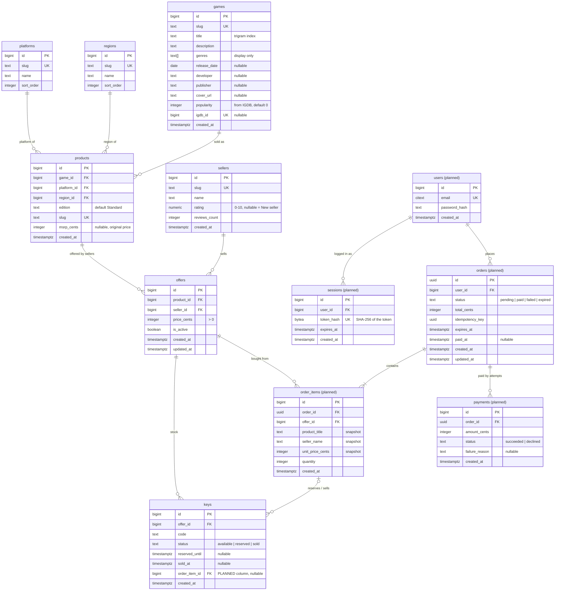
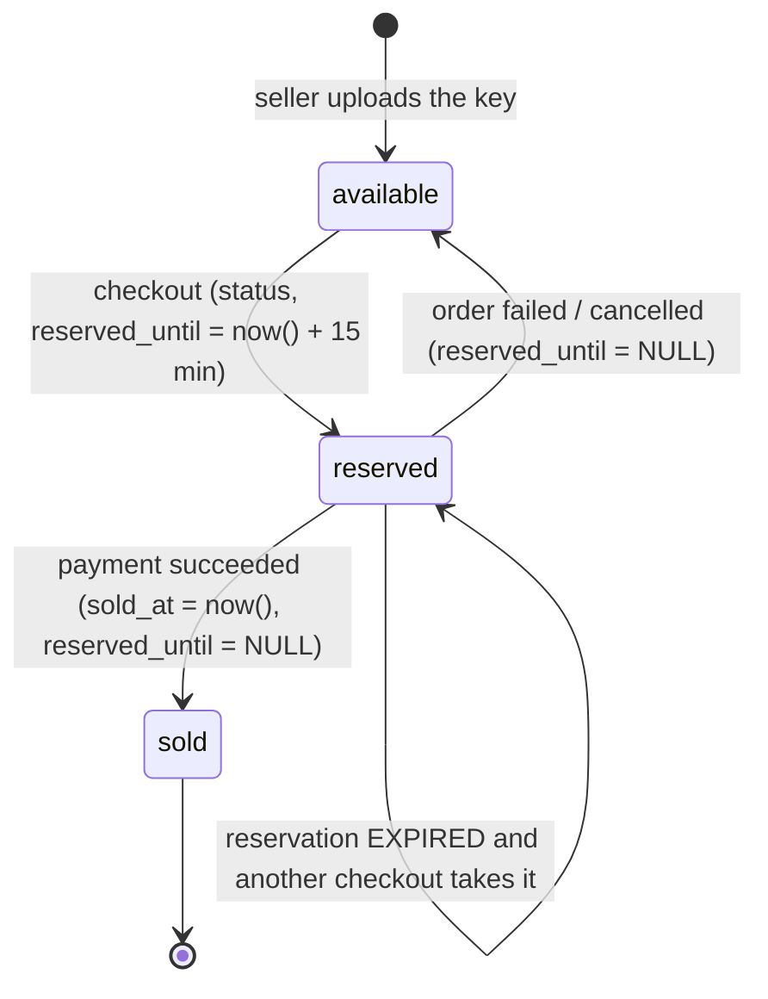
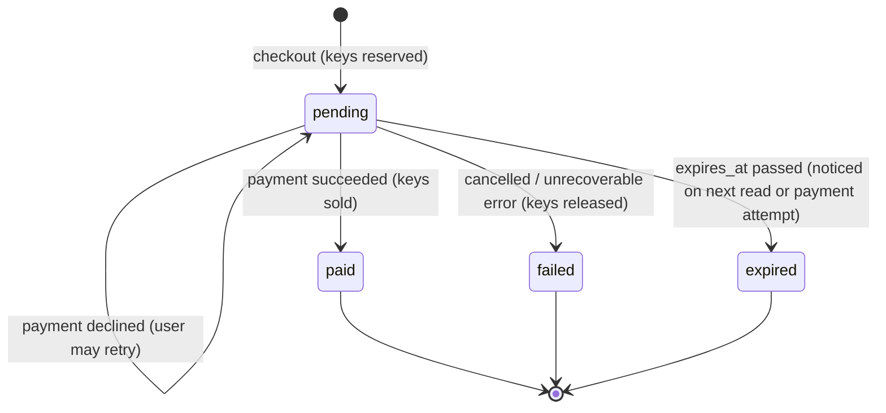

# Data model

The whole schema of the marketplace, designed once. Only the **catalog** tables exist today
(migration `00002_catalog.sql`). The **auth** and **commerce** tables are *planned*: they are
created in their own tasks and must follow this document (or update it in the same PR).

| Group | Tables | Status |
|---|---|---|
| Catalog | `platforms`, `regions`, `games`, `products`, `sellers`, `offers`, `keys` | **created** – migration `00002` |
| Auth | `users`, `sessions` | planned – auth task |
| Commerce | `orders`, `order_items`, `payments` + column `keys.order_item_id` | planned – checkout task |

Ground rules used everywhere:
- **Money is integer cents, EUR only** (`price_cents integer`). Never `float`/`numeric` for money.
- **IDs:** `bigint GENERATED ALWAYS AS IDENTITY` (the database owns the numbers; a manual `INSERT` of an id fails, so seeds refer to rows by slug). Exception: `orders.id` is a **UUID** – it appears in URLs and must not reveal how many orders exist.
- **Slugs** (`the-witcher-3-pc-global`) are the public, URL-friendly identifiers; numeric ids stay internal. Every slug column has the same CHECK `^[a-z0-9]+(-[a-z0-9]+)*$` (lowercase letters/digits, single `-` between groups) and is UNIQUE.
- **Required text is never blank:** every required name/title/code has CHECK `btrim(x) <> ''` (`NOT NULL` alone still allows `''` or `'   '`). The only exception is `games.description`, where `''` deliberately means "no description".
- **All timestamps are `timestamptz`, default `now()`**, so time zones are never ambiguous.
- **Foreign keys are `ON DELETE RESTRICT`** (one deliberate exception: `sessions`). See [Why RESTRICT](#why-restrict-and-not-cascade).
- **Rules live in the database** (`NOT NULL`, `UNIQUE`, `CHECK`, FKs), not only in Go. See [Why CHECK in the DB](#why-check-constraints-in-the-database).
- **Derived values are not stored** (P2): stock, cheapest price, discount % and the seller's tier label are computed (by queries or in Go).
- Data access is hand-written `pgx` SQL (no ORM, no sqlc, P8). The sketches below are that SQL.

## ER diagram

Planned tables are marked **(planned)**; the planned column `keys.order_item_id` is marked in its comment.



How to read it: a **game** (The Witcher 3) is sold as several **products** (PC / Global / Standard,
Xbox / Europe / GOTY …). Many **sellers** make an **offer** (their price) for a product. Each offer
has its own **keys** – one row per activation code; the number of sellable keys *is* the stock.

## Catalog tables (created – migration `00002`)

Notation: *NN* = `NOT NULL`. Every column without "null" is NOT NULL.

### `platforms` and `regions`
Lookup tables for the store filters (PC, PlayStation 5 … / Global, Europe …). Same shape (P1).

| Column | Type | Why |
|---|---|---|
| `id` | `bigint` identity, PK | internal key used by `products` |
| `slug` | `text` NN, **UNIQUE**, CHECK slug format | filter value in the URL (`?platform=ps5`); the CHECK keeps it URL-safe |
| `name` | `text` NN, CHECK not blank | display name ("PlayStation 5") |
| `sort_order` | `integer` NN, default `0` | the order in the filter list is a business choice, not alphabetical |

- **Why a table, not a Postgres `enum`:** adding a platform is an `INSERT`, not a migration; an enum value cannot be removed easily; the table also carries `name` and `sort_order`.
- Indexes: only the PK and the UNIQUE on `slug` (a few dozen rows).

### `games`
The game itself – everything that is the same on every platform.

| Column | Type | Why |
|---|---|---|
| `id` | `bigint` identity, PK | |
| `slug` | `text` NN, **UNIQUE**, CHECK slug format | game URL |
| `title` | `text` NN, CHECK not blank | shown everywhere, searched with trigrams |
| `description` | `text` NN, default `''` | empty string instead of NULL: one "no description" value, no NULL checks in Go |
| `genres` | `text[]` NN, default `'{}'` | display only (P6): an array is enough, no join table because we never filter by genre |
| `release_date` | `date`, null | NULL = unknown; `date` (not timestamp) because a day is the real precision |
| `developer`, `publisher` | `text`, null | not always known |
| `cover_url` | `text`, null | IGDB image CDN URL (`t_cover_big`, built from the IGDB `image_id`; nothing is stored in the repo). NULL **or** a broken URL → the frontend shows a generated placeholder |
| `popularity` | `integer` NN, default `0` | IGDB `total_rating_count` (set by the seed); the **default store sort** is `popularity DESC`. `0` = unknown, so a game without IGDB data still sorts (last) |
| `igdb_id` | `bigint`, null, **UNIQUE** | the game's id in IGDB, for importing/refreshing data; UNIQUE so one IGDB game cannot be imported twice; NULL = not linked (several NULLs are allowed by UNIQUE) |
| `created_at` | `timestamptz` NN, default `now()` | |

**Search index:** `CREATE INDEX games_title_trgm_idx ON games USING gin (title gin_trgm_ops);`
- `pg_trgm` splits text into 3-letter pieces ("wit", "itc", "tch" …). Two strings that share many trigrams are similar, so "witchr" still finds "Witcher".
- **`gin_trgm_ops` (GIN)** supports *both* `ILIKE '%witcher%'` (substring) *and* the similarity operators `%` / `<%` (typos) – one index for both kinds of search. GIN is faster to read than GiST; GiST's only extra (`ORDER BY title <-> 'x'`, nearest-neighbour) is not needed: we order the few matching rows by `word_similarity()` after filtering.
- **Plain `title`, not `lower(title)`:** pg_trgm lowercases trigrams itself and `ILIKE` is case-insensitive, so an expression index would add nothing (and every query would have to repeat the exact expression to use it).
- Note: the function `similarity(a, b)` alone cannot use an index; queries must filter with the *operators* (`%`, `<%`) and may sort by the function.

### `products`
The thing a buyer chooses: **one game on one platform for one region in one edition**.

| Column | Type | Why |
|---|---|---|
| `id` | `bigint` identity, PK | |
| `game_id` | `bigint` NN, FK → `games`, RESTRICT | |
| `platform_id` | `bigint` NN, FK → `platforms`, RESTRICT | |
| `region_id` | `bigint` NN, FK → `regions`, RESTRICT | a key bought for "Europe" may not activate elsewhere, so region is part of the product |
| `edition` | `text` NN, default `'Standard'`, CHECK not blank | Standard / Deluxe / GOTY … – free text, editions differ per game |
| `slug` | `text` NN, **UNIQUE**, CHECK slug format | product URL, e.g. `the-witcher-3-pc-global` |
| `msrp_cents` | `integer`, null, CHECK `> 0` | the original (list) price of this variant. The **discount %** shown on cards is derived from it and the listing price, never stored. NULL = unknown → no discount badge |
| `created_at` | `timestamptz` NN, default `now()` | |

- **UNIQUE `(game_id, platform_id, region_id, edition)`** (`products_variant_key`): the same variant cannot exist twice (otherwise offers would be split between two "identical" pages). Its first column `game_id` also serves "all products of a game" and the FK check when a game is deleted.
- **Indexes `products_platform_id_idx`, `products_region_id_idx`:** the store filters; they also make the RESTRICT check fast when a platform/region is deleted. Two single-column indexes because each filter can be used alone (Postgres can combine them with a BitmapAnd).

### `sellers`
Marketplace sellers (a fixed list of 8 fictional sellers from the seed, `pkg/seedgen`; seller accounts are out of scope).

| Column | Type | Why |
|---|---|---|
| `id` | `bigint` identity, PK | |
| `slug` | `text` NN, **UNIQUE**, CHECK slug format | |
| `name` | `text` NN, CHECK not blank | |
| `rating` | `numeric(4,2)`, **null**, CHECK `0–10` | e.g. `9.42` – exact decimal for display (not money); `(4,2)` = max `99.99`, the CHECK limits it to `10.00`. **NULL = no rating yet**, the UI shows "New seller" (a CHECK passes for NULL) |
| `reviews_count` | `integer` NN, default `0`, CHECK `≥ 0` | |
| `created_at` | `timestamptz` NN, default `now()` | |

**Tier label – derived in Go, not stored** (one place to change the wording, no label that disagrees with the number):

| `rating` | Label |
|---|---|
| NULL | New seller |
| ≥ 9.75 | Superb |
| ≥ 9.50 | Excellent |
| ≥ 9.00 | Very good |
| ≥ 8.00 | Good |
| < 8.00 | no label (only the number is shown) |

Thresholds (decided) are based on real Eneba examples: 9.90 → Superb, 9.67 → Excellent, 9.41 → Very good.
The checks run top-down, so the first matching row wins.

### `offers`
One seller's price for one product.

| Column | Type | Why |
|---|---|---|
| `id` | `bigint` identity, PK | |
| `product_id` | `bigint` NN, FK → `products`, RESTRICT | |
| `seller_id` | `bigint` NN, FK → `sellers`, RESTRICT | |
| `price_cents` | `integer` NN, CHECK `> 0` | money in cents; a free or negative price is always a bug |
| `is_active` | `boolean` NN, default `true` | a seller can pause an offer without deleting it (orders will reference it) |
| `created_at`, `updated_at` | `timestamptz` NN, default `now()` | `updated_at` is kept current by a trigger (below), so no query can forget it |

- **UNIQUE `(product_id, seller_id)`** (`offers_product_seller_key`): one offer per seller per product – a seller changes their price, they do not add a second offer. Its first column also serves the FK from `products`.
- **Partial index `offers_active_product_price_idx ON offers (product_id, price_cents) WHERE is_active`:** exactly the product-page query ("active offers of this product, cheapest first") – the index returns the rows already in price order (verified: index scan, no Sort step); and `MIN(price_cents)` per product for the listing. Inactive offers are never read by the store, so they are not in the index.
- **Trigger `offers_set_updated_at`** (`BEFORE UPDATE … FOR EACH ROW`) calls the small function `set_updated_at()`, which sets `NEW.updated_at := now()`. Generic, so later tables (e.g. `orders`) reuse it. Note: inside one transaction `now()` is the transaction start time.
- Not indexed on purpose (decided): `seller_id` alone – there is no "offers of a seller" page; add an index when one appears.

### `keys`
One activation code. **Stock = number of sellable keys** (P2).

| Column | Type | Why |
|---|---|---|
| `id` | `bigint` identity, PK | |
| `offer_id` | `bigint` NN, FK → `offers`, RESTRICT | each key belongs to the seller's offer (the seller uploaded it) |
| `code` | `text` NN, CHECK not blank | the secret the buyer receives (plain text here – see [production](#what-a-production-system-would-do-differently)) |
| `status` | `text` NN, default `'available'`, CHECK `IN ('available','reserved','sold')` | the state machine below; `text + CHECK` instead of an enum for the same reasons as P1 |
| `reserved_until` | `timestamptz`, null | set while reserved; **a past value = the reservation expired = the key is sellable again** (P3) |
| `sold_at` | `timestamptz`, null | when it was sold |
| `created_at` | `timestamptz` NN, default `now()` | |
| `order_item_id` | *planned* `bigint`, null, FK → `order_items` | which order item reserved/bought it (added in the checkout task) |

Constraints:
- **UNIQUE `(offer_id, code)`** – the same code cannot be uploaded twice into one offer; first column also serves the FK from `offers`.
- **`keys_reserved_until_only_when_reserved`:** `reserved_until` is set **if and only if** `status = 'reserved'`.
- **`keys_sold_at_only_when_sold`:** `sold_at` is set **if and only if** `status = 'sold'`.
  These two make impossible combinations ("available but reserved until 18:00", "sold but no sale time") unrepresentable.

**Partial index `keys_unsold_offer_idx ON keys (offer_id, reserved_until) WHERE status <> 'sold'`:**
- "Sellable" means `available` **or** `reserved` with an expired `reserved_until`. `now()` cannot be used in an index predicate (it must be immutable), so the index holds every **unsold** key and the query checks the expiry on `reserved_until`.
- `reserved_until` is the second index column so the **stock count** can be answered from the index alone (verified: `Index Only Scan using keys_unsold_offer_idx`), without reading the table rows.
- Sold keys are the vast majority over time and are never needed for stock, so they are left out – the index stays the size of the *current* stock.

## Auth tables (planned – auth task)

### `users`
| Column | Type | Why |
|---|---|---|
| `id` | `bigint` identity, PK | |
| `email` | `citext` NN, **UNIQUE** | `citext` = case-insensitive text: `Jon@x.com` and `jon@x.com` are the same account, and the UNIQUE index enforces it |
| `password_hash` | `text` NN | argon2id/bcrypt hash; the password itself is never stored |
| `created_at` | `timestamptz` NN, default `now()` | |

### `sessions`
| Column | Type | Why |
|---|---|---|
| `id` | `bigint` identity, PK | |
| `user_id` | `bigint` NN, FK → `users` **ON DELETE CASCADE** | the one CASCADE (decided): sessions are disposable login state, not history |
| `token_hash` | `bytea` NN, **UNIQUE** | **SHA-256 of the session token** (P5) – the cookie holds the random token, the DB only its hash |
| `expires_at` | `timestamptz` NN | checked on every request (`expires_at > now()`) |
| `created_at` | `timestamptz` NN, default `now()` | |

- **Why a hash (P5):** if the database (or a backup, or a log of a query) leaks, the attacker gets hashes that cannot be used as cookies.
- **Why SHA-256 and not bcrypt:** the token is 32 random bytes (not a guessable password), so a fast hash is safe; and the lookup must be by exact value (`WHERE token_hash = $1`), which a salted bcrypt hash cannot do.
- Index on `user_id` ("log out everywhere"). Expired rows are deleted lazily (on login) – no cron job.

## Commerce tables (planned – checkout task)

**The cart lives in the browser** (decided) – there is no cart table. At checkout the frontend sends
the list of `(offer_id, quantity)`; the server re-reads prices from `offers` (never trusts client
prices) and creates the order. Reservations last **15 minutes** (decided).

### `orders`
| Column | Type | Why |
|---|---|---|
| `id` | `uuid` PK, default `gen_random_uuid()` | appears in URLs; not guessable, does not reveal the order count |
| `user_id` | `bigint` NN, FK → `users`, RESTRICT | orders are financial records – a user with orders is not hard-deleted |
| `status` | `text` NN, default `'pending'`, CHECK `IN ('pending','paid','failed','expired')` | state machine below |
| `total_cents` | `integer` NN, CHECK `> 0` | sum of the items at checkout time |
| `idempotency_key` | `uuid` NN | sent by the client (one per checkout attempt); **UNIQUE `(user_id, idempotency_key)`** – a double click or a network retry returns the *same* order instead of reserving keys twice |
| `expires_at` | `timestamptz` NN | = the keys' `reserved_until`; after it the order can no longer be paid |
| `paid_at` | `timestamptz`, null | CHECK: set **iff** `status = 'paid'` |
| `created_at`, `updated_at` | `timestamptz` NN, default `now()` | `updated_at` via the same `set_updated_at()` trigger |

Index: `(user_id, created_at DESC)` for "my orders".

### `order_items`
| Column | Type | Why |
|---|---|---|
| `id` | `bigint` identity, PK | |
| `order_id` | `uuid` NN, FK → `orders`, RESTRICT | |
| `offer_id` | `bigint` NN, FK → `offers`, RESTRICT | which seller's offer was bought |
| `product_title` | `text` NN, CHECK not blank | **snapshot** ("The Witcher 3 – PC – Global – Standard"): the order must look the same even if the catalog changes later |
| `seller_name` | `text` NN, CHECK not blank | **snapshot** of who sold it, for the same reason (a seller can be renamed) |
| `unit_price_cents` | `integer` NN, CHECK `> 0` | **snapshot** of the price paid; the offer's price may change tomorrow |
| `quantity` | `integer` NN, CHECK `> 0` | number of keys |
| `created_at` | `timestamptz` NN, default `now()` | |

UNIQUE `(order_id, offer_id)` – one line per offer in an order (more keys = higher `quantity`).

### `payments`
Simulated payment attempts (P4). A separate table because one order can have **several attempts**
("declined" → the user retries).

**No card data at all** (decided): there is no card form and no card column. The payment step is a
simple choice **"Mock payment: Success / Decline"**; the choice decides the attempt's `status`. Nothing
sensitive is collected or stored, so no PCI concerns.

| Column | Type | Why |
|---|---|---|
| `id` | `bigint` identity, PK | |
| `order_id` | `uuid` NN, FK → `orders`, RESTRICT | |
| `amount_cents` | `integer` NN, CHECK `> 0` | |
| `status` | `text` NN, CHECK `IN ('succeeded','declined')` | the user's mock choice: Success → `succeeded`, Decline → `declined` |
| `failure_reason` | `text`, null | e.g. "Declined (mock payment)"; CHECK: set only when declined |
| `created_at` | `timestamptz` NN, default `now()` | |

- Index `(order_id)`.
- **Partial UNIQUE `(order_id) WHERE status = 'succeeded'`:** at most one successful payment per order – a double charge is impossible at the database level.

### Planned change to `keys` (checkout task)
`ALTER TABLE keys ADD COLUMN order_item_id bigint NULL REFERENCES order_items (id) ON DELETE RESTRICT;`
+ CHECK `(status = 'available') = (order_item_id IS NULL)` + index on `order_item_id` ("keys of my order").
A nullable column added to an existing table → backward compatible (expand).

## State machines

### Key

- **Expiry needs no job (P3):** an expired reservation stays `status = 'reserved'` with a past `reserved_until`. Every "sellable" query treats `reserved_until < now()` as available, so the next checkout simply takes it (and overwrites `reserved_until` and, later, `order_item_id`).
- **Who owns a reserved key?** The order item in `order_item_id`. A payment is accepted only before the order's `expires_at`; as a second safety, keys are sold with `WHERE order_item_id = $item AND status = 'reserved'`. If another checkout already took one of the keys (its reservation had expired), fewer rows match, the transaction is rolled back and the order is marked `expired` – someone else's key is never sold.

### Order

`paid`, `failed`, `expired` are final. `expired` is set lazily (when the order is read or paid after `expires_at`); until then the order is "pending but past expiry", which the code treats the same way.

## Query sketches

SQL that the Go code (hand-written `pgx`) runs. User input is never concatenated into SQL: it travels as
query parameters (`$n`; in `pkg/catalog` written as named parameters `@name`, which pgx rewrites to `$n`).
Sketches 1, 1b and 2 are **implemented in `pkg/catalog/store.go`** (Task 09) and tested against the
deterministic seed (`pkg/catalog/store_integration_test.go`, run in CI); sketches 3 and 4 are still plans
for the checkout and search tasks. The "sellable key" condition appears in all of them:

```sql
k.status <> 'sold' AND (k.reserved_until IS NULL OR k.reserved_until < now())
-- = available, or reserved but expired. "status <> 'sold'" is written exactly like the
--   predicate of keys_unsold_offer_idx, so the planner can use that partial index.
```

### 1. Store listing
Products with game, platform, region, listing price, MSRP + discount %, offer count and in-stock flag;
optional filters (platform and region = several slugs each, price range); one of six sort orders
(default: popularity); paging. `GET /api/products`.

**Listing price (decided) = the cheapest active offer that has stock.** An active offer with no
sellable keys does not set the price (nobody could buy at it). A product with no such offer is
**out of stock**: it stays visible, has no price (`NULL`), sorts **last** on the price and discount
sorts and is **excluded** whenever a price filter is used.

The query is built from one shared CTE, `base` ("every product with everything the listing and the
facets need"). **The items and all facets read from `base`**, so a condition added to its `WHERE`
applies to all of them at once - the future text search (`q`) adds exactly one line there.

```sql
-- named parameters: @platforms text[] (empty = no filter), @regions text[], @min_price bigint | NULL,
-- @max_price bigint | NULL, @limit, @offset
WITH active_offers AS (               -- every ACTIVE offer + "does it have a sellable key?"
    SELECT o.product_id, o.price_cents,
           EXISTS (SELECT 1
                   FROM keys k
                   WHERE k.offer_id = o.id
                     AND k.status <> 'sold'
                     AND (k.reserved_until IS NULL OR k.reserved_until < now())) AS has_stock
    FROM offers o
    WHERE o.is_active
),
product_stats AS (                    -- one row per product that has active offers
    SELECT product_id,
           min(price_cents) FILTER (WHERE has_stock) AS min_price_cents,  -- NULL = out of stock
           count(*)         FILTER (WHERE has_stock) AS offer_count       -- offers you can buy now
    FROM active_offers
    GROUP BY product_id
),
base AS (
    SELECT p.id, p.slug, p.edition, p.msrp_cents,
           g.title, g.cover_url, g.release_date, g.popularity,
           pl.id AS platform_id, pl.slug AS platform_slug, pl.name AS platform_name,
           r.id  AS region_id,   r.slug  AS region_slug,   r.name  AS region_name,
           ps.min_price_cents,
           coalesce(ps.offer_count, 0) AS offer_count,
           CASE WHEN ps.min_price_cents < p.msrp_cents          -- only a real discount; NULL if msrp
                THEN (p.msrp_cents - ps.min_price_cents)::bigint * 100  -- unknown, out of stock or
                     / p.msrp_cents                                     -- price >= msrp. Integer
           END AS discount_pct                                          -- division = rounds DOWN
    FROM products p
    LEFT JOIN product_stats ps ON ps.product_id = p.id   -- LEFT: products without stock stay visible
    JOIN games     g  ON g.id  = p.game_id
    JOIN platforms pl ON pl.id = p.platform_id
    JOIN regions   r  ON r.id  = p.region_id
    WHERE true                       -- the search task adds its condition HERE (items AND facets follow)
)
SELECT b.slug, b.title, b.edition, b.platform_slug, b.platform_name, b.region_slug, b.region_name,
       b.cover_url, b.min_price_cents, b.msrp_cents, b.discount_pct, b.offer_count,
       b.min_price_cents IS NOT NULL AS in_stock,
       count(*) OVER () AS total      -- all matching rows, computed before LIMIT
FROM base b
WHERE (cardinality(@platforms::text[]) = 0 OR b.platform_slug = ANY(@platforms::text[]))
  AND (cardinality(@regions::text[])   = 0 OR b.region_slug   = ANY(@regions::text[]))
  AND (@min_price::bigint IS NULL OR b.min_price_cents >= @min_price::bigint)  -- NULL price never matches,
  AND (@max_price::bigint IS NULL OR b.min_price_cents <= @max_price::bigint)  -- so out-of-stock drops out
ORDER BY b.popularity DESC, b.id                                   -- sort=popularity (DEFAULT)
-- ORDER BY b.min_price_cents ASC  NULLS LAST, b.id                   sort=price_asc
-- ORDER BY b.min_price_cents DESC NULLS LAST, b.id                   sort=price_desc
-- ORDER BY (b.min_price_cents IS NULL), b.discount_pct DESC NULLS LAST, b.id   sort=discount
-- ORDER BY b.release_date DESC NULLS LAST, b.id                      sort=newest
-- ORDER BY b.title ASC, b.id                                         sort=title
--   Go picks ONE of these fixed lines from a whitelist map; user text never goes into ORDER BY.
LIMIT @limit OFFSET @offset;
```
- **Discount % is derived (decided):** `(msrp - listing price) x 100 / msrp` in integer math, which rounds **down** - the badge never promises more than the real saving (3999 -> 1799 = 55.01 % -> "-55 %"). It is `NULL` (no badge) when `msrp_cents` is unknown, the product is out of stock, or the price is not below the MSRP. The discount sort puts "no discount" last, and out-of-stock products after those (`(b.min_price_cents IS NULL)` is the first sort key).
- **Default sort = popularity** (from IGDB). Out-of-stock products are *not* pushed down there - only the price and discount sorts put them last (decided).
- `min(...) FILTER (WHERE has_stock)` takes the minimum only over offers with stock; if there are none, the result is `NULL`, which *is* the out-of-stock signal (`in_stock = min_price_cents IS NOT NULL`).
- Price filter: `NULL >= 1000` is `NULL` (not true), so out-of-stock products drop out automatically when a price bound is given, and stay when it is not.
- A product with no active offers at all is also out of stock (no `product_stats` row -> `NULL` price, `offer_count = 0`).
- `EXISTS` stops at the first sellable key (cheaper than counting); it uses `keys_unsold_offer_idx`.
- `b.id` as the last sort key makes paging stable when two products have the same price.
- `cardinality(@platforms) = 0 OR ... = ANY(@platforms)` = "filter only if given; any of the slugs may match", so one SQL string serves every filter combination. The slugs are ONE array parameter: no string-built SQL, so no SQL injection. An unknown slug matches nothing.
- **`count(*) OVER ()`** returns the total of all matching rows on every row, *before* `LIMIT` - one query gives both the page and "page 2 of 7". Edge case: a page past the last one has no rows, so the total is read with a second, tiny `count(*)` query in that case only.
- Go sends the items query and the three facet queries below as **one pgx batch**: one network round trip and one implicit transaction, so items and counts come from the same snapshot.

### 1b. Facets (filter options with counts)
Returned in the same response as the listing (`facets` next to `items`). **Counts follow the current
filters** (decided, "standard multi-select faceting"): each group is counted with **all other active
filters applied except its own**. So after picking `platform=steam` the *region* counts show only Steam
products, but the *platform* list keeps the counts of every platform (otherwise PSN would show 0 and the
user could never add it to the selection). All three read from the same `base` CTE as the listing.

```sql
-- platform facet: region + price filters, NOT the platform filter
SELECT pl.slug, pl.name, count(b.id) AS cnt
FROM platforms pl
LEFT JOIN base b ON b.platform_id = pl.id
                AND (cardinality(@regions::text[]) = 0 OR b.region_slug = ANY(@regions::text[]))
                AND (@min_price::bigint IS NULL OR b.min_price_cents >= @min_price::bigint)
                AND (@max_price::bigint IS NULL OR b.min_price_cents <= @max_price::bigint)
GROUP BY pl.id
HAVING count(b.id) > 0 OR pl.slug = ANY(@platforms::text[])   -- hide empty entries, keep selected ones
ORDER BY pl.sort_order, pl.id;

-- region facet: the same with platform + price filters (HAVING ... r.slug = ANY(@regions))

-- price range: platform + region filters, NOT the price filter; min/max ignore NULL = in-stock only
SELECT min(b.min_price_cents), max(b.min_price_cents)
FROM base b
WHERE (cardinality(@platforms::text[]) = 0 OR b.platform_slug = ANY(@platforms::text[]))
  AND (cardinality(@regions::text[])   = 0 OR b.region_slug   = ANY(@regions::text[]));
```
- **Why `LEFT JOIN platforms -> base`:** it starts from the lookup table, so a platform with no matching product still gets a row (count 0). `HAVING` then decides: count > 0, or the platform is currently selected. A selected entry therefore never vanishes from the filter UI, even when the other filters leave it empty (e.g. `platform=battle-net`: no products at all, still listed with 0).
- The entries are ordered by `sort_order` (a business decision), not by count or name.
- **Price range:** `NULL` (JSON `null`) when no in-stock product matches the platform/region filters. It ignores the price filter on purpose: the slider keeps its full range while the user drags it.
- An unknown selected slug is not in the lookup table, so it is not invented as an entry (the listing is simply empty).
- Facets are not global any more (an earlier draft of Task 09 had a separate global `GET /api/catalog/facets`; the owner replaced it with this).

### 2. Product page – offers
Only **buyable** offers of one product (active **and** stock > 0, decided), with seller info and
stock per offer, cheapest first.

```sql
-- $1 product slug
SELECT o.id AS offer_id, o.price_cents,
       s.slug AS seller_slug, s.name AS seller_name,
       s.rating, s.reviews_count,       -- rating NULL = "New seller"; tier label made in Go
       st.stock
FROM products p
JOIN offers  o ON o.product_id = p.id AND o.is_active
JOIN sellers s ON s.id = o.seller_id
CROSS JOIN LATERAL (                    -- stock of THIS offer, usable in WHERE below
    SELECT count(*) AS stock
    FROM keys k
    WHERE k.offer_id = o.id
      AND k.status <> 'sold'
      AND (k.reserved_until IS NULL OR k.reserved_until < now())
) st
WHERE p.slug = $1
  AND st.stock > 0                      -- offers without stock are hidden
ORDER BY o.price_cents, o.id;
```
- **Offers with `stock = 0` are not listed**, so the first row is always the cheapest offer you can actually buy (the same rule as the listing price). If no row comes back, the page shows the product as "Out of stock".
- `CROSS JOIN LATERAL` computes the count once per offer and gives it a name (`st.stock`), so it can be both returned and filtered on. A subquery in the `SELECT` list cannot be used in `WHERE`.
- `offers_active_product_price_idx` returns the offers already in price order; each `stock` count is an index-only scan of `keys_unsold_offer_idx`. The product header (title, cover, platform …) is a separate one-row query.
- `GET /api/products/{slug}` sends three queries as one pgx batch: the header (no row -> `404`), these offers, and the **variants** (the other products of the same game, `JOIN products v ON v.game_id = p.game_id AND v.id <> p.id`, each with its own cheapest buyable price from the same `product_stats` CTE as the listing). The product's own `priceCents` is simply the first offer. The seller tier label and `isNew` (rating `NULL`) are made in Go.

### 3. Reserve N keys of one offer (checkout)
```sql
-- inside the checkout transaction (BEGIN … COMMIT); $1 offer id, $2 quantity
WITH picked AS (
    SELECT id
    FROM keys
    WHERE offer_id = $1
      AND status <> 'sold'
      AND (reserved_until IS NULL OR reserved_until < now())  -- expired = available (P3)
    ORDER BY id                       -- oldest keys first
    LIMIT $2
    FOR UPDATE SKIP LOCKED            -- lock the picked rows; skip rows another checkout holds
)
UPDATE keys k
SET status         = 'reserved',
    reserved_until = now() + interval '15 minutes'
    -- checkout task adds: , order_item_id = $3
FROM picked
WHERE k.id = picked.id
RETURNING k.id;
```
- If fewer than `$2` rows come back → `ROLLBACK` and answer "not enough stock". Nothing half-reserved remains.
- **`FOR UPDATE`** locks the chosen rows until the transaction ends, so two buyers can never get the same key.
- **`SKIP LOCKED`**: a second buyer at the same moment does not *wait* for the first one's locks – they skip those rows and take the next free keys. Without it, all concurrent checkouts of a popular offer would queue on the same rows.
- After locking, Postgres re-checks the `WHERE` on the newest row version, so a key that someone else reserved and committed in the meantime is not taken.

### 4. Title search (why the trigram index exists)
```sql
-- $1 what the user typed, e.g. 'witchr'; % and _ in it are escaped in Go before use in ILIKE
SELECT g.slug, g.title, word_similarity($1, g.title) AS score
FROM games g
WHERE g.title ILIKE '%' || $1 || '%'   -- substring: 'witcher' in 'The Witcher 3'
   OR $1 <% g.title                     -- typo-tolerant word match: 'witchr' ~ 'Witcher'
ORDER BY score DESC, g.title
LIMIT 10;
```
Both conditions are served by `games_title_trgm_idx`. `<%` uses the default
`pg_trgm.word_similarity_threshold` (0.6); changing it would need `SET`, which PgBouncer transaction
mode does not keep – it would have to be `SET LOCAL` inside the query's transaction.

## Why RESTRICT and not CASCADE
`ON DELETE CASCADE` would turn one mistaken `DELETE FROM games` into the silent loss of its products,
offers, keys – and later order history. `RESTRICT` makes such a delete fail with an error; data that
is referenced must be retired explicitly (e.g. `offers.is_active = false`). The only CASCADE is
`sessions → users`: sessions are throw-away login state.

## Why CHECK constraints in the database
The Go code will validate input too (for friendly error messages), but the database is the last line
of defence: it also protects against seed scripts, manual SQL in the Neon console, future endpoints and
bugs. A row that breaks a rule (price 0, "sold" without `sold_at`) simply cannot exist, so every reader
can trust the data without re-checking it.

## What a production system would do differently
- **Encrypt key codes at rest** (application-level envelope encryption with a KMS key) and reveal a code only to its buyer; today `keys.code` is plain text.
- **Multi-currency:** a `currency char(3)` next to every amount, prices per currency or FX rates with the rate snapshot on the order; today everything is EUR cents.
- **Cache the cheapest price / stock** at scale: a `product_stats` table or materialized view refreshed by triggers/events, or a search engine (Elasticsearch/Meilisearch) for listing, filtering and search; today they are computed per request (P2) – correct and simple at this size.
- **Keyset pagination** (`WHERE (price, id) > ($last_price, $last_id)`) instead of `OFFSET`, which gets slower on deep pages.
- **Background job** to mark expired orders and release reservations eagerly (for reporting), instead of only lazy expiry.
- **Real payment provider** with webhooks, idempotent payment intents and refunds; seller payouts, fees, VAT.
- **Audit/history** tables (price history, key status changes), soft deletes, and partitioning or archiving of sold keys.
- **Seller accounts** with their own auth, key upload API and per-seller stock limits.
